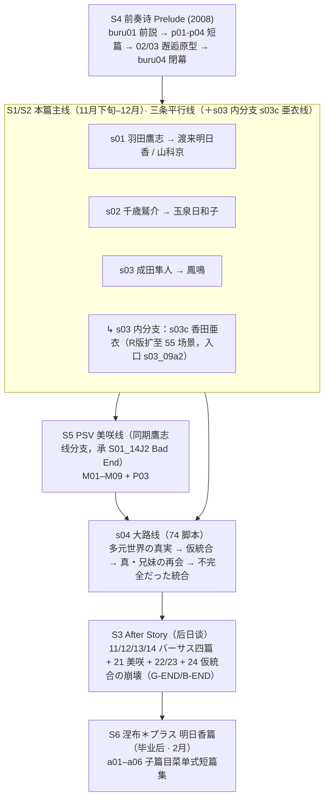

# 《我们没有翅膀——格雷塔迦露德与柳木原》· 全系列剧情流程图（Agent 版）

> **校准**：2026-10-09 · `ISSUE-20261009-01` ｜ 定位：现行说明（剧情结构；Agent 版） ｜ 权威入口：`工程\我们没有翅膀——格雷塔迦露德与柳木原\00_项目索引.md`

> **用途**：供编程组据此**排序剧情文件、配置音乐/特效/人物素材**；供 UI 组理解界面出现时机。
> **人类可读版**：同目录 `01_剧情流程图.html`（可交互）。
> 归属：资源组 ｜ 建立：2026-09-18 ｜ Issue：ISSUE-20260918-03
> **本文件所有设定结论均附原文语料证据；证据不足者一律标 `（待确认）`，不得当作已定事实使用。**

---

## 〇、阅读指引

| 章节 | 内容 | 谁需要 |
| --- | --- | --- |
| §一 | 世界观骨架（双轴 + 五人格） | 全体 |
| §二 | 人物总表 | 全体 |
| §三 | 六源在故事中的位置与总流程图 | 编程组 |
| §四 | 逐源场景级结构（章节序列） | 编程组 |
| §五 | 结局矩阵 | 编程组 |
| §六 | 时间线 | 编程组 |
| §七 | 演出逻辑（已知 / 未知） | 编程组、UI 组 |
| §八 | 标签体系与素材对应约定 | 编程组 |
| §九 | 待确认项清单 | 全体（勿当事实） |

### 证据来源代号

| 代号 | 文件 |
| --- | --- |
| **E1** | `工程\我们没有翅膀R\语料\R版台词.json`（58,855 槽，字段 `file/index/speaker/voice/text/kind`） |
| **E2** | `工程\我们没有翅膀\汉化\剧情汉化\*.jsonl`（397 脚本）+ `_总表.tsv`（58,639 行） |
| **E3** | `工程\我们没有翅膀 After Story\语料\台词.json`（172 文件，`messages[].kind=title/line`） |
| **E4** | `工程\我们没有翅膀 前奏诗\汉化\剧情汉化\*.jsonl`（59 脚本） |
| **E5** | `工程\我们没有翅膀PSV\汉化\场景标题_中文化.tsv`、`名字表_中文化.tsv`、`剧本全文.md` |
| **E6** | `工程\涅布＊普拉斯\语料\明日香线_原文.json`（1,961 串）｜**路径更正（2026-09-19）**：原写 `工程\涅＊普拉斯\...`，工程目录名实际为 **`涅布＊普拉斯`**；该文件属 gitignore 的 `语料\`，**主工作树磁盘上存在**（`test -e` 通过），但 worktree 检出中不含 |
| **E7** | 各作 `作品skill\SKILL.md` / `术语表.md` |

引用格式：E1 用列表下标 `[n]`，E2/E4 用 `seq`，E3 用 `<文件名>.messages`，E6 用串序号。

---

## 一、世界观骨架

### 1.1 一句话

> **一个身体，五个人格**——羽田鷹志（タカシ）／千歳鷲介／成田隼人／伊丹伽楼羅（伽鲁炟）／羽田ヨージ（洋治）。基本人格是 **ヨージ**，其余四个是从他分裂出的前台人格。全系列讲的是**五个人格如何在现实（柳木原）与幻想（格雷塔迦露德）之间寻求统合**的故事。

### 1.2 双轴舞台

```
        幻想轴：グレタガルド（王国）
        ┌─────────────────────────────────────┐
        │  万色の四枚羽根（次期王候补四人）      │
        │   ホーク   = 羽田鷹志                │
        │   イーグル = 千歳鷲介                │
        │   ファルコン = 成田隼人              │
        │   ガルーダ = 伊丹伽楼羅              │
        │  先代王コンドル = 羽田ヨージ          │
        │  プリンセス・アスカ = 渡来明日香       │
        │  プリンセス・ダヴ   = 羽田小鳩         │
        │  ペガサス / スパロウ / フェニックス    │
        └─────────────────────────────────────┘
                        ↕ 互为表里（往返）
        ┌─────────────────────────────────────┐
        │  现实轴：柳木原（大都会）             │
        │   美空学園（鷹志·三年）               │
        │   蒼穹女学院（鳴·亜衣·小鳩附属）       │
        │   アレキサンダー（洋食餐厅，鷲介打工）  │
        │   成田工務店（隼人）                  │
        │   ヤナポリ広場 / ロックバード / Ｒ－ウィング │
        │   フレイムバーズ（YFB，不良自警团）    │
        └─────────────────────────────────────┘
```

**证据**：
- E1 `[59]` `s01_02a.tob`：「異種族の襲撃を退けて**グレタガルド**から帰ってくると、**美空学園**ではすでに昼休みが始まっていた。」（一句并置两轴）
- E1 `[60]` 同：「窓の外には隣りの高層ビル、そして**大都会・柳木原**のほの白い空。」
- E1 `[15]` `s01_01a.tob` 鷹志：「羽田鷹志は、グレタガルドの先代国王が集めた次期王候補“**万色の四枚羽根**”のひとり、**聖騎士ホーク**の≪転生≫した姿だ。」
- E1 `[683]` `s01_02c`：「“万色の四枚羽根”の中でも最強最後の戦士、“**黄金の鷹**”ホーク・シアンブルー」
- E1 `[754]` `s01_02d2`：「イーグル。ファルコン。ガルーダ。」
- E1 `[11125]` `s01_14e` 鷲介：「実はおいちゃんが**イーグル**なのよ」
- E1 `[36870]` `s03_14a` 伽楼羅：「臣民は余を**ガルーダ**と呼んでいた。……現世での名を銘ずるなら、**伊丹伽楼羅**だ」
- E1 `[11137]` `s01_14e`：「**羽田ヨージ**。グレタガルドで言えば、**先代王コンドル**になるのかな」
- E1 `[662]` `s01_02c`：「グレタガルドの**アスカ姫**というより、美空学園の**渡来さん**みたいだ……」
- E1 `[3421]` `s01_04o`：「……**プリンセス・ダヴ**」

### 1.3 五人格结构（**全系列的核心谜题**）

**判定：不是三个人，不是平行世界，而是「同一身体的多重人格（解離性同一性障害）」。**

```
                    ┌──────────────┐
                    │  羽田ヨージ   │  ← 基本（原初）人格
                    │（洋治/小鹰志）│     幻想侧＝先代王コンドル
                    │  长期不出现   │     DJコンドル电台人格
                    └──────┬───────┘
                           │ 分裂
        ┌──────────┬───────┴────┬──────────┐
        ▼          ▼            ▼          ▼
   ┌────────┐ ┌────────┐  ┌────────┐ ┌──────────┐
   │羽田鷹志│ │千歳鷲介│  │成田隼人│ │伊丹伽楼羅│
   │ タカシ │ │  シュウ│  │ ハヤト │ │（伽鲁炟）│
   │第一人称│ │第一人称│  │第一人称│ │ 被封印的  │
   │  「僕」 │ │  「俺」 │  │  「俺」 │ │  长兄人格 │
   │ホーク  │ │イーグル│  │ファルコン│ │ ガルーダ  │
   └────────┘ └────────┘  └────────┘ └──────────┘
        └─────────── 三人格互称「兄弟」───────────┘
```

**决定性证据**：
1. 自认多重人格障碍：E1 `[23695]` `s02_15a.tob` 鷲介「実は俺、分かりやすい言葉で言うところの**多重人格障害**なんすよ。」；E1 `[35623]` `s03_12h` 翔「マルチプル・パーソナリティ・ディスオーダー。**多重人格障害**だ」
2. 同一身体：E1 `[11781]` `s01_14h`「自分と**同じ体の中にいる**とは思えないくらいかっこ良かった。」
3. 主人格是ヨージ、其余是分裂：E1 `[11136-11140]` `s01_14e`「この世界の元々の持ち主は――羽田ヨージ」「俺たちはそこから**分裂した存在**」「**本当の人格じゃない**」
4. 基本人格：E1 `[11150]`「確かに**基本人格はヨージ君のもの**だけど、どうも彼、二度と出てくる気はないみたいなんだよね」
5. 兄弟相称：E1 `[11080]` `s01_14e`「どうよ、どうなのよ**羽田三兄弟**」；E1 `[12996]` `s01_19a`「千歳くんと僕の会ったことのない**成田くん**という二人の**兄弟**」
6. 共五人：E1 `[57512]` `s04_25c` ヨージ「なんでおれら、**五人**バラバラなんだ？」；`s04_08a` 标题「**はねだ５／１**」；`s04_25c` 标题「**五者面談**」
7. 统合机制：E1 `[11568]` `s01_14g1` 京「人格同士を結びつける『**統合**』って形が一般的なんだって」；E1 `[12999]` `s01_19a`「これがきっと千歳くんや成田くんとの**統合**ってことなんだと思う」

⚠️ **姓名更正**：正确为 **羽田鷹志 / 千歳鷲介 / 成田隼人**。`工程\我们没有翅膀R\作品skill\术语表.md:128-130` 作「渡来 鷹志／羽田 隼人」是**姓名倒置错误**（该表原标"待确认"），PSV 术语表行 311 已更正。本工程以语料为准。

### 1.4 核心谜题与真相

| 关键词 | 含义 | 证据 |
| --- | --- | --- |
| **グレタガルド** | 三重层次：表＝异世界冒险；里＝**鷹志自己创造的内心世界**；终＝多元世界中的一个位面 | E1 `[11133-11134]`「君がその世界は**自分の作り上げたもの**だと気づいたから」「そしてここは**君の中**、自分自身の心の中」；E1 `[11364]`「グレタガルドなんてものは、**僕が都合よく作った世界**でしかなかった」；E1 `[3553]`「グレタガルドって**僕の妄想**だったんだあ！」 |
| **多元世界の真実** | 宇宙由无数并行位面构成；伽楼罗自称在多个「频道」以泡/细胞/垢/音/怀念等形态存在 | E1 `[49134]` `s04_03e` フェニックス「我々を取りまくこの**多元世界の真実**！」；`s04_03f1/f2` 标题「多元世界の真実・泡と細胞と垢 / 音と懐かしさ」；E1 `[41033]` `s03_24`「パラレルワールドっていうんですか…並行世界とか多元宇宙みたいなね」 |
| **仮統合** | s04 达成的「临时统合」——五人格勉强合一 | E3 `24_1a.tob` 标题「イントロダクション：**仮統合の崩壊**」 |
| **不完全だった統合** | 假统合并未真正合一 | E1 `[57517]` `s04_25c`「ボクらは五人一つになって、上手いこと≪統合≫を果たしたつもりだったけど、それはしょせん**間に合わせの応急処置**でしかなかった」；`[57518]`「実際には**不完全だった**……≪統合≫の**フリ**をしてた」 |
| **真・兄妹の再会** | 融合后的「俺」与妹妹小鳩真正以兄妹身份重逢（两人本无血缘） | E1 `[51821]` `s04_08c.tob` 标题；E1 `[1167]` `s01_03a`「**血の繋がった兄妹じゃない**から…物心ついてからずっと本当の妹だと思って接してきた」 |
| **奈落（アビス）** | 人格被封印、放逐之处；也是 DJコンドル 的电台名 | E1 `[3467]` `s01_05`「ＤＪコンドルの！『ラブレター・フロム・アビス』！」；E1 `[10965]` `s01_14c`「奈落（アビス）のおく深くに**封印**」 |
| **ＩＳＨ / 終の子 / 死神 / 末弟** | 主角们倾诉的对象＝**玩家/读者视角**，能统合救济分裂者 | E1 `[58849]` `s04_29a`「おまえみたいなやつのこと、専門的には死神じゃなくて**ＩＳＨ**って呼ぶらしい…バラバラなやつらをまとめて、**救済**してくれる存在」；E1 `[48545]` `s04_02a` 伽楼羅「**終の子**よ、声なき**末弟**よ」 |
| **人格切换隐喻** | 身体＝驾驶舱 `コックピット`、强制换人＝`スクランブル`、人格交涉＝`面談`、关机＝`スイッチオフ` | E1 `[3680]` `s01_05b`；E1 `[19173]` `s02_10a`；E1 `[11152]` `s01_14e`；`s03_11e` 标题「皇帝スイッチオフ（Ｎ）」 |

### 1.5 组织与团体

| 组织 | 说明 | 证据 |
| --- | --- | --- |
| **フレイムバーズ（YFB）** | 柳木原的不良自警团，顶点 鳳凰寺カケル＝鳳翔 | E1 `[18177]` `s02_07b` 優「少年自警団を標榜し…『柳木原フレイムバーズ』、通称ＹＦＢ…その頂点に君臨するのが**鳳凰寺カケル**、こと**鳳翔**」 |
| **Ｒ－ウィング** | 传说乐队「ロックバード」的后援会，实为宗教性集团 | E1 `[5870]` `s01_08d0`「ロックバードの後援会『Ｒ－ウィング』の一員」；E1 `[26441]` `s03_03e` バニィＤ「宗教がかってる」 |
| **王宮騎士団** | グレタガルド 的骑士团 | E1 `[674][681][763]` `s01_02c/02e` |
| **パトリアルク** | 掲示板上的反大司教势力（パトリアルク・ヨーゼフ） | E1 `[33857]` `s03_11c`「投稿者はパトリアルク・ヨーゼフ」 |

---

## 二、人物总表

> 译名以**系列已交付口径**为准（各作术语表）；标 ⚠️ 者为跨作不一致项，见 §九。

### 2.1 主角核心（同一身体的人格群）

| 日文 | 中文 | 身份 / 作用 | 第一人称 | 幻想侧 | 证据 |
| --- | --- | --- | --- | --- | --- |
| 羽田 鷹志 / タカシ | 羽田 鹰志 | 前台人格①，美空学园三年生 | 僕 | 聖騎士ホーク（黄金の鷹） | E1 `[13][15]` |
| 千歳 鷲介 | 千岁 鹫介 | 前台人格②，飞特族/情报屋，アレキサンダー 打工 | 俺 | イーグル（久遠の翼） | E1 `[3590][11125]` |
| 成田 隼人 | 成田 隼人 | 前台人格③，便利屋/柳木原カリスマ | 俺 | ファルコン（暗黒街の王）（推定） | E1 `[24548][735]` |
| 伊丹 伽楼羅 / ガルーダ | 伊丹 伽楼罗 / 伽鲁炟 | 被封印的长兄人格；现实名 伊丹伽楼羅，幻想名 ガルーダ（賢者王） | — | ガルーダ | E1 `[36870][19975]` |
| 羽田 ヨージ | 羽田 洋治 ⚠️／小鹰志 | 基本（原初）人格，长期不出场 | — | 先代王コンドル | E1 `[11137][11150]`；E2 `s01_14e.sob#289` |
| 羽田 小鳩 | 羽田 小鸠 | 鷹志的妹妹（**无血缘**），蒼穹女学院附属 | — | プリンセス・ダヴ | E1 `[1167][3421][46213]` |
| 終の子 / 末弟 / ＩＳＨ | 终之子 / 末弟 / ＩＳＨ | 无声观察者＝玩家视角 | — | — | E1 `[58849][48545]` |

### 2.2 女主角

| 日文 | 中文 | 身份 | 所属线 | 幻想侧 | 证据 |
| --- | --- | --- | --- | --- | --- |
| 渡来 明日香 | 渡来 明日香 | 美空学园「学园公主」 | s01 主 | プリンセス・アスカ | E1 `[321][350][662]` |
| 山科 京 | 山科 京 | 鷹志同班，Ｒ－ウィング 关系者 | s01 副 | — | E1 `[2521][6122]` |
| 玉泉 日和子 | 玉泉 日和子 | アレキサンダー 店员，新人作家（笔名 細川玉木） | s02 | — | E1 `[15609][13140]` |
| 鳳 鳴 | 凤 鸣 | 蒼穹女学院生，鳳翔之妹 | s03 | — | E1 `[26146][52608]` |
| 香田 亜衣 | 香田 亚衣 | 隼人线另一女主 | s03c（R 版扩线） | — | E1 `[26239]`；E3 `23_1a` |
| 林田 美咲 | 林田 美咲 | 鷹志的学妹（1年B→2年B） | PSV 独占线 | — | E5 `M01_01` |
| 日野 英里子 | 日野 英里子 | 女子大生，アレキサンダー 前辈 | s02 副 | — | E1 `[13254]` |
| 望月 紀奈子 | 望月 纪奈子 | 预备校二年生，编辑志向 | s02 副 | — | E1 `[13140]` |
| 高内 昌子 | 高内 昌子 | 鷹志班女学级委员 | s01/PSV 副 | — | E1 `[2485]` |
| 春日 春恵 | 春日 春惠 | 昵称 パル | s03 副 | プラチナ（推定） | E1 `[34493][55566]` |

### 2.3 男性配角

| 日文 | 中文 | 身份 | 证据 |
| --- | --- | --- | --- |
| 森里 和馬 | 森里 和马 | 鷹志的同学/唯一朋友，后属 フレイムバーズ | E1 `[87]` |
| 針生 蔵人 / ハリュー・クロード | 针生 藏人 / 哈里·克劳德 | 鷹志前辈，乐队「ロックバード」关系者 | E1 `[2113]` |
| 鳳凰寺 カケル / 鳳 翔 | 凤凰寺 翔 / 凤 翔 | フレイムバーズ 顶点，鳴之兄 | E1 `[18177][52608]` |
| 軽部 狩男 | 轻部 狩男 | アレキサンダー 店长（マスター） | E1 `[13079]` |
| 伊丹 伽楼羅 | 伊丹 伽楼罗 | 长兄人格 | E1 `[36870]` |

### 2.4 幻想侧角色

| 日文 | 中文 | 对应 / 身份 | 证据 |
| --- | --- | --- | --- |
| 聖騎士ホーク / ホーク・シアンブルー | 圣骑士霍克 | ＝鷹志（黄金の鷹） | E1 `[15][683]` |
| イーグル | 伊格尔 ⚠️／伊库鲁尔 | ＝鷲介（久遠の翼） | E1 `[11125][734]` |
| ファルコン | 法卢空 | ＝隼人（暗黒街の王）（推定） | E1 `[735]`；E3 `13_4a` |
| ガルーダ | 伽鲁炟 | ＝伊丹伽楼羅（賢者王） | E1 `[733][36870]` |
| コンドル | 空多奴 | ＝羽田ヨージ（先代王） | E1 `[11137][695]` |
| プリンセス・ダヴ / ダヴ | 妲朴公主 | ＝羽田小鳩 | E1 `[3421][10966]` |
| プリンセス・アスカ | 阿斯嘉公主 | ＝渡来明日香（推定） | E1 `[648][662]` |
| フェニックス | 菲尼克斯 | ＝鳳翔（鳳凰寺） | E1 `[20046][35521]` |
| ペガサス / サー・ペガサス | 佩格萨斯 | 白銀の天馬，ホーク战友 | E1 `[634][771]` |
| スパロウ | 丝帕萝 | 幻想侧女术士 | E1 `[3040]` |
| プラチナ | 普纳奇纳 | ＝春日春恵（推定） | E1 `[25536]` |
| バニィＤ | 巴尼Ｄ | 本名 土門大輔，鶴岡工業番长 | E1 `[25049]` |
| ＬＲ２００１ | ＬＲ２００１ | 本名 左右田仙一，「アンコモン」头目 | E1 `[25041][34018]` |
| アリス | 爱丽丝 | 外国人少女 | E1 `[25494]` |
| マルチネス | 马汀内斯 | 昵称，本名不明 | E1 `[25477]` |
| チケドン | 奇肯多 ⚠️／千夏丼 | 火烈鸟成员 | E7 术语表 |
| メンマ | 面魔 | 拉面摊 | E7 术语表 |

---

## 三、六源在故事中的位置与总流程图

### 3.1 总流程图（Mermaid）



### 3.2 逐源标签表（**编程组排序依据**）

| 代号 | 源 | 引擎 | 脚本前缀 | 主角 | 女主 | 游戏内日期 | 剧情阶段 |
| --- | --- | --- | --- | --- | --- | --- | --- |
| **otp** | S4 前奏诗 | Lucifen SOB0 | `buru01-04` / `p01-p04` / `02_` / `03_` | 框架剧＋各角色 | 明日香/京/美咲/狩男 | 未定（含 12 月） | 序 / 短篇集 |
| **ot** | S1 本篇 | Lucifen SOB0 | `s00` / `s01` / `s02` / `s03` / `s03c` / `s04` | 五人 | 三条线（＋`s03` 内分支 `s03c`） | 11月下旬–12月 | 主线 |
| **otr** | S2 R 版 | Lucifen TOB0 | 同本篇（418 tob；`s03c` 55） | 同上 | ＋亜衣线完整 | 同上 | 主线（全年龄重制） |
| **otv** | S5 PSV | 5pb./MAGES. | `M01`–`M09` / `P03` | 鷹志 | 林田美咲 | 12/13–12/24 | 主线分支 |
| **ota** | S3 After Story | Lucifen TOB0 | `11`–`14` / `21`–`24` / `31`–`34` / `41`–`42` / `50`–`54` / `61`–`64` / `sc_` | 五人 | 全员 | 年末–新年 | 后日谈 |
| **np** | S6 涅布 | BGI/Ethornell | `a01`–`a06`（+`start/end_oretuba`） | 鷹志 | 渡来明日香 | 2月（毕业前） | 后日谈 |

---

## 四、逐源场景级结构

### 4.1 S4 前奏诗 Prelude（2008）· 框架剧 + 短篇集 + 邂逅原型

**结构**：由火烈鸟三人（シトラス / ミネオラ / ポンカン）＋ＡＤさん主持的「剧场」框架包裹。

调度顺序（`sob_init.dat` 实测）：`MAIN → GAMEINIT → … → P01 → P02 → P03 → P04 → 02 → 03 → BURU01–04 → STAFF`

| 篇 | 脚本 | 章节标题（首条） | 槽数 |
| --- | --- | --- | --- |
| buru01 前説 | `buru01` | 舞台开场报幕 | 142 |
| p01 明日香（4话） | `p01_01a`–`01d` | 想像力の豊かな人間になりたい → 心の広い… → 窮地にあっても… → しかし、いまは何よりごはんを食べたい | 743 |
| p02 山科京（5话） | `p02_01a`–`01e` | ラメンタービレ → クレッシェンド → カンタービレ → テンポ・ジュスト → ダ・カーポ | 640 |
| p03 美咲（4话） | `p03_01a`–`01d` | しあわせ美咲ちゃん → まけるな → なやめる → よみがえる美咲ちゃん | 585 |
| p04 軽部狩男（5话） | `p04_01a`–`02b` | いま俺たちのおっぱいが始まる！… | 1,254 |
| 02 邂逅（鷲介） | `02_01a`–`03j` | 邂逅 ～バーサス千歳鷲介～ … | 2,511 |
| 03 邂逅（隼人） | `03_01a`–`03k` | 邂逅 ～バーサス成田隼人～ … | 2,925 |
| buru04 閉幕 | `buru04` | 火烈鸟谢幕播报 | 60 |
| 系统 | `gameinit`/`history`/`staff`/`title`/`title2` | — | 92 |

**选择支**（共 4 个选择点 / 9 个选项槽，实测 `sel` 字段）：
- `02_03b` seq 811-812：監督に従う / 従わない
- `02_03g` seq 1607-1609：はい / いいえ / どちらとも言えない
- `03_03b` seq 623-624：小娘のノリに合わせる / 断ちきる
- `03_03i` seq 934-935：それはあるかも / ないだろ

**规模**：59 个有文本脚本 / 9,059 槽（台词 5,963 + 非台词 3,096）/ 原文 314,570 字 / 译文 235,828 字 / 说话人 90 种 / 语音 ID 4,347 种。

---

### 4.2 S1 本篇（2009）· 三条平行线（＋s03 内分支亜衣线）+ 大路线

**脚本分组（实测）**

| 组 | 脚本数 | 槽位 | 主角 | 主女主 | 副线 / 结局 |
| --- | --- | --- | --- | --- | --- |
| `s00` | 1 | 2 | — | — | 序文 ～俺たちに翼はない～ |
| `s01` | 114 | 13,969 | 羽田鷹志 | **渡来明日香** | 山科京（`s01_17a/18a`）、羽田小鳩 |
| `s02` | 83 | 12,327 | 千歳鷲介 | **玉泉日和子** | 日野英里子、川端紀奈子 |
| `s03` | 95 | 17,389 | 成田隼人 | **鳳鳴** | 香田亜衣（`s03c`） |
| `s03c` | 21 | 2,897 | 成田隼人 | **香田亜衣** | 亜衣线（`青春おことわり`） |
| `s04` | 74 | 11,993 | 羽田鷹志たち（五人） | 羽田小鳩 | 最终章，串起グレタガルド |

合计 **388 剧情脚本 / 58,638 槽**（台词 35,472 / 非台词 23,166）。

#### s01 · 羽田鷹志线

**章节序列**（实测首条 `kind=other` 槽；→ 表示省略的中间章节）：
```
邂逅～バーサス羽田鷹志～ → プロローグ～美空学園のひとびと～ → プロローグ～僕の親友と初恋～
→ プリンセス・アスカと王宮騎士団 → 民／姫にささぐ誓い → 黄金の鷹伝説八十五章 → 胡蝶の夢
→ 鷹志と小鳩 → 眠れぬ夜の散文詩 → … → シンデレラ階段 → 春の雪 → 闇の森の妖術士 → 逃避
→ 幕間～奈落は燃えているか～ → 僕じゃない僕 → 帰還 → … → 自称世界でいちばんいらない女
→ … → 針生蔵人はロックな趣味 → 黄金の鷹伝説最終章 → … → 明日香の秘密とグレタガルドの真実
→ 五つの扉 → 五里霧中 → 世界の底を逃げまどう → 鷹は羽ばたいた → ここまでプレリュード
→ 現実の繋がり → エピローグ～羽田君と渡来さん～（明日香END）
→ エピローグ～鷹志君と京ちゃん～（京END） → 解纜～バーサス羽田鷹志～
```

**选择支**（`sel=1`/`sel=2` 槽，分布于 11 个脚本）：`s01_02c`、`s01_02e`、`s01_03b`、`s01_04e`（看不看）、`s01_04l`、`s01_08c0`（三人选一）、`s01_08d0`（三选一）、`s01_08d4`（抱不抱京）、`s01_09c0`（三选一大学）、`s01_12b`（邀不邀山科）、`s01_13b`。

#### s02 · 千歳鷲介线

**章节序列**：
```
邂逅～バーサス千歳鷲介～ → プロローグ～アレキサンダーのひとびと～ → メンズフリーズ
→ 日和子リターンズ → … → はじめての細川玉木 → アレキサンダー初出勤 → …
→ 多元世界の無邪気な旅人 → … → エピローグ～シュウちゃんと日和子さん～ → 解纜～バーサス千歳鷲介～
```
**选择支**：`s02_03b`、`s02_03g`（胸好き 肯定/否定/沈黙 三选一）、`s02_05a`、`s02_05e`、`s02_06b`、`s02_06f`、`s02_09c`、`s02_09d1/d2`（接不接巨乳客人）、`s02_10c`。

#### s03 · 成田隼人线

**章节序列**：
```
邂逅～バーサス成田隼人～ → 柳木原カリスマプレジデント → フレイムバーズのひとびと → 成田工務店
→ … → 皇帝スイッチオフ → … → 翔の悪夢 → … → 俺の護りたいもの → … → 成田工務店は本日をもって
→ … → 久遠の翼 → … → エピローグ～隼人さんと鳴～ → 解纜～バーサス成田隼人～ → 幕間～ワンス アポナ タイム イン奈落～
```
**结构特征**：大量 `(N)/(C)` 成对文件表示**同一场景的不同版本**（如 `s03_03j1 また会うんじゃね？` / `j2 もう会わないんじゃね？`、`s03_05d1 クレープください` / `d2 クレープいらない`、`s03_06d/e/f/g` 的 N/C 分版）。
**选择支**：`s03_03b`、`s03_03i`、`s03_05c`。

#### s03c · 香田亜衣线（本篇 21 脚本 → R 版 55 脚本）

- **2009 原版**：21 个 `s03c_*.sob`（亜衣作为角色/支线已存在）
- **R 版**：扩至 **55 个 `s03c_*.tob`**（**新增 34 个场景**，亜衣升格为完整攻略路线）

**R 版亜衣线章节推进**：
```
s03c_01a 青春おことわり → 01b お気に入りの階段～日曜日に亜衣と～ → 01c ふたりでネカフェ／ＲＷ戦記（Ｃ）
→ 01d（选择点：黙る／拒否る → 01d1 / 01d2） → 02 あいつの居場所（Ａ）/（Ｃ）
→ 03 皇帝相关 → 04 皇帝召見 → 05 レーゾン・デートル → 06–07 存在价值与再出发
→ 08–13 学园/青春群像 → 14–17 关系推进（雪中/圣诞/亜衣式的一天）
→ 18 欢迎来到青春之光 → 19 硬汉已死 → 20 エピローグ～隼人君と亜衣～
```
- **进入亜衣线的主线分支点**：**`s03_09a2`「世间种种（Ｃ）」→ `next = ['s03c_01a']`**（W6g/W6b 实测，见 `资源组\剧本\scene_ot.jsonl`）
  - 机制：`s03_09a` 有 **(N)/(C) 两个变体**——`s03_09a1`「世间万象（Ｎ）」继续鸣线（`next=s03_09b`），`s03_09a2`「世间种种（Ｃ）」分叉到亜衣线。即**亜衣线是隼人线 `s03` 内的分支，而非独立平行线**。
  - ⚠️ **本文档旧版（v1.0）曾误记「进入亜衣线的主线分支点＝`s04_03e` 选第 1 项（４５．４ＭＨｚ频道的故事）」——该说法错误**：实测 `s04_03e`「小巷鼎谈」的三个选项通向的是 `s04_03f1`/`f2`/`f3`（多元世界真相三条），与亜衣线无关。已于 2026-09-19 更正。
- **亜衣线内唯一确证选择支**：`s03c_01d` 的「沉默」/「拒绝」（跳转标签 `S03C_01D1` / `S03C_01D2`）
- ⚠️ 大量标题带 `（Ａ）`/`（Ｃ）` 变体，是否构成额外选择支**未判定**（见 §九）

#### s04 · 大路线（最终章 · 74 脚本）

**章节序列**（剧情流程图主干）：
```
承前 → 風来たりなば → 世界の声 → 邂逅～バーサス伊丹伽楼羅～ → 王の帰還 → 地下室の饗宴
→ 日曜日の軍議 → 伽楼羅の本分 → 路地裏の鼎談
→ 【多元世界の真実・泡と細胞と垢 / 音と懐かしさ / 右下を這うもの】
→ グレタガルドの子供たち → 麗しのプリンセス・ダヴ → 決断の賢者王
→ 邂逅～バーサス羽田鷹志～ → 奈落よいとこ… → 重なる追憶 → … → 真実の鏡 → … → 救いの風
→ ハードボイルドは死なず → やっぱり俺たちに翼はない → 風が吹いたあと
→ コンドル王と万色の四枚羽根 → 邂逅～バーサス羽田鷹志たち～ → 【はねだ５／１】
→ 今日から俺は → 【真・兄妹の再会】 → ぎこちない朝食（Take2） → …
→ クロスオーバーⅠ×Ⅱ／Ⅱ×Ⅲ → … → 【ヨウジ退行】 → 【不完全だった統合】
→ 禁じられた遊び（Take2） → 【五者面談】 → そうだ、埼玉行こう → 自分探し → 二番目のひと
→ 俺たちに翼はないこともない → いま彼らはとてものどかな国で──
→ 閉幕～それでも奈落はまわっている～ → エピローグ～お兄ちゃんと小鳩～
→ 解纜～バーサス羽田鷹志たち～
```
**选择支**：`s04_03e`（三选一）、`s04_05i`（带不带救赎 二选一）。

---

### 4.3 S2 R 版（2011）· 与本篇的差异

| 项 | 本篇（2009） | R 版（2011） |
| --- | --- | --- |
| 分级 | R18 | 一般向（15+） |
| 剧情脚本 | 388 `.sob`（SOB0） | 418 `.tob`（TOB0）+ 21 `.sob`（系统） |
| 槽位 | 58,638 | 58,855（台词 35,462 / 旁白 22,963 / 标题 430） |
| 场景差异 | — | 与本篇**共有 384 个**；**新增 34 个（全 `s03c_*`）**；仅本篇有 4 个（`s01_14k`、`s03_15g`、`s03_21b`、`s04_05e`） |
| 18 禁场景 | 原版 | 改写为全年龄 + 追加 CG |
| 译文复用价值 | — | R 版日文与参照汉化**逐字命中 92.20%** |

**→ 编程组选源建议**：R 版是**最完整的单一来源**（含亜衣线完整 55 场景 + 全部主线），但缺 4 个场景且 18 禁改写。**本篇与 R 版需互补使用**（见 §九 待裁决 D8）。

---

### 4.4 S5 PSV 美咲线（2014）· 31 脚本

| 章 | 脚本 | 字节 | 台词数 | 场景标题 |
| --- | --- | --- | --- | --- |
| M01 | M01_01–01_04 | 14,477 / 41,735 / 30,751 / 64,912 | 58/156/82/224 | 承前～ここまでプレリュード～ / 鷲介と美咲 / … |
| M02 | M02_01–02_08 | 34,682–66,265 | 120–196 | タカシと小鳩 / … / タカシと美咲 |
| M03 | M03_01 / 03_02 | 76,984 / 95,203 | 207 / 326 | 明日香の欠席 / … |
| M04 | M04_01 / 04_02 / 04_03 | 44,289 / 13,500 / 79,826 | 133 / 45 / 288 | … / 林さんの恋を成就させる |
| M05 | M05_01 / 05_02 | 45,189 / 40,400 | 163 / 155 | 初めてのデート |
| M06 | M06_01 / 06_02 / 06_03 | 22,605 / 60,448 / 74,706 | 55 / 153 / 242 | さよなら高内さん / … |
| M07 | M07_01 / 07_02 | 64,693 / 31,563 | 228 / 72 | 死にかけイーグル / よみがえる賢者王 |
| M08 | M08_01 | 92,844 | 288 | 失恋イーグル |
| M09 | M09_01 / 09_02 | 148,264 / 8,288 | 234 / 19 | エピローグ～林田さんと僕～ / 解纜～バーサス羽田鷹志～ |
| P03 | P03_01A–01D | 36,284 / 57,754 / 79,546 / 62,141 | 112/151/176/142 | しあわせ美咲ちゃん 等 4 短篇（Prelude 复刻） |

**合计 31 脚本 / 1,641,834 B / 4,904 台词**（+27 条梗概 = 4,931 交付记录）

**游戏内日期**（脚本头注释实测）：M01=12/13(水)、M02=12/14、M03=12/15、M04=12/16、M05=12/17、M06=12/18、M07=12/21、M08=12/22、M09=12/24(日)

**结构**：**线性，无剧情选择支**（`FlagSwitch_Tag`/`FlagOperation` 出现 0 次）；各脚本以 `:NextScene` 串联。仅两处结局旗标：`M09_01` 置 `misaki_ed=1`、`P03_01D` 置 `Pre_misaki=1`。
**入口**：从 `S01_14J2`（羽田鷹志编 Bad End）接入（`M01_01` 注释原文「羽田鷹志編バッドエンド『S01_14J2.TXT』の続き」）。

---

### 4.5 S3 After Story（2010 FD）· 172 剧本 / 18,213 槽

**五层结构**（非分支路线，而是后日谈合集）

| 层 | 前缀 | 文件数 | 消息数 | 内容 |
| --- | --- | --- | --- | --- |
| **A. 四大主角 arc** | `11` / `12` / `13` / `14` | 21 / 22 / 19 / 28 | 2,412 / 2,774 / 2,586 / 2,766 | バーサス 羽田タカシ / 千歳鷲介 / 成田隼人 / 羽田ヨージ 各自后日谈 |
| **B. 新增女主与群像** | `21` / `22` / `23` / `24` | 9 / 7 / 7 / 20 | 926 / 700 / 891 / 1,675 | 美咲线 / おっぱい系列 / 蒼穹女学院 Xデー / **最终统合线** |
| **C. 各线 after** | `31`–`34` | 各 1 | 143/123/122/131 | あの日の想いは上書き禁止 / 毎日がロマンス書店編 / 帰ってきた成田工務店 / プリンセス・ザ・ローリングサンダー |
| **D. 番外群像** | `41` / `42` / `50`–`54` | 5 / 5 / 各 1 | 427 / 409 / 112+78+75+54+20 | 羽田部隊ニューイヤー行軍 / グラン・マルニエ / おれつば劇場 五幕 |
| **E. 成人向/おまけ** | `61`–`64` / `sc_04-10` / `sr` | 5/2/3/7/1 | 437/141/116/212/883/0 | 京 H / ひょこ / 温泉 / 夢ＡＶ / おまけ H |

**24 章（最终统合线）关键节点**：
```
24_1a イントロダクション：仮統合の崩壊 → 24_2b..4e 各角色「エンカウント」
（小鸠/明日香/京/高内/美咲/日和子/纪奈子/英里子/吉川/鸣/亚衣/春惠/爱丽丝）
→ 24_5a 最終エンカウント：和馬
→ 24_5b 【Ｇ－ＥＮＤ：やったねお兄ちゃん】（小鸠救助成功）
→ 24_5c 【Ｂ－ＥＮＤ：俺の涙よ誰かに届け】（失败，GAME OVER）
```
**选择支**：全项目 **40 处**（`语料\选择支补译.json`），标签为 `選択肢１/選択肢２/合流` 等 37 种。

**合计**：正文 18,047 + 标题 166 = 18,213 槽 / 日文 527,666 字 / 中文 392,488 字 / 说话人 133 种 / 语音引用 10,407 次（10,308 个不同 ID）/ 图像引用 1,056 次（363 个不同文件）。

---

### 4.6 S6 涅布＊プラス 明日香篇（2012）· 28 脚本 / 1,961 槽

**定位**：Navel 三部作品联动短篇集（SHUFFLE! 桜篇 / **我们没有翅膀 明日香篇** / 世界征服彼女 椿子篇）。
**结构**：`start_oretuba` 是**子篇目菜单脚本**（内含 28 条子篇目标题），因此是**菜单选择式短篇集**，非单线连续长篇。

**子篇目标题**（`start_oretuba` 偏移 0x230f–0x27a5 实测）：
```
再会～バーサス羽田タカシ～ / いちゃいちゃ明日香さまプラス / あのころの僕らと言ったら
黄金の鷹外伝～夢見るホークじゃいられない～ / タカシくんで遊ぼうｗｉｔｈリボン/猫ミミ/ヘッドドレス/鼻メガネ
Ｓだよ/Ｍだよ/ドＭだよ / エピローグ～今年の二月は暖かい～ ×5 / 閉幕～バーサス羽田タカシ～
```

**正文走向**（a01–a06）：
1. `a01_a0` 第一人称旁白开场：鹰志已能承认自己「普通」，约定成年后面对三人（人格）问题；即将毕业，毕业后离城入住山丘疗养所，明日香承诺等待
2. `a01_b0`–`01_c0` 毕业前日常 + 首个 H 场景
3. `a02` 2/11–2/14 情人节前夕；回忆去年冬天洋菓子店打工
4. `a03` 明日香家留守写稿；插入グレタガルド幻想线梦境（阿斯嘉公主 + 黄金之鹰霍克·西亚布鲁）
5. `a04` 「兴奋变装套装」→ **4 条并行分支**（蝴蝶结/女仆头饰/猫耳/假鼻子眼镜）→ 汇合 `a04_b0`
6. `a05` 「S/M 比」斗嘴（10:0 vs 6:4）；`a05_b1`/`05_c1` 为 H 场景主体
7. `a06_a0` 情人节当天收巧克力
8. `a06_b1`–`06_b4` **4 条并行搞笑分支**（模仿小鸠 / 猫化 / 女仆 / 小鸠+高内）
9. `a06_c0` 收尾旁白：「おつかれさま、誰かさん……便りがないのは良い便り。世界が平和でありますように。ばいばい。」

**合计**：1,961 槽（dialogue 1,077 / narration 767 / label 62 / unknown 55）/ 日文 60,792 字 / 中文 46,408 字。

---

## 五、结局矩阵

| 结局 | 脚本 | 名称 | 含义 |
| --- | --- | --- | --- |
| 明日香 END | `s01_16a` | エピローグ～羽田君と渡来さん～ | 鷹志 × 明日香 |
| 京 END | `s01_18a` | エピローグ～鷹志君と京ちゃん～ | 鷹志 × 山科京 |
| 日和子 END | `s02_16a` | エピローグ～シュウちゃんと日和子さん～ | 鷲介 × 日和子 |
| 鳴 END | `s03_22a` | エピローグ～隼人さんと鳴～ | 隼人 × 鳴 |
| 亜衣 END（原版） | `s03c_05a` | レーゾン・デートル | 亜衣线收束（21 场景版） |
| 亜衣 END（R 版） | `s03c_20a` | エピローグ～隼人君と亜衣～ | R 版亜衣线正式结局 |
| 美咲 END（PSV） | `M09_01` / `M09_02` | エピローグ～林田さんと僕～ / 解纜～バーサス羽田鷹志～ | 美咲线 |
| **解纜**（各线收束） | `s01_19a` / `s02_17a` / `s03_23a` | 解纜～バーサス各主角～ | 人格统合 / 向观察者告别 |
| **真 END（大路线）** | `s04_28b` → `s04_29a` | エピローグ～お兄ちゃんと小鳩～ → 解纜～バーサス羽田鷹志たち～ | 五人走向不完全统合，与妹妹重逢 |
| AS ヨージ线收束 | `14_8a` | 閉幕～バーサス羽田ヨージ～ | ヨージ × 小鳩 |
| AS G-END | `24_5b` | Ｇ－ＥＮＤ：やったねお兄ちゃん | 小鳩救助成功 |
| AS B-END | `24_5c` | Ｂ－ＥＮＤ：俺の涙よ誰かに届け | 失败，GAME OVER |

**包含关系**：
- 每条角色线 = 「邂逅 → … → エピローグ（女主结局）→ 解纜（路线收束/统合）」
- 三条线（＋亜衣线）**并行于同一时间带**，汇入 `s04` 大路线
- `s04` 是唯一的「全员/真相」结局
- After Story 在 `s04` 之后（`24_1a` 明示接「仮統合」）
- PSV 美咲线是 R 版基础上新增的鷹志线分支，结局独立

---

## 六、时间线

### 6.1 游戏内日期锚点（E1 实测）

| 日期 | 作品 / 路线 | 原文 |
| --- | --- | --- |
| 2 年前 4 月 | 本篇 s01 回忆（鷹志×明日香初遇） | 「それはまだ入学式からひと月も経っていない、ある四月の晴れた午後」`[58]` |
| 11/22 22:00 | s03 隼人 | 「１１月２２日の２２時」`[28025]` |
| 11/23（木） | s03 隼人 | 「１１月２３日、木曜日。ヤナポリ広場１８時」`[28307]` |
| 11/24–11/28 | s03（大司教骚动） | `[33841][33847][33851][33857][33862]` |
| 11/22–11/26 | s03c 亜衣线（论坛圣战事件） | `s03c_01c` 行 80-94 |
| 11/29 | s02 鷲介 | 「１１月２９日、晩秋の午後」`[16879]` |
| 12/1 | s03 翔 | 「１２月１日……今日はあいつが母親の子宮から引きずりだされた日」`[35840]` |
| 12/3（日） | s01 | 「１２月３日、日曜日の夕方から夜」`[1793]` |
| 12/4（月） | s02 | 「１２月４日、月曜日」`[19335]` |
| 12/5 | s04 | 「俺は１２月５日デビューなんだ」`[51627]` |
| 12/13–12/24 | PSV 美咲线 | 脚本头 `//ゲーム内日時` 注释（M01–M09） |
| 12/24 | s01 | 「１２月２４日……神様の誕生前夜祭よりも大事な」`[9655]` |
| 年末–新年 | After Story | `[57205]`；E3 `41_1`「羽田部隊１２３１ニューイヤー行軍」 |
| 2 月（毕业前） | 涅布 明日香篇 | E6 `a01_a0`「春みたいに暖かな二月のある日」「間もなく卒業」 |

### 6.2 各作先后顺序

```
S4 前奏诗（框架剧 + 短篇 + 邂逅原型）        ← 发售最早 2008，剧情内时点证据不足（§九）
        ↓
S1/S2 本篇主线  11月下旬 ──── 12月 ──── 12/24 ─── 新年
    s01 / s02 / s03（三条平行线）；s03c 亜衣线为 s03 内分支（入口 s03_09a2）
    S5 PSV 美咲线（同期鷹志线分支，12/13–12/24）
        ↓
s04 大路线（12/5 起，经新年）→ 仮統合
        ↓
S3 After Story（后日谈；24 章「仮統合の崩壊」）
        ↓
S6 涅布＊プラス 明日香篇（2 月 · 毕业前）
```

---

## 七、演出逻辑（编程组 1:1 复刻所需）

### 7.1 ⚠️ 最大的未知：演出命令语义未逆向

**Lucifen（TOB0/SOB0）与 BGI（`._bp`）都是字节码，立绘差分 / 图层 / 坐标 / 转场 / 淡入淡出 / BGM 循环 的 opcode 语义在工作区内没有任何文档。**

- `lucifen.cpp` 只是文本 dumper，作者自述 `// no idea if commands have proper inline arguments in this bytecode lol`
- **→ 本工程只能以「资源引用顺序 + 章节标题语义」重建演出，必然存在折价。** 此点已在总纲 §六 R1 登记，须向用户明示。

### 7.2 各源已知的引用机制

| 源 | 文本承载 | 素材引用 | 说话人 | 语音 |
| --- | --- | --- | --- | --- |
| **S1 本篇**（SOB0） | 字符串池：`#<说话人>\<语音ID>$&<正文>$`（全库 35,607 次 `$&`） | `PIC\*.ELG`（540 种）、`SE\*.OGG`（442 种）；**无 `CHR\`、无 `BGM\` 路径引用** | 同上 `#…\` 段 | `<语音ID>$&` 段 |
| **S2 R 版**（TOB0） | 消息表 + 声明串 | `CHR\*.ELG`（立绘）、`PIC\*.ELG`、`SE\*.OGG`；**BGM 不按名引用** | 声明串 `01 01 <u16 L> <名> 00` | 声明串 `<ID>` |
| **S3 After Story**（TOB0） | 记录头 `5b 20 <op> 00 00 00 01 <u32 arg> <u8 typ> <载荷>`，**op 不固定** | 同 R 版；PIC 1,056 次 / 363 种、SE 292 种（全命中） | 记录区内最后一个「非资源类」声明串 | 同上 |
| **S4 前奏诗**（SOB0） | 同本篇 `#…\…$&…$` | `PIC\*.ELG`、`SE\*.OGG`；**BGM 按编号** `BGM\BGM%02d.OGG` / `%02dA.OGG` | 同上 | 同上 |
| **S5 PSV**（Shift-JIS DSL） | `[Task]{ :Tasktype "Message" :Message "…" :Name N :Voice N }` | `:Texture N // 注释名`（**局部编号，非归档索引**）、`:SE/:BGM/:Voice` 为归档索引、`:Image`（EyeCatch）、`:Movie` | `:Name <编号>` → `adv.txt [Name]` 表 | `:Voice <编号>` |
| **S6 涅布**（BGI `._bp`） | 常量池 ASCII 串 | `_DrawScene`/`_DrawBS`/`_PlaySE`/`_PlayBGM`/`_EyeCatchIn`/`_Quake`/`_Flash` 等命令名 + 资源名成对出现 | 独立短串槽 | `_PlayVoice` + `<3字母><5位数字>` |

### 7.3 PSV 源（S5）的演出字段（**最完整可读的一套**，可作参考模型）

```
:Tasktype "SpriteBG"   :Texture 0 // BG_BLACK   :Position 640,360  :FadeIn 0  :Priority 10
:Tasktype "SpriteBS"   :Texture 910 // MIS71    :Position 640,480  :Priority 1  :FadeIn 1
:Tasktype "EffectStart" :EffectNumber 42,0 // ブラー（模糊）  :Priority 1 :Fade 0 :Param 4,0,…
:Tasktype "Message"    :Message "「はい？」" :Name 332 // 林さん  :Voice 17009 // misaki_147
:Tasktype "SceneJumpDialog" :BG 0,0,22 :CharaIcon 29 :JumpNextTag … :Text "…\n…"
:Movie 7（ED_misaki） / :Movie 11（OP03）
```
**Tasktype 清单**（本线实测）：Message、CharacterOpen(BS)、SePlay/SeStop、SpriteBG/SpriteBS/Sprite、CharacterAction(End)/Move/Wait/Delete、BgmPlay/BgmStop、Window、EyeCatch(End)、InOut(_Act)、FadeIn/Out、Flash、EffectQuake(End)、EffectStart/End、TimeWait、Tag、NextScene、End、SceneJumpDialog(End)、SetSceneName、GlobalFlagOperation、MoviePlay/MovieStop、Achievement。

**素材 ID → 文件名映射**（重构地基）：
- `:Texture N` 是**场景内局部编号**，1,330 个编号中 602 个在不同脚本里对应不同名字 → **必须按 `//` 注释名解析**
- `:SE/:BGM/:Voice` 是归档索引，可直接按序取
- `:Image 0,N` = `CG.cpk` 的 `EC*.png` 按 TOC 1-based 序（吻合 99.39%）；`:Image 1,s,b[,f]` 的 `b` = `SystemData.cpk` 的 `ec_bg*.png` 按 TOC 0-based 序（吻合 99.03%）；`s`/`f` 语义未确证

### 7.4 文本显示约束（**各源差异极大，编程组必须分别处理**）

| 源 | 等长约束 | 编码 | 名字框 | 折行 |
| --- | --- | --- | --- | --- |
| S1 本篇 | **无**（SOB0 指针寻址） | SJIS→GBK | 说话人标签为引擎键 | 引擎自行折行（未实机确认） |
| S2 R 版 | **有（硬）**：译文 GBK 字节数必须 == 原文；**变长会导致选择支失效退标题** | SJIS→GBK | 声明串末字节必须 NUL，否则名字框显示 2–3 方块 | 未实测 |
| S3 After Story | **有（硬）**：等长化（截断已归零） | SJIS→GBK | 同上 | 未实测 |
| S4 前奏诗 | **无**（SOB0） | SJIS→GBK | 说话人标签保留（名字框仍日文） | 未实测 |
| S5 PSV | **无**（自由文本字段） | CP932→GBK | `:Name` 编号 | 用转义 `\n` |
| S6 涅布 | **有**：单槽 GBK 字节数 ≤ 原 SJIS 字节数 | SJIS→GBK | 说话人标签保留 | 引擎负责（推断） |

**→ 迁到 krkr 后等长约束全部消失**，可自由使用完整译文（这给了修复 R 版 5,368 条截断的机会）。

### 7.5 系统功能命令

| 源 | 系统脚本 | 存档格式 |
| --- | --- | --- |
| S1/S4 | `config1/2`、`gameinit`、`history`、`saveload`、`scskip`、`ssskip`、`title`、`title2` | `u32 comp][u32 uncomp][10 字节附加块]` + LZSS，流起点 0x12 |
| S2 | 21 个 `.sob` | 未逆向（相关任务已被用户 2026-09-15 放弃） |
| S5 | `adv.txt` 的 `[Window]`/`[MainWindowN]`/`[NameWindowN]`（`:Shape`/`:UV`/`:Texture`/`:FontScale`/`:NameFontScale 0.8125`） | PSV 原生 |

---

## 八、标签体系与素材对应约定（资源组 → 编程组接口）

### 8.1 每个场景的标签字段（阶段 2 产出的 `scene.jsonl` 结构）

| 字段 | 说明 | 示例 |
| --- | --- | --- |
| `source` | 来源代号 | `ot` / `otr` / `ota` / `otp` / `otv` / `np` |
| `scene_id` | 场景唯一 id | `otr_s03c_20a` |
| `title_jp` / `title_cn` | 章节标题 | `エピローグ～隼人君と亜衣～` / `尾声～隼人与亚衣～` |
| `game_date` | 游戏内日期（无则空） | `12/24` |
| `phase` | 剧情阶段 | `序 / 共通 / 个人线 / 转折 / 真相 / 结局 / 后日谈` |
| `route` | 所属路线 | `s03c 亜衣线` |
| `cast` | 出场角色（含说话人标签） | `[隼人, 亜衣, 旁白]` |
| `bgm` / `se` / `voice` / `cg` / `chara` | 素材引用序列（**按出现顺序**） | `[bgm07a, bgm07b]` |
| `text` | 逐槽 `{speaker, voice, jp, cn, kind}` | — |

### 8.2 素材命名规范（强制，见总纲 §七 I1）

`<来源代号>_<原文件名>`，例：`otv_mis71.png`、`otr_ai_03a.png`、`np_bgm01a.ogg`、`ot_bg12b.png`。

### 8.3 素材对应率现状（阶段 2 目标：100% 命中）

| 源 | 图像引用命中 | 音效引用命中 | 语音引用命中 | 缺口 |
| --- | --- | --- | --- | --- |
| S2 R 版亜衣线 | 509/509（BG06B/BG07B 为分片，16 片已提取） | 135/135 | 2,226/2,226 | `CO255` 原作即无文件 |
| S3 After Story | 363/363 | 292/292 | 10,268/10,308 | 40 个疑为误判（`cin`/`cit`/`lr2`/`co2`） |
| S4 前奏诗 | 全命中 | 全命中 | 全命中 | 无 |
| S5 PSV 美咲线 | 364/364 | 72/72 | 1,737/1,737 | **UI 306 张已补提**（W3；原记「未提取」为 2026-09-18 时点） |
| S6 涅布 | 全命中 | 58/58 | **68/627** | ⚠️ ASU 音库缺失，559 条无语音 |
| S1 本篇 | 未清点 | 未清点 | 未清点 | 素材未解包 |

---

## 九、待确认项（**勿当事实使用**）

### 9.1 需用户裁决（阻塞）

| # | 项 | 选项 |
| --- | --- | --- |
| **D1** | 统一分辨率 | 800×600（4:3）/ 960×544 / 1280×720 |
| **D6** | 剧本编排方式 | ① 全系列线性重排 ② 保留原作路线选择/子篇目菜单 ③ 新写框架串联 |
| **D7** | PSV 美咲线是否纳入 | 纳入 / 排除 |
| **D8** | 成人向内容取哪一版 | R18 原版 / R 版全年龄改写 / 双版本 |

### 9.2 需裁决的译名（跨作不一致）

| 原词 | 冲突译法 | 出处 |
| --- | --- | --- |
| `ヨージ` | **洋治**（本篇汉化）vs **小鹰志**（AS/PSV/涅布术语表） | E2 `s01_14e.sob#289` vs E3/E7 |
| `イーグル` | **伊格尔**（R 版）vs **伊库鲁尔**（PSV/新米） | E7 各术语表 |
| `ダヴ` | **达芙**（R 版）vs **妲朴**（AS/新米） | 同上 |
| `チケドン` | **千夏丼**（R 版）vs **奇肯多**（AS/新米） | 同上 |
| `羽田君` / `渡来さん` | **羽田同学 / 渡来同学**（涅布）vs **羽田君 / 渡来**（R 版） | E6 vs E1 |
| `ガルーダ` / `伽楼羅` | 同一角色的两个字符串，R 版分译 `伽鲁炟` / `伽楼罗` | E1 `[36870]` |

### 9.3 待考证的设定

| # | 项 | 现状 |
| --- | --- | --- |
| 1 | **ファルコン＝隼人、ダヴ＝小鳩、プラチナ＝春日春恵、プリンセス・アスカ＝渡来明日香** | 均为「鸟名/角色名对应体系」**推定**；语料中**明确自认的只有** ホーク＝鷹志、イーグル＝鷲介、コンドル＝ヨージ、ガルーダ＝伽楼羅 |
| 2 | **前奏诗在剧情内的时序** | 2008 先行作；`02_*`/`03_*` 与正传 `s02`/`s03` 标题相同但为浓缩版。是「正传前史」「原型」还是「平行版本」，语料内无明确时点声明 |
| 3 | **`ＩＳＨ`／终之子 是否为独立人格** | 倾向「观察者 ≠ 人格」（`s04_25c`「五者面談」只列五人），但无排除性台词 |
| 4 | **亜衣线 `（Ａ）`/`（Ｃ）` 标题变体是否构成额外选择支** | 仅确证 1 个选择支（`s03c_01d` 沉默/拒绝） |
| 5 | **美咲的初次登场作** | PSV 术语表称「PS3/PSV 独占女主角」，但 2008 前奏诗 `p03_01a` 已有美咲短篇 → 「独占」应指**攻略路线**而非角色首现 |
| 6 | **小鳩与鷹志的亲属关系细节** | 语料明言「血の繋がった兄妹じゃない」、同住叔父叔母家；「表妹/养妹」的具体家系无完整说明 |
| 7 | **After Story 发售年份** | AS skill 未载；仅按「s04 之后」确定剧情位序 |
| 8 | **本篇「4 条结局」的官方归类** | 本流程图按「明日香/京/日和子/鳴 四条女主结局 + 各线解纜 + s04 真结局」归纳 |
| 9 | **涅布 明日香篇是否含 H 场景** | 术语表标「待确认」；据分级（18+）与正文推断为含 |
| 10 | **PSV 版是否含亜衣线** | PSV 定位「以 R 版为基础」应含；但本工作区只做了美咲线（`M##`），未验证 `S##` 中的亜衣段 |

### 9.4 待修复缺陷（阶段 2）

见 `to-do-list.md` §一 表（B1–B10）。

---

## 附：证据文件速查

| 用途 | 路径 |
| --- | --- |
| R 版全台词（最全，含本篇+亜衣线） | `工程\我们没有翅膀R\语料\R版台词.json` |
| 本篇逐槽对照 | `工程\我们没有翅膀\汉化\剧情汉化\_总表.tsv` |
| After Story 全台词 | `工程\我们没有翅膀 After Story\语料\台词.json` |
| 前奏诗逐槽 | `工程\我们没有翅膀 前奏诗\汉化\剧情汉化\*.jsonl` |
| PSV 美咲线全文 | `工程\我们没有翅膀PSV\汉化\剧本全文.md` |
| 涅布明日香篇原文 | `工程\涅布＊普拉斯\语料\明日香线_原文.json` |
| 各作术语表 | `工程\<各作>\作品skill\术语表.md` |