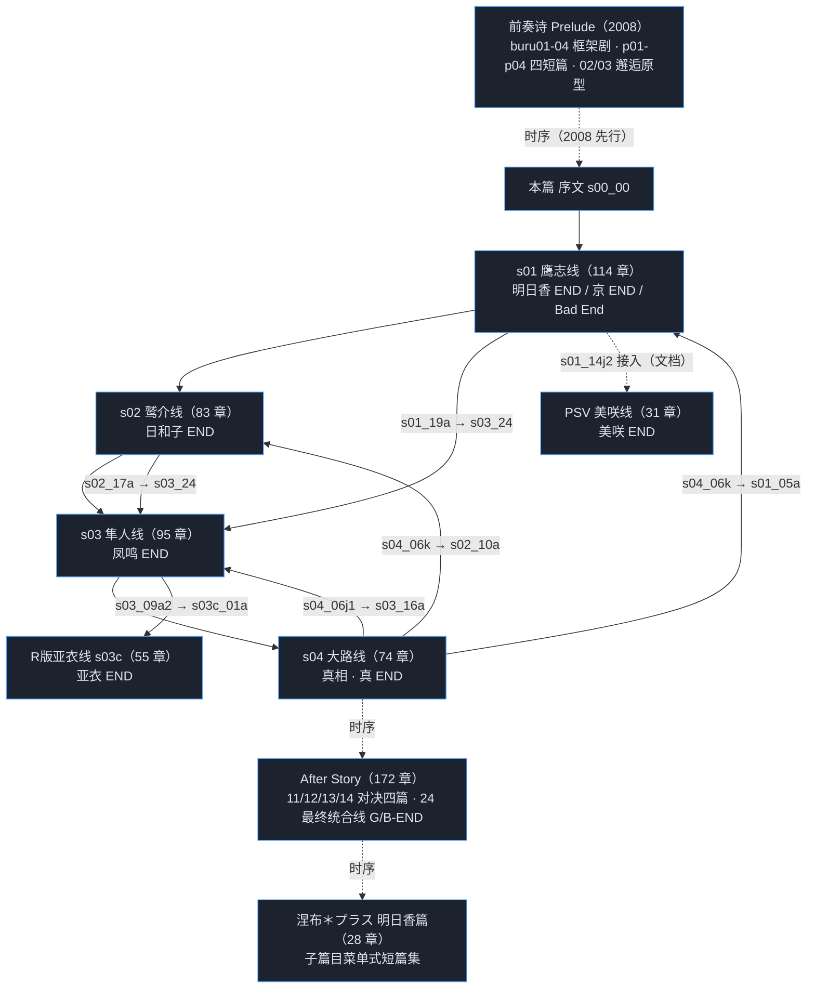

# 《我们没有翅膀——格雷塔迦露德与柳木原》· 全系列**章节级**剧情流程图

> **校准**：2026-10-09 · `ISSUE-20261009-01` ｜ 定位：现行说明（图视图，源 `资源组\05_章节总表.tsv`） ｜ 权威入口：`工程\我们没有翅膀——格雷塔迦露德与柳木原\00_项目索引.md`

> 模块 `ISSUE-20260920-17` ｜ 构建器 `资源组\工具\build_chapter_flow.py`（只读语料、幂等、可复跑）
> 数据源 `资源组\05_章节总表.tsv`（712 章） ｜ 本图 **712 个章节节点**（lane 条目合计 814）、**760 条 `next` 边**

**与 `07_路线脉络.md` 的关系（口径声明）**

- 本文件是**图视图**（Mermaid 关系图 ＋ 逐路线播放顺序表 ＋ 分岔点表），`07_路线脉络.md` 是**逐章列表视图**。
- **两者顺序口径完全一致**：lane 划分与 lane 内章节顺序**直接复用 07 的路线定义与播放顺序算法**
  （`build_chapter_docs.py` 的 `build_routes()`／`play_order()`，即「沿 `next[i]` 走该路线的分岐臂」的
  分支感知展开：**分支点在前、各臂相邻、汇合点在后**），**不是** `05_章节总表.tsv` 的 `章节序号`
  （那是逐源 DFS 前序，会跨路线穿插，**不等于播放顺序**）。
- **数据源同为 `资源组\05_章节总表.tsv`**；本文件不改动 07/06/05 中的任何内容。
- 顺序一致性由 `资源组\工具\verify_chapter_flow.py` 逐 lane 自动比对（见 §十一）。

---

## 〇、图例、口径与读图说明

### 〇.1 `next` 与「臂」的口径（与 07 §0.1 一致）

| 记号 | 含义 |
| --- | --- |
| **节点** | **一个章节**（一脚本 = 一章；`script` 全局唯一，共 712 个） |
| 实线箭头 `-->` | 章节 `next` 边（**`next` 第 i 项 = 臂 i**） |
| 虚线箭头 `-.->` | **跨路线**边，指向另一条路线的桩节点（`X_<script>`，桩非章节节点） |
| **★** 前缀 + 红框 | **`是否影响后续剧情` 非空** 的章节（共 18 件，逐条说明见 §八） |
| 橙框 | **分岔点**（`next` 项数 ≥ 2，即 N 臂） |
| 绿框 | 结局 / `next` 为空（终点）的章节 |
| 蓝框 / 紫框 | 系统·框架章节 / 番外·短剧情·其他章节 |

**「选项 i → `next[i]`」不是通则（本版修正）**：
`next` 的第 i 项一律记作**「臂 i」**；**只有当该章「选项数 = `next` 项数」时，才可称「选项 i → 臂 i」**。

- 全系列 **50 个含选项章节**中，**32 章**满足「选项数 = `next` 项数」
  （如 `s01_02c` 2 选项 2 臂、`s01_09c0` 3 选项 3 臂、`s02_10c` 3 选项 3 臂）；
- 另 **18 章不满足**，即选项与臂**不能一一对应**：

| 章节 | 选项数 | `next` 项数（臂数） | 说明 |
| --- | ---: | ---: | --- |
| `s01_12b` | 2 | 3 | 选项数 < 臂数，配对未确证 |
| `s01_13b` | 2 | 3 | 选项数 < 臂数，配对未确证 |
| `11_3d0` | 4 | 3 | 选项数 > 臂数，配对未确证 |
| `12_4c0` | 3 | 2 | 选项数 > 臂数，配对未确证 |
| `24_1b` | 3 | 1 | 选项数 > 臂数，配对未确证 |
| `24_2b` | 3 | 1 | 选项数 > 臂数，配对未确证 |
| `24_2c` | 3 | 1 | 选项数 > 臂数，配对未确证 |
| `24_2d` | 3 | 1 | 选项数 > 臂数，配对未确证 |
| `24_3b` | 3 | 1 | 选项数 > 臂数，配对未确证 |
| `24_3c` | 3 | 1 | 选项数 > 臂数，配对未确证 |
| `24_3d` | 3 | 1 | 选项数 > 臂数，配对未确证 |
| `24_3e` | 3 | 1 | 选项数 > 臂数，配对未确证 |
| `24_4b` | 3 | 1 | 选项数 > 臂数，配对未确证 |
| `24_4c` | 3 | 1 | 选项数 > 臂数，配对未确证 |
| `24_4d` | 3 | 1 | 选项数 > 臂数，配对未确证 |
| `24_4e` | 3 | 2 | 选项数 > 臂数，配对未确证 |
| `24_5a` | 3 | 1 | 选项数 > 臂数，配对未确证 |
| `start_oretuba` | 34 | 26 | 选项数 > 臂数，配对未确证 |

故本文件与 07 一致，**一律按「臂」表述，不臆称「选第 N 项」**。

**关键分岔点的选项数为 0 —— 属脚本级分岐（由前置 flag 决定），不存在「选第几项」**：
`s01_14g`、`s01_14i`、`s03_08b`、`s04_06j1`、`s04_06k` 等**选项数 = 0**，
其 `next` 却有多项（2–3 臂）；此类分岔由脚本内的前置 flag 决定走向，**没有选项文本、没有「第几项」**。
（全系列「`next` 项数 ≥ 2 而选项数 = 0」的分岔点共 27 个。）

### 〇.2 关键分岔点 × 臂（与 `07_路线脉络.md` §0.1 逐条一致）

| 分岔点 | 该章选项数 | 选项文本（中文） | 走的臂 | 该臂入口 | 该臂走向 | 归属路线 |
| --- | ---: | --- | ---: | --- | --- | --- |
| `s01_14g` | 0 | （无选项文本，脚本级分岐） | 1 | `s01_14g1` | `s01_14g1 → s01_14h → s01_17a → s01_18a`（京 END）→ `s01_19a` | (2)山科京 |
| `s01_14g` | 0 | （无选项文本，脚本级分岐） | 2 | `s01_14g2` | 死路（`next=[]`） | (6)鹰志线 Bad End 支 |
| `s01_14g` | 0 | （无选项文本，脚本级分岐） | 3 | `s01_14i` | `s01_14i → s01_14j1 → s01_14k → s01_14l → s01_15a → s01_15b → s01_16a`（明日香 END） | (1)渡来明日香 |
| `s01_14i` | 0 | （无选项文本，脚本级分岐） | 1 | `s01_14j1` | `s01_14j1 → s01_14k → s01_14l → s01_15a → s01_15b → s01_16a` | (1)渡来明日香 |
| `s01_14i` | 0 | （无选项文本，脚本级分岐） | 2 | `s01_14j2` | 死路（`next=[]`） | (6)鹰志线 Bad End 支 |
| `s03_08b` | 0 | （无选项文本，脚本级分岐） | 1 | `s03_08c1` | `s03_08c1` → `s03_09a1` → `s03_09b` → （鸣线主链，全文见 (4) 章表）→ `s03_22a` | (4)凤鸣 |
| `s03_08b` | 0 | （无选项文本，脚本级分岐） | 2 | `s03_08c2` | `s03_08c2` → `s03_09a2` → **跨源** `s03c_01a`（R 版亚衣线） | (7)香田亚衣 |
| `s04_05i` | 2 | 不带来救赎 / 带来救赎 | 1 | `s04_06j1` | `s04_06j1` → `s04_06k` → `s01_05a` / `s02_10a` | (1)(3) |
| `s04_05i` | 2 | 不带来救赎 / 带来救赎 | 2 | `s04_06j2` | `s04_06j2` → `s04_07a` → （s04 主链 45 章，全文见 (5) 章表）→ `s04_28b` → `s04_29a`（真 END） | (5)大路线（真相） |
| `s04_06j1` | 0 | （无选项文本，脚本级分岐） | 1 | `s03_16a` | `s03_16a` → `s03_17a` → `s03_18a` → `s03_19a` → `s03_20a` → `s03_21a` → `s03_21b` → `s03_21c` → `s03_22a`（鸣解缆） | (4)凤鸣 |
| `s04_06j1` | 0 | （无选项文本，脚本级分岐） | 2 | `s04_06k` | `s04_06k` → `s01_05a` / `s02_10a` | (1)(3) |
| `s04_06j1` | 0 | （无选项文本，脚本级分岐） | 3 | `s04_06l` | 终点（`next=[]`） | (5)大路线（真相） |
| `s04_06k` | 0 | （无选项文本，脚本级分岐） | 1 | `s01_05a` | `s01_05a` → `s01_05b` → `s01_06a` → （s01 主链，全文见 (1) 章表）→ `s01_16a` | (1)渡来明日香 |
| `s04_06k` | 0 | （无选项文本，脚本级分岐） | 2 | `s02_10a` | `s02_10a` → `s02_10b` → `s02_10c` → （s02 主链，全文见 (3) 章表）→ `s02_16a` | (3)玉泉日和子 |
| `ota_24_4e` | 3 | 隼人 / 迦楼罗 / 小鹰志 | 1 | `24_5a` | `24_5a → 24_5b`（G-END） | (10)最终统合线 |
| `ota_24_4e` | 3 | 隼人 / 迦楼罗 / 小鹰志 | 2 | `24_5c` | `24_5c`（B-END，终点） | (10)最终统合线 |

### 〇.3 读图说明

1. **每张图 = 07 的一条路线（lane）**，lane 顺序与 07 §零 的路线编号 1–19 完全一致。
2. **lane 内节点顺序 = 沿 `next[i]` 走该路线分岐臂的播放顺序**：分岔点在前、各臂相邻、汇合点在后；
   收敛分支的两臂之间不会插入无关章节。
3. **跨路线边**（含全系列唯一**跨源**边 `s03_09a2 → s03c_01a`，以及 `s04_06k → s01_05a`／`s02_10a` 等）
   **全部保留**，在图上以虚线 + 桩节点表示，并在 lane 末尾「跨路线边」小表与 §九 汇总中显式标注。
4. **共享章节**：同一章被多条路线播放时，在每条路线中**均完整列出**并标 `〔共用〕`（07 口径）。
   故 lane 条目合计 **814**，**去重后唯一章节数 = 712**（＝ `05_章节总表.tsv` 的 712 行）。
5. **节点标签用中文标题**（与 07 的 `《中文》〔日文〕` 对齐）；日文原名以**副标签**给出
   （md：逐路线播放顺序表的「章节」列与 Mermaid 之外的分岔点表；HTML：节点副标签 + 悬停 + 详情面板）。

### 〇.4 路线总账（与 07 §零 一致）

| # | 路线 | 定位 | 脚本来源 | 列出章数 | 其中独占 | 其中共用 |
| ---: | --- | --- | --- | ---: | ---: | ---: |
| 1 | 渡来明日香 | 本篇主线 ＋ AfterStory 后日谈 | `ot+ota` | 130 | 130 | 0 |
| 2 | 山科京 | 本篇副线 | `ot` | 106 | 4 | 102 |
| 3 | 玉泉日和子 | 本篇主线 ＋ AfterStory 后日谈 | `ot+ota` | 105 | 105 | 0 |
| 4 | 凤鸣 | 本篇主线 ＋ AfterStory 后日谈 | `ot+ota` | 114 | 114 | 0 |
| 5 | 大路线（真相） | 本篇终章 | `ot` | 74 | 74 | 0 |
| 6 | 鹰志线 Bad End 支 | 本篇副支 | `ot` | 2 | 2 | 0 |
| 7 | 香田亚衣 | R版亚衣线 | `otr` | 55 | 55 | 0 |
| 8 | 林田美咲 | PSV美咲线 ＋ AfterStory 后日谈 | `otv+ota` | 40 | 40 | 0 |
| 9 | 羽田小鸠（后日谈） | AfterStory | `ota` | 28 | 28 | 0 |
| 10 | 最终统合线（后日谈） | AfterStory | `ota` | 20 | 20 | 0 |
| 11 | AfterStory 番外 | 番外 | `ota` | 53 | 53 | 0 |
| 12 | 渡来明日香（涅布追加） | 涅布明日香篇 | `np` | 28 | 28 | 0 |
| 13 | 前奏诗·明日香篇 | 前奏诗 | `otp` | 4 | 4 | 0 |
| 14 | 前奏诗·山科京篇 | 前奏诗 | `otp` | 5 | 5 | 0 |
| 15 | 前奏诗·美咲篇 | 前奏诗 | `otp` | 4 | 4 | 0 |
| 16 | 前奏诗·轻部狩男篇 | 前奏诗 | `otp` | 5 | 5 | 0 |
| 17 | 前奏诗·框架剧 buru | 前奏诗 | `otp` | 4 | 4 | 0 |
| 18 | 前奏诗·原型版 02/03（D15 已排除） | 前奏诗 | `otp` | 32 | 32 | 0 |
| 19 | 前奏诗·系统脚本 | 前奏诗 | `otp` | 5 | 5 | 0 |
| — | **合计（列出行数）** | — | — | **814** | **712** | **102** |

---

## 一、跨作品总览



> 实线＝TSV 中真实存在的 `next` 边；虚线＝时序或既有文档记载、**TSV 中无对应 `next` 边**的衔接（见 §九）。

| 作品 | 源代号 | 章数 | 主线定位 |
| --- | --- | ---: | --- |
| 前奏诗 | `otp` | 59 | 全系列最早（2008 先行作）：框架剧＋四角色短篇＋邂逅原型 |
| 本篇 | `ot` | 367 | 正传本体：序文 → 三条平行人格线 → 大路线真相 |
| R版亚衣线 | `otr` | 55 | R 版（2011）：亚衣线扩至 55 章，隼人线内分支 |
| PSV美咲线 | `otv` | 31 | PSV（2014）：美咲线，承鹰志线 Bad End 的同期分支 |
| AfterStory | `ota` | 172 | 后日谈合集：对决四篇＋各线 after＋最终统合线 |
| 涅布明日香篇 | `np` | 28 | 涅布（2012）：毕业后 2 月的子篇目菜单式短篇集 |

---

## 二、本篇（2009）· 序文 · 三条平行线 · 大路线

**合计 531 章（lane 条目）**。本组含 07 路线 (1)渡来明日香、(2)山科京、(3)玉泉日和子、(4)凤鸣、(5)大路线（真相）、(6)鹰志线 Bad End 支。

### (1) 渡来明日香 · `ot+ota`（列出 130 章：独占 130 ＋ 共用 0）

- **定位**：本篇《我们没有翅膀》鹰志线（s01）主线女主；山科京为其副线（s01_14g 分岐）。本篇含鹰志线前半（s01_01a–s01_05）与解缆后半（s01_05a–s01_19a）两段，后半经 s04_06k 汇入；AfterStory 由 11_* 承接后日谈（对决羽田鹰志篇）。
- **选择支路径（本线走的臂）**：`s01_14g`《五里霧中》三臂中走**臂 3** → `s01_14i`；`s01_14i` 两臂中走**臂 1** → `s01_14j1 → s01_14k → s01_14l → s01_15a → s01_15b → s01_16a`（明日香 END）。解缆后半自大路线 `s04_06k` 两臂中走**臂 1** → `s01_05a` 汇入本线（其后 s01 主链全文见本节章表），终至 `s01_19a`《解纜》。（`s01_14g`／`s01_14i` 均无选项文本，为脚本级分岐。）
- **顺序依据**：沿 `next[i]` 走该路线分岐臂（与 `07_路线脉络.md` §(1) 逐章一致）

```mermaid
flowchart TD
    classDef norm fill:#1c232e,stroke:#2b3543,color:#dde4ee;
    classDef imp fill:#3a1620,stroke:#ff6b6b,color:#ffd7d7,stroke-width:2px;
    classDef branch fill:#3a2f14,stroke:#ffb347,color:#ffe9c2;
    classDef end fill:#12331f,stroke:#4ade80,color:#d6ffe4;
    classDef sys fill:#1a2330,stroke:#4ea3ff,color:#cfe6ff;
    classDef side fill:#241a30,stroke:#b07cff,color:#e9dcff;
    classDef cross fill:#111820,stroke:#5d6b7d,color:#8fa0b6,stroke-dasharray:4 3;
    n_s00_00["s00_00 · 文～我们没有翅膀～"]:::norm
    n_s01_01a["s01_01a · 邂逅～对抗：羽田鹰志～"]:::norm
    n_s01_02a["s01_02a · 序章～美空学院的人们～"]:::norm
    n_s01_02b["s01_02b · 序章～我的挚友与初恋之人～"]:::norm
    n_s01_02c["s01_02c · 阿斯嘉公主与王宫骑士团"]:::branch
    n_s01_02d1["s01_02d1 · 献给民众的誓言"]:::norm
    n_s01_02d2["s01_02d2 · 献给公主的誓言"]:::norm
    n_s01_02e["s01_02e · 黄金之鹰传说八十五章～茨瓦伊城堡的攻防～"]:::branch
    n_s01_02f1["s01_02f1 · 无法写入"]:::norm
    n_s01_02f2["s01_02f2 · 蝴蝶之梦"]:::norm
    n_s01_03a["s01_03a · 鹰志与小鸠"]:::norm
    n_s01_03b["s01_03b · 失眠之夜的散文诗"]:::branch
    n_s01_03c1["s01_03c1 · 遭淘汰的十字架默示录"]:::norm
    n_s01_03c2["s01_03c2 · 鹰不会落下来"]:::norm
    n_s01_03d["s01_03d · 她的来电与慌了神的我"]:::norm
    n_s01_04a["s01_04a · 别扭的早餐"]:::branch
    n_s01_04b1["s01_04b1 · 拨１０４！"]:::norm
    n_s01_04b2["s01_04b2 · 住宅区的母女"]:::norm
    n_s01_04c["s01_04c · 北风与空调"]:::norm
    n_s01_04d["s01_04d · 干冷清晨的走法"]:::norm
    n_s01_04e["s01_04e · 灰姑娘阶梯"]:::branch
    n_s01_04f1["s01_04f1 · 被问是否想看时予以否定"]:::norm
    n_s01_04f2["s01_04f2 · 被问是否想看时否定并找补"]:::norm
    n_s01_04g["s01_04g · 期末考试最后一天"]:::norm
    n_s01_04h["s01_04h · 打不开的窗"]:::norm
    n_s01_04i["s01_04i · 约定的放学后"]:::norm
    n_s01_04j["s01_04j · 煎鸡排＆炸虾套餐"]:::norm
    n_s01_04k["s01_04k · 春之雪"]:::branch
    n_s01_04l["s01_04l · 暗之森的妖术师"]:::branch
    n_s01_04m1["s01_04m1 · 全灭"]:::norm
    n_s01_04m2["s01_04m2 · 我一直都想帮上谁的忙"]:::norm
    n_s01_04n["s01_04n · （无标题）"]:::norm
    n_s01_04o["s01_04o · 逃避"]:::norm
    n_s01_05["s01_05 · 幕间～奈落是否在燃烧～"]:::norm
    n_s01_05a["s01_05a · （无标题）"]:::norm
    n_s01_05b["s01_05b · 不是我的我"]:::norm
    n_s01_06a["s01_06a · 归来"]:::norm
    n_s01_06b["s01_06b · 于是在白色的天空下，我的一天又开始了"]:::norm
    n_s01_06c["s01_06c · 一如往常的学校"]:::norm
    n_s01_06d["s01_06d · 班会"]:::norm
    n_s01_06e["s01_06e · 那道墙很高，但厚度并没有多少。"]:::norm
    n_s01_06f["s01_06f · 隔着栅栏的你和我"]:::norm
    n_s01_07a["s01_07a · 山药泥的早晨"]:::norm
    n_s01_07b["s01_07b · 沉思的男生Ａ"]:::norm
    n_s01_07c["s01_07c · 金黄色的时间"]:::norm
    n_s01_07d["s01_07d · “向着色彩撩人的花、盛开怒放的夏天”"]:::norm
    n_s01_07e["s01_07e · 自称世上最没用的女人"]:::norm
    n_s01_07f["s01_07f · 牢笼中飞不起来的鸟儿们"]:::norm
    n_s01_08a["s01_08a · 自称世上最厉害的女人"]:::norm
    n_s01_08b["s01_08b · 朋友的证明"]:::norm
    n_s01_08c0["s01_08c0 · ＢＥＮＴＯ ＦＯＲ ＹＯＵ"]:::branch
    n_s01_08c1["s01_08c1 · 只要有你在"]:::norm
    n_s01_08c2["s01_08c2 · 只要人多就好"]:::norm
    n_s01_08c3["s01_08c3 · 只要有我在"]:::norm
    n_s01_08c4["s01_08c4 · 圣骑士霍克，在现世为出路烦恼之卷"]:::norm
    n_s01_08d0["s01_08d0 · 米亚科加尔德"]:::branch
    n_s01_08d1["s01_08d1 · 他是我养大的"]:::norm
    n_s01_08d2["s01_08d2 · 你爱着她"]:::norm
    n_s01_08d3["s01_08d3 · 邪念"]:::norm
    n_s01_08d4["s01_08d4 · 溺水的鱼"]:::branch
    n_s01_08e1["s01_08e1 · 伸出的手"]:::norm
    n_s01_08e2["s01_08e2 · 伸出的话语"]:::norm
    n_s01_08f["s01_08f · ＩＮ ＴＨＥ ＲＯＯＭ、ＡＴ ＮＩＧＨＴ"]:::norm
    n_s01_09a["s01_09a · 草莓果酱的早晨"]:::norm
    n_s01_09b["s01_09b · 关于丢失钱包的风波及其始末"]:::norm
    n_s01_09c0["★ s01_09c0 · 愉快的联谊会"]:::imp
    n_s01_09c1["s01_09c1 · 校园生活ｗｉｔｈ明日香"]:::norm
    n_s01_09c2["s01_09c2 · 校园生活ｗｉｔｈ京"]:::norm
    n_s01_09c3["s01_09c3 · 校园生活ｗｉｔｈ藏人"]:::norm
    n_s01_09c4["s01_09c4 · 第一届·明天在哪里干活会议"]:::norm
    n_s01_09d["★ s01_09d · 针生同学藏人在寻找摇滚范的爱好"]:::imp
    n_s01_10a["s01_10a · 加油吧同居的哥哥"]:::norm
    n_s01_10b["s01_10b · 从天堂到地狱"]:::norm
    n_s01_10c["s01_10c · 黄金之鹰传说最终章～被腰斩的连载～"]:::norm
    n_s01_10d["s01_10d · 这是“比方说”的故事"]:::norm
    n_s01_10e["s01_10e · 伸手回握"]:::norm
    n_s01_10f["s01_10f · 无论何时，我都想成为某人的力量"]:::branch
    n_s01_10g1["s01_10g1 · 相互依赖"]:::norm
    n_s01_10g2["s01_10g2 · 去还是不去"]:::norm
    n_s01_11a["s01_11a · 黄金之鹰神话第一章～终焉的开始～"]:::branch
    n_s01_11b1["s01_11b1 · 疾驰的爱"]:::norm
    n_s01_11b2["s01_11b2 · 星期天的夜晚，独自在房间"]:::norm
    n_s01_12a["s01_12a · 公主之墙（明日香大人的墙）"]:::norm
    n_s01_12b["s01_12b · 加上针生同学，减去明日香"]:::branch
    n_s01_12c1["s01_12c1 · 暴走的爱"]:::norm
    n_s01_12c2["s01_12c2 · 山科京独自回去了"]:::norm
    n_s01_12d["s01_12d · 缅怀渡来明日香之会"]:::norm
    n_s01_13a["s01_13a · 小鸠喊哥哥的那天"]:::norm
    n_s01_13b["s01_13b · 今天的羽田班"]:::branch
    n_s01_13c1["s01_13c1 · 暴走的爱"]:::branch
    n_s01_13d["s01_13d · 钥匙与誓约"]:::norm
    n_s01_13c2["s01_13c2 · 山科京今天也是一个人回去的"]:::norm
    n_s01_13e["s01_13e · 他匆匆活着的理由"]:::norm
    n_s01_14a["s01_14a · 最近的上学风景"]:::norm
    n_s01_14b["s01_14b · 果然世界是和平的"]:::norm
    n_s01_14c["s01_14c · 明日香的秘密与格雷塔迦露德的真相"]:::branch
    n_s01_14d["s01_14d · 别抢别人的东西"]:::norm
    n_s01_14e["s01_14e · 五扇门"]:::branch
    n_s01_14f1["s01_14f1 · 迷途之爱"]:::norm
    n_s01_14f2["s01_14f2 · （无标题）"]:::norm
    n_s01_14g["★ s01_14g · 五里雾中"]:::imp
    n_s01_14i["★ s01_14i · 在世界底层仓皇逃窜"]:::imp
    n_s01_14j1["s01_14j1 · 鹰振翅高飞"]:::norm
    n_s01_14k["s01_14k · 现实的联系"]:::norm
    n_s01_14l["s01_14l · 请·渡来化·我"]:::norm
    n_s01_15a["s01_15a · 做得太过火的明日香大人"]:::norm
    n_s01_15b["s01_15b · 我果然也是个少女呢。呐（略）"]:::norm
    n_s01_16a["s01_16a · 终章～羽田君和渡来同学～"]:::end
    n_s01_19a["s01_19a · 解缆～对抗：羽田鹰志～"]:::end
    n_11_1a["11_1a · 重逢～对决羽田鹰志～"]:::norm
    n_11_1b["11_1b · 近况～羽田君与渡来同学～"]:::norm
    n_11_2a["11_2a · 家人～鸽与鹰～"]:::norm
    n_11_2b["11_2b · 最近的学院生活"]:::norm
    n_11_2c["11_2c · 被冷落的公主"]:::norm
    n_11_3a["11_3a · 美咲酱绽放（里篇）"]:::norm
    n_11_3b0["11_3b0 · 汰架示与咲夜"]:::branch
    n_11_3b1["11_3b1 · 关于香田亚衣"]:::norm
    n_11_3b2["11_3b2 · 关于女学生Ａ"]:::norm
    n_11_3c["11_3c · 还是想成为谁的助力"]:::norm
    n_11_3d0["★ 11_3d0 · 停不住的男人"]:::imp
    n_11_3d1["11_3d1 · 打工ｗｉｔｈ明日香"]:::norm
    n_11_3d2["11_3d2 · 打工ｗｉｔｈ京"]:::norm
    n_11_3d3["11_3d3 · 打工ｗｉｔｈ藏人"]:::norm
    n_11_4a["11_4a · 美咲酱起飞（里）"]:::norm
    n_11_4b["11_4b · 回来了，针生同学"]:::norm
    n_11_5a["11_5a · 母亲渡来化女儿"]:::norm
    n_11_5b["11_5b · 慰劳"]:::norm
    n_11_5c["11_5c · 提升男人味"]:::norm
    n_11_5d["11_5d · 和明日香同学卿卿我我"]:::norm
    n_11_6a["11_6a · 闭幕～对决羽田鹰志～"]:::end
    n_s00_00 --> n_s01_01a
    n_s01_01a --> n_s01_02a
    n_s01_02a --> n_s01_02b
    n_s01_02b --> n_s01_02c
    n_s01_02c -->|"臂 1"| n_s01_02d1
    n_s01_02c -->|"臂 2"| n_s01_02d2
    n_s01_02d1 --> n_s01_02e
    n_s01_02d2 --> n_s01_02e
    n_s01_02e -->|"臂 1"| n_s01_02f1
    n_s01_02e -->|"臂 2"| n_s01_02f2
    n_s01_02f1 --> n_s01_03a
    n_s01_02f2 --> n_s01_03a
    n_s01_03a --> n_s01_03b
    n_s01_03b -->|"臂 1"| n_s01_03c1
    n_s01_03b -->|"臂 2"| n_s01_03c2
    n_s01_03c1 --> n_s01_03d
    n_s01_03c2 --> n_s01_03d
    n_s01_03d --> n_s01_04a
    n_s01_04a -->|"臂 1"| n_s01_04b1
    n_s01_04a -->|"臂 2"| n_s01_04b2
    n_s01_04b1 --> n_s01_04c
    n_s01_04b2 --> n_s01_04c
    n_s01_04c --> n_s01_04d
    n_s01_04d --> n_s01_04e
    n_s01_04e -->|"臂 1"| n_s01_04f1
    n_s01_04e -->|"臂 2"| n_s01_04f2
    n_s01_04f1 --> n_s01_04g
    n_s01_04f2 --> n_s01_04g
    n_s01_04g --> n_s01_04h
    n_s01_04h --> n_s01_04i
    n_s01_04i --> n_s01_04j
    n_s01_04j --> n_s01_04k
    n_s01_04k -->|"臂 1"| n_s01_04l
    n_s01_04k -->|"臂 2"| n_s01_04o
    n_s01_04l -->|"臂 1"| n_s01_04m1
    n_s01_04l -->|"臂 2"| n_s01_04m2
    n_s01_04m1 --> n_s01_04o
    n_s01_04m2 --> n_s01_04n
    n_s01_04n --> n_s01_04o
    n_s01_04o --> n_s01_05
    X_s02_01a["↷ s02_01a（转 (3)玉泉日和子）"]:::cross
    n_s01_05 -.->|"跨路线"| X_s02_01a
    n_s01_05a --> n_s01_05b
    n_s01_05b --> n_s01_06a
    n_s01_06a --> n_s01_06b
    n_s01_06b --> n_s01_06c
    n_s01_06c --> n_s01_06d
    n_s01_06d --> n_s01_06e
    n_s01_06e --> n_s01_06f
    n_s01_06f --> n_s01_07a
    n_s01_07a --> n_s01_07b
    n_s01_07b --> n_s01_07c
    n_s01_07c --> n_s01_07d
    n_s01_07d --> n_s01_07e
    n_s01_07e --> n_s01_07f
    n_s01_07f --> n_s01_08a
    n_s01_08a --> n_s01_08b
    n_s01_08b --> n_s01_08c0
    n_s01_08c0 -->|"臂 1"| n_s01_08c1
    n_s01_08c0 -->|"臂 2"| n_s01_08c2
    n_s01_08c0 -->|"臂 3"| n_s01_08c3
    n_s01_08c1 --> n_s01_08c4
    n_s01_08c2 --> n_s01_08c4
    n_s01_08c3 --> n_s01_08c4
    n_s01_08c4 --> n_s01_08d0
    n_s01_08d0 -->|"臂 1"| n_s01_08d1
    n_s01_08d0 -->|"臂 2"| n_s01_08d2
    n_s01_08d0 -->|"臂 3"| n_s01_08d3
    n_s01_08d1 --> n_s01_08d4
    n_s01_08d2 --> n_s01_08d4
    n_s01_08d3 --> n_s01_08d4
    n_s01_08d4 -->|"臂 1"| n_s01_08e1
    n_s01_08d4 -->|"臂 2"| n_s01_08e2
    n_s01_08e1 --> n_s01_08f
    n_s01_08e2 --> n_s01_08f
    n_s01_08f --> n_s01_09a
    n_s01_09a --> n_s01_09b
    n_s01_09b --> n_s01_09c0
    n_s01_09c0 -->|"臂 1"| n_s01_09c1
    n_s01_09c0 -->|"臂 2"| n_s01_09c2
    n_s01_09c0 -->|"臂 3"| n_s01_09c3
    n_s01_09c1 --> n_s01_09c4
    n_s01_09c2 --> n_s01_09c4
    n_s01_09c3 --> n_s01_09c4
    n_s01_09c4 --> n_s01_09d
    n_s01_09d --> n_s01_10a
    n_s01_10a --> n_s01_10b
    n_s01_10b --> n_s01_10c
    n_s01_10c --> n_s01_10d
    n_s01_10d --> n_s01_10e
    n_s01_10e --> n_s01_10f
    n_s01_10f -->|"臂 1"| n_s01_10g1
    n_s01_10f -->|"臂 2"| n_s01_10g2
    n_s01_10g1 --> n_s01_11a
    n_s01_10g2 --> n_s01_11a
    n_s01_11a -->|"臂 1"| n_s01_11b1
    n_s01_11a -->|"臂 2"| n_s01_11b2
    n_s01_11b1 --> n_s01_12a
    n_s01_11b2 --> n_s01_12a
    n_s01_12a --> n_s01_12b
    n_s01_12b -->|"臂 1"| n_s01_12c1
    n_s01_12b -->|"臂 2"| n_s01_12c2
    n_s01_12b -->|"臂 3"| n_s01_12d
    n_s01_12c1 --> n_s01_13a
    n_s01_12c2 --> n_s01_13a
    n_s01_12d --> n_s01_13a
    n_s01_13a --> n_s01_13b
    n_s01_13b -->|"臂 1"| n_s01_13c1
    n_s01_13b -->|"臂 2"| n_s01_13c2
    n_s01_13b -->|"臂 3"| n_s01_13e
    n_s01_13c1 -->|"臂 1"| n_s01_13d
    n_s01_13c1 -->|"臂 2"| n_s01_14a
    n_s01_13d --> n_s01_14a
    n_s01_13c2 --> n_s01_14a
    n_s01_13e --> n_s01_14a
    n_s01_14a --> n_s01_14b
    n_s01_14b --> n_s01_14c
    n_s01_14c -->|"臂 1"| n_s01_14d
    n_s01_14c -->|"臂 2"| n_s01_14e
    n_s01_14d --> n_s01_14e
    n_s01_14e -->|"臂 1"| n_s01_14f1
    n_s01_14e -->|"臂 2"| n_s01_14f2
    n_s01_14f1 --> n_s01_14g
    n_s01_14f2 --> n_s01_14g
    X_s01_14g1["↷ s01_14g1（转 (2)山科京）"]:::cross
    n_s01_14g -.->|"臂 1 跨路线"| X_s01_14g1
    X_s01_14g2["↷ s01_14g2（转 (6)鹰志线 Bad End 支）"]:::cross
    n_s01_14g -.->|"臂 2 跨路线"| X_s01_14g2
    n_s01_14g -->|"臂 3"| n_s01_14i
    n_s01_14i -->|"臂 1"| n_s01_14j1
    X_s01_14j2["↷ s01_14j2（转 (6)鹰志线 Bad End 支）"]:::cross
    n_s01_14i -.->|"臂 2 跨路线"| X_s01_14j2
    n_s01_14j1 --> n_s01_14k
    n_s01_14k --> n_s01_14l
    n_s01_14l --> n_s01_15a
    n_s01_15a --> n_s01_15b
    n_s01_15b --> n_s01_16a
    n_s01_16a --> n_s01_19a
    X_s03_24["↷ s03_24（转 (4)凤鸣）"]:::cross
    n_s01_19a -.->|"跨路线"| X_s03_24
    n_11_1a --> n_11_1b
    n_11_1b --> n_11_2a
    n_11_2a --> n_11_2b
    n_11_2b --> n_11_2c
    n_11_2c --> n_11_3a
    n_11_3a --> n_11_3b0
    n_11_3b0 -->|"臂 1"| n_11_3b1
    n_11_3b0 -->|"臂 2"| n_11_3b2
    n_11_3b1 --> n_11_3c
    n_11_3b2 --> n_11_3c
    n_11_3c --> n_11_3d0
    n_11_3d0 -->|"臂 1"| n_11_3d1
    n_11_3d0 -->|"臂 2"| n_11_3d2
    n_11_3d0 -->|"臂 3"| n_11_3d3
    n_11_3d1 --> n_11_4a
    n_11_3d2 --> n_11_4a
    n_11_3d3 --> n_11_4a
    n_11_4a --> n_11_4b
    n_11_4b --> n_11_5a
    n_11_5a --> n_11_5b
    n_11_5b --> n_11_5c
    n_11_5c --> n_11_5d
    n_11_5d --> n_11_6a
    X_51_1["↷ 51_1（转 (11)AfterStory 番外）"]:::cross
    n_11_6a -.->|"跨路线"| X_51_1
```

**播放顺序（与 `07_路线脉络.md` §(1) 逐章一致）**

| 序 | script | 章节《中文》〔日文〕 | 选项数 | 臂数 | 备注 |
| ---: | --- | --- | ---: | ---: | --- |
| 1 | `s00_00` | 《文～我们没有翅膀～》〔文　～俺たちに翼はない～〕 | 0 | 1 |  |
| 2 | `s01_01a` | 《邂逅～对抗：羽田鹰志～》〔邂逅　～バーサス羽田鷹志～〕 | 0 | 1 |  |
| 3 | `s01_02a` | 《序章～美空学院的人们～》〔プロローグ　～美空学園のひとびと～〕 | 0 | 1 |  |
| 4 | `s01_02b` | 《序章～我的挚友与初恋之人～》〔プロローグ　～僕の親友と初恋のひと～〕 | 0 | 1 |  |
| 5 | `s01_02c` | 《阿斯嘉公主与王宫骑士团》〔プリンセス・アスカと王宮騎士団〕 | 2 | 2 | 分岔点（2 臂） |
| 6 | `s01_02d1` | 《献给民众的誓言》〔民にささぐ誓い〕 | 0 | 1 |  |
| 7 | `s01_02d2` | 《献给公主的誓言》〔姫にささぐ誓い〕 | 0 | 1 |  |
| 8 | `s01_02e` | 《黄金之鹰传说八十五章～茨瓦伊城堡的攻防～》〔黄金の鷹伝説八十五章～ツヴァイ砦の攻防～〕 | 2 | 2 | 分岔点（2 臂） |
| 9 | `s01_02f1` | 《无法写入》〔かきこみできません〕 | 0 | 1 |  |
| 10 | `s01_02f2` | 《蝴蝶之梦》〔胡蝶の夢〕 | 0 | 1 |  |
| 11 | `s01_03a` | 《鹰志与小鸠》〔鷹志と小鳩〕 | 0 | 1 |  |
| 12 | `s01_03b` | 《失眠之夜的散文诗》〔眠れぬ夜の散文詩〕 | 2 | 2 | 分岔点（2 臂） |
| 13 | `s01_03c1` | 《遭淘汰的十字架默示录》〔淘汰される十字架の黙示録〕 | 0 | 1 |  |
| 14 | `s01_03c2` | 《鹰不会落下来》〔鷹は舞いおりない〕 | 0 | 1 |  |
| 15 | `s01_03d` | 《她的来电与慌了神的我》〔彼女からの電話とうろたえる僕〕 | 0 | 1 |  |
| 16 | `s01_04a` | 《别扭的早餐》〔ぎこちない朝食〕 | 0 | 2 | 分岔点（2 臂） |
| 17 | `s01_04b1` | 《拨１０４！》〔ダイヤル１０４を廻せ！〕 | 0 | 1 |  |
| 18 | `s01_04b2` | 《住宅区的母女》〔住宅街の母娘〕 | 0 | 1 |  |
| 19 | `s01_04c` | 《北风与空调》〔北風とエアコン〕 | 0 | 1 |  |
| 20 | `s01_04d` | 《干冷清晨的走法》〔乾いた朝の歩き方〕 | 0 | 1 |  |
| 21 | `s01_04e` | 《灰姑娘阶梯》〔シンデレラ階段〕 | 2 | 2 | 分岔点（2 臂） |
| 22 | `s01_04f1` | 《被问是否想看时予以否定》〔見たいかと問われて否定〕 | 0 | 1 |  |
| 23 | `s01_04f2` | 《被问是否想看时否定并找补》〔見たいかと問われて否定しつつフォロー〕 | 0 | 1 |  |
| 24 | `s01_04g` | 《期末考试最后一天》〔期末テスト最終日〕 | 0 | 1 |  |
| 25 | `s01_04h` | 《打不开的窗》〔開かない窓〕 | 0 | 1 |  |
| 26 | `s01_04i` | 《约定的放学后》〔約束の放課後〕 | 0 | 1 |  |
| 27 | `s01_04j` | 《煎鸡排＆炸虾套餐》〔チキンソテー＆エビフライ定食〕 | 0 | 1 |  |
| 28 | `s01_04k` | 《春之雪》〔春の雪〕 | 0 | 2 | 分岔点（2 臂） |
| 29 | `s01_04l` | 《暗之森的妖术师》〔闇の森の妖術士〕 | 2 | 2 | 分岔点（2 臂） |
| 30 | `s01_04m1` | 《全灭》〔ぜんめつしました〕 | 0 | 1 |  |
| 31 | `s01_04m2` | 《我一直都想帮上谁的忙》〔僕はいつだって誰かの力になりたいんだ〕 | 0 | 1 |  |
| 32 | `s01_04n` | 《（无标题）》 | 0 | 1 |  |
| 33 | `s01_04o` | 《逃避》 | 0 | 1 |  |
| 34 | `s01_05` | 《幕间～奈落是否在燃烧～》〔幕間　～奈落は燃えているか～〕 | 0 | 1 |  |
| 35 | `s01_05a` | 《（无标题）》 | 0 | 1 |  |
| 36 | `s01_05b` | 《不是我的我》〔僕じゃない僕〕 | 0 | 1 |  |
| 37 | `s01_06a` | 《归来》〔帰還〕 | 0 | 1 |  |
| 38 | `s01_06b` | 《于是在白色的天空下，我的一天又开始了》〔そして白い空の下また僕の一日が始まる〕 | 0 | 1 |  |
| 39 | `s01_06c` | 《一如往常的学校》〔いつもと同じ学校〕 | 0 | 1 |  |
| 40 | `s01_06d` | 《班会》〔学級会議〕 | 0 | 1 |  |
| 41 | `s01_06e` | 《那道墙很高，但厚度并没有多少。》〔その壁は高いが厚みはさほどでもない〕 | 0 | 1 |  |
| 42 | `s01_06f` | 《隔着栅栏的你和我》〔格子を挟んだキミとボク〕 | 0 | 1 |  |
| 43 | `s01_07a` | 《山药泥的早晨》〔とろろ芋の朝〕 | 0 | 1 |  |
| 44 | `s01_07b` | 《沉思的男生Ａ》〔もの思う男子Ａ〕 | 0 | 1 |  |
| 45 | `s01_07c` | 《金黄色的时间》〔黄金色の時間〕 | 0 | 1 |  |
| 46 | `s01_07d` | 《“向着色彩撩人的花、盛开怒放的夏天”》〔“色めく花、咲き誇る夏へ”〕 | 0 | 1 |  |
| 47 | `s01_07e` | 《自称世上最没用的女人》〔自称世界でいちばんいらない女〕 | 0 | 1 |  |
| 48 | `s01_07f` | 《牢笼中飞不起来的鸟儿们》〔檻の中の飛べない鳥たち〕 | 0 | 1 |  |
| 49 | `s01_08a` | 《自称世上最厉害的女人》〔自称世界でいちばんすごい女〕 | 0 | 1 |  |
| 50 | `s01_08b` | 《朋友的证明》〔ともだちのあかし〕 | 0 | 1 |  |
| 51 | `s01_08c0` | 《ＢＥＮＴＯ ＦＯＲ ＹＯＵ》〔ベントゥー・フォー・ユー〕 | 3 | 3 | 分岔点（3 臂） |
| 52 | `s01_08c1` | 《只要有你在》〔君がいるだけで〕 | 0 | 1 |  |
| 53 | `s01_08c2` | 《只要人多就好》〔数がいるだけで〕 | 0 | 1 |  |
| 54 | `s01_08c3` | 《只要有我在》〔俺がいるだけで〕 | 0 | 1 |  |
| 55 | `s01_08c4` | 《圣骑士霍克，在现世为出路烦恼之卷》〔聖騎士ホーク、現世にて進路に悩むの巻〕 | 0 | 1 |  |
| 56 | `s01_08d0` | 《米亚科加尔德》〔ミヤコガルド〕 | 3 | 3 | 分岔点（3 臂） |
| 57 | `s01_08d1` | 《他是我养大的》〔彼は私が育てた〕 | 0 | 1 |  |
| 58 | `s01_08d2` | 《你爱着她》〔君は彼女を愛している〕 | 0 | 1 |  |
| 59 | `s01_08d3` | 《邪念》 | 0 | 1 |  |
| 60 | `s01_08d4` | 《溺水的鱼》〔溺れる魚〕 | 2 | 2 | 分岔点（2 臂） |
| 61 | `s01_08e1` | 《伸出的手》〔差しのべられた手〕 | 0 | 1 |  |
| 62 | `s01_08e2` | 《伸出的话语》〔差しのべられた言葉〕 | 0 | 1 |  |
| 63 | `s01_08f` | 《ＩＮ ＴＨＥ ＲＯＯＭ、ＡＴ ＮＩＧＨＴ》〔インザルーム、アットナイト〕 | 0 | 1 |  |
| 64 | `s01_09a` | 《草莓果酱的早晨》〔苺ジャムの朝〕 | 0 | 1 |  |
| 65 | `s01_09b` | 《关于丢失钱包的风波及其始末》〔なくなった財布に関する騒動とその顛末〕 | 0 | 1 |  |
| 66 | `s01_09c0` | 《愉快的联谊会》〔たのしい親睦会〕 | 3 | 3 | ★影响后续剧情 分岔点（3 臂） |
| 67 | `s01_09c1` | 《校园生活ｗｉｔｈ明日香》〔キャンパスライフｗｉｔｈ明日香〕 | 0 | 1 |  |
| 68 | `s01_09c2` | 《校园生活ｗｉｔｈ京》〔キャンパスライフｗｉｔｈ京〕 | 0 | 1 |  |
| 69 | `s01_09c3` | 《校园生活ｗｉｔｈ藏人》〔キャンパスライフｗｉｔｈ蔵人〕 | 0 | 1 |  |
| 70 | `s01_09c4` | 《第一届·明天在哪里干活会议》〔第一回・明日どこで作業するか会議〕 | 0 | 1 |  |
| 71 | `s01_09d` | 《针生同学藏人在寻找摇滚范的爱好》〔針生蔵人はロックな趣味を探している〕 | 0 | 1 | ★影响后续剧情 |
| 72 | `s01_10a` | 《加油吧同居的哥哥》〔がんばれ同居人のおにいさん〕 | 0 | 1 |  |
| 73 | `s01_10b` | 《从天堂到地狱》〔天国から地獄〕 | 0 | 1 |  |
| 74 | `s01_10c` | 《黄金之鹰传说最终章～被腰斩的连载～》〔黄金の鷹伝説　最終章～打ちきられた連載～〕 | 0 | 1 |  |
| 75 | `s01_10d` | 《这是“比方说”的故事》〔これは“たとえば”の話だけど〕 | 0 | 1 |  |
| 76 | `s01_10e` | 《伸手回握》〔差しのべかえす〕 | 0 | 1 |  |
| 77 | `s01_10f` | 《无论何时，我都想成为某人的力量》〔私はいつだって誰かの力になりたいんだ〕 | 0 | 2 | 分岔点（2 臂） |
| 78 | `s01_10g1` | 《相互依赖》〔共依存〕 | 0 | 1 |  |
| 79 | `s01_10g2` | 《去还是不去》〔往くか往かざるか〕 | 0 | 1 |  |
| 80 | `s01_11a` | 《黄金之鹰神话第一章～终焉的开始～》〔黄金の鷹神話　第一章～終わりの始まり～〕 | 0 | 2 | 分岔点（2 臂） |
| 81 | `s01_11b1` | 《疾驰的爱》〔疾走する愛〕 | 0 | 1 |  |
| 82 | `s01_11b2` | 《星期天的夜晚，独自在房间》〔日曜の夜ひとり部屋で〕 | 0 | 1 |  |
| 83 | `s01_12a` | 《公主之墙（明日香大人的墙）》〔プリンセス・ウォール（明日香さまの壁）〕 | 0 | 1 |  |
| 84 | `s01_12b` | 《加上针生同学，减去明日香》〔プラス針生マイナス明日香〕 | 2 | 3 | 分岔点（3 臂） |
| 85 | `s01_12c1` | 《暴走的爱》〔爆走する愛〕 | 0 | 1 |  |
| 86 | `s01_12c2` | 《山科京独自回去了》〔山科京はひとりで帰った〕 | 0 | 1 |  |
| 87 | `s01_12d` | 《缅怀渡来明日香之会》〔渡来明日香を偲ぶ会〕 | 0 | 1 |  |
| 88 | `s01_13a` | 《小鸠喊哥哥的那天》〔小鳩が兄と呼んだ日〕 | 0 | 1 |  |
| 89 | `s01_13b` | 《今天的羽田班》〔今日の羽田班〕 | 2 | 3 | 分岔点（3 臂） |
| 90 | `s01_13c1` | 《暴走的爱》〔暴走する愛〕 | 0 | 2 | 分岔点（2 臂） |
| 91 | `s01_13d` | 《钥匙与誓约》〔鍵と誓約〕 | 0 | 1 |  |
| 92 | `s01_13c2` | 《山科京今天也是一个人回去的》〔山科京は今日もひとりで帰った〕 | 0 | 1 |  |
| 93 | `s01_13e` | 《他匆匆活着的理由》〔彼が生きいそぐ理由〕 | 0 | 1 |  |
| 94 | `s01_14a` | 《最近的上学风景》〔近ごろの登校風景〕 | 0 | 1 |  |
| 95 | `s01_14b` | 《果然世界是和平的》〔やっぱり世界は平和だったんだ〕 | 0 | 1 |  |
| 96 | `s01_14c` | 《明日香的秘密与格雷塔迦露德的真相》〔明日香の秘密とグレタガルドの真実〕 | 0 | 2 | 分岔点（2 臂） |
| 97 | `s01_14d` | 《别抢别人的东西》〔ひとのものとらないで〕 | 0 | 1 |  |
| 98 | `s01_14e` | 《五扇门》〔五つの扉〕 | 0 | 2 | 分岔点（2 臂） |
| 99 | `s01_14f1` | 《迷途之爱》〔迷走する愛〕 | 0 | 1 |  |
| 100 | `s01_14f2` | 《（无标题）》 | 0 | 1 |  |
| 101 | `s01_14g` | 《五里雾中》〔五里霧中〕 | 0 | 3 | ★影响后续剧情 分岔点（3 臂） |
| 102 | `s01_14i` | 《在世界底层仓皇逃窜》〔世界の底を逃げまどう〕 | 0 | 2 | ★影响后续剧情 分岔点（2 臂） |
| 103 | `s01_14j1` | 《鹰振翅高飞》〔鷹は羽ばたいた〕 | 0 | 1 |  |
| 104 | `s01_14k` | 《现实的联系》〔現実の繋がり〕 | 0 | 1 |  |
| 105 | `s01_14l` | 《请·渡来化·我》〔プリーズ・ワタライズ・ミー〕 | 0 | 1 |  |
| 106 | `s01_15a` | 《做得太过火的明日香大人》〔やりすぎ明日香さま〕 | 0 | 1 |  |
| 107 | `s01_15b` | 《我果然也是个少女呢。呐（略）》〔私もやっぱり乙女なのだ。な（略）〕 | 0 | 1 |  |
| 108 | `s01_16a` | 《终章～羽田君和渡来同学～》〔エピローグ　～羽田君と渡来さん～〕 | 0 | 1 |  |
| 109 | `s01_19a` | 《解缆～对抗：羽田鹰志～》〔解纜　～バーサス羽田鷹志～〕 | 0 | 1 |  |
| 110 | `11_1a` | 《重逢～对决羽田鹰志～》〔再会　～バーサス羽田タカシ～〕 | 0 | 1 |  |
| 111 | `11_1b` | 《近况～羽田君与渡来同学～》〔近況　～羽田君と渡来さん～〕 | 0 | 1 |  |
| 112 | `11_2a` | 《家人～鸽与鹰～》〔家族　～Ｄｏｖｅ＆Ｈａｗｋ～〕 | 0 | 1 |  |
| 113 | `11_2b` | 《最近的学院生活》〔近ごろの学園生活〕 | 0 | 1 |  |
| 114 | `11_2c` | 《被冷落的公主》〔ほっとかれプリンセス〕 | 0 | 1 |  |
| 115 | `11_3a` | 《美咲酱绽放（里篇）》〔美咲ちゃんブルーミング（裏）〕 | 0 | 1 |  |
| 116 | `11_3b0` | 《汰架示与咲夜》〔汰架示と咲夜〕 | 2 | 2 | 分岔点（2 臂） |
| 117 | `11_3b1` | 《关于香田亚衣》〔香田亜衣について〕 | 0 | 1 |  |
| 118 | `11_3b2` | 《关于女学生Ａ》〔女生徒Ａについて〕 | 0 | 1 |  |
| 119 | `11_3c` | 《还是想成为谁的助力》〔相変わらず誰かの力になりたいんだ〕 | 0 | 1 |  |
| 120 | `11_3d0` | 《停不住的男人》〔留まらない男〕 | 4 | 3 | ★影响后续剧情 分岔点（3 臂） |
| 121 | `11_3d1` | 《打工ｗｉｔｈ明日香》〔アルバイトｗｉｔｈ明日香〕 | 0 | 1 |  |
| 122 | `11_3d2` | 《打工ｗｉｔｈ京》〔アルバイトｗｉｔｈ京〕 | 0 | 1 |  |
| 123 | `11_3d3` | 《打工ｗｉｔｈ藏人》〔アルバイトｗｉｔｈ蔵人〕 | 0 | 1 |  |
| 124 | `11_4a` | 《美咲酱起飞（里）》〔美咲ちゃんテイクオフ（裏）〕 | 0 | 1 |  |
| 125 | `11_4b` | 《回来了，针生同学》〔おかえり針生さん〕 | 0 | 1 |  |
| 126 | `11_5a` | 《母亲渡来化女儿》〔母ワタライズ娘〕 | 0 | 1 |  |
| 127 | `11_5b` | 《慰劳》〔ねぎらい〕 | 0 | 1 |  |
| 128 | `11_5c` | 《提升男人味》〔男を上げよう〕 | 0 | 1 |  |
| 129 | `11_5d` | 《和明日香同学卿卿我我》〔いちゃいちゃ明日香さん〕 | 0 | 1 |  |
| 130 | `11_6a` | 《闭幕～对决羽田鹰志～》〔閉幕　～バーサス羽田タカシ～〕 | 0 | 1 |  |

**本 lane 分岔点（22 个）与各臂**

| 分岔点 | 标题 | 选项数 | 臂 | 该臂入口 | 该臂归属路线 | 跨路线 |
| --- | --- | ---: | ---: | --- | --- | :---: |
| `s01_02c` | 阿斯嘉公主与王宫骑士团 | 2 | 1 | `s01_02d1` | (1)渡来明日香／(2)山科京 |  |
| `s01_02c` | 阿斯嘉公主与王宫骑士团 | 2 | 2 | `s01_02d2` | (1)渡来明日香／(2)山科京 |  |
| `s01_02e` | 黄金之鹰传说八十五章～茨瓦伊城堡的攻防～ | 2 | 1 | `s01_02f1` | (1)渡来明日香／(2)山科京 |  |
| `s01_02e` | 黄金之鹰传说八十五章～茨瓦伊城堡的攻防～ | 2 | 2 | `s01_02f2` | (1)渡来明日香／(2)山科京 |  |
| `s01_03b` | 失眠之夜的散文诗 | 2 | 1 | `s01_03c1` | (1)渡来明日香／(2)山科京 |  |
| `s01_03b` | 失眠之夜的散文诗 | 2 | 2 | `s01_03c2` | (1)渡来明日香／(2)山科京 |  |
| `s01_04a` | 别扭的早餐 | 0 | 1 | `s01_04b1` | (1)渡来明日香／(2)山科京 |  |
| `s01_04a` | 别扭的早餐 | 0 | 2 | `s01_04b2` | (1)渡来明日香／(2)山科京 |  |
| `s01_04e` | 灰姑娘阶梯 | 2 | 1 | `s01_04f1` | (1)渡来明日香／(2)山科京 |  |
| `s01_04e` | 灰姑娘阶梯 | 2 | 2 | `s01_04f2` | (1)渡来明日香／(2)山科京 |  |
| `s01_04k` | 春之雪 | 0 | 1 | `s01_04l` | (1)渡来明日香／(2)山科京 |  |
| `s01_04k` | 春之雪 | 0 | 2 | `s01_04o` | (1)渡来明日香／(2)山科京 |  |
| `s01_04l` | 暗之森的妖术师 | 2 | 1 | `s01_04m1` | (1)渡来明日香／(2)山科京 |  |
| `s01_04l` | 暗之森的妖术师 | 2 | 2 | `s01_04m2` | (1)渡来明日香／(2)山科京 |  |
| `s01_08c0` | ＢＥＮＴＯ ＦＯＲ ＹＯＵ | 3 | 1 | `s01_08c1` | (1)渡来明日香／(2)山科京 |  |
| `s01_08c0` | ＢＥＮＴＯ ＦＯＲ ＹＯＵ | 3 | 2 | `s01_08c2` | (1)渡来明日香／(2)山科京 |  |
| `s01_08c0` | ＢＥＮＴＯ ＦＯＲ ＹＯＵ | 3 | 3 | `s01_08c3` | (1)渡来明日香／(2)山科京 |  |
| `s01_08d0` | 米亚科加尔德 | 3 | 1 | `s01_08d1` | (1)渡来明日香／(2)山科京 |  |
| `s01_08d0` | 米亚科加尔德 | 3 | 2 | `s01_08d2` | (1)渡来明日香／(2)山科京 |  |
| `s01_08d0` | 米亚科加尔德 | 3 | 3 | `s01_08d3` | (1)渡来明日香／(2)山科京 |  |
| `s01_08d4` | 溺水的鱼 | 2 | 1 | `s01_08e1` | (1)渡来明日香／(2)山科京 |  |
| `s01_08d4` | 溺水的鱼 | 2 | 2 | `s01_08e2` | (1)渡来明日香／(2)山科京 |  |
| `s01_09c0` | 愉快的联谊会 | 3 | 1 | `s01_09c1` | (1)渡来明日香／(2)山科京 |  |
| `s01_09c0` | 愉快的联谊会 | 3 | 2 | `s01_09c2` | (1)渡来明日香／(2)山科京 |  |
| `s01_09c0` | 愉快的联谊会 | 3 | 3 | `s01_09c3` | (1)渡来明日香／(2)山科京 |  |
| `s01_10f` | 无论何时，我都想成为某人的力量 | 0 | 1 | `s01_10g1` | (1)渡来明日香／(2)山科京 |  |
| `s01_10f` | 无论何时，我都想成为某人的力量 | 0 | 2 | `s01_10g2` | (1)渡来明日香／(2)山科京 |  |
| `s01_11a` | 黄金之鹰神话第一章～终焉的开始～ | 0 | 1 | `s01_11b1` | (1)渡来明日香／(2)山科京 |  |
| `s01_11a` | 黄金之鹰神话第一章～终焉的开始～ | 0 | 2 | `s01_11b2` | (1)渡来明日香／(2)山科京 |  |
| `s01_12b` | 加上针生同学，减去明日香 | 2 | 1 | `s01_12c1` | (1)渡来明日香／(2)山科京 |  |
| `s01_12b` | 加上针生同学，减去明日香 | 2 | 2 | `s01_12c2` | (1)渡来明日香／(2)山科京 |  |
| `s01_12b` | 加上针生同学，减去明日香 | 2 | 3 | `s01_12d` | (1)渡来明日香／(2)山科京 |  |
| `s01_13b` | 今天的羽田班 | 2 | 1 | `s01_13c1` | (1)渡来明日香／(2)山科京 |  |
| `s01_13b` | 今天的羽田班 | 2 | 2 | `s01_13c2` | (1)渡来明日香／(2)山科京 |  |
| `s01_13b` | 今天的羽田班 | 2 | 3 | `s01_13e` | (1)渡来明日香／(2)山科京 |  |
| `s01_13c1` | 暴走的爱 | 0 | 1 | `s01_13d` | (1)渡来明日香／(2)山科京 |  |
| `s01_13c1` | 暴走的爱 | 0 | 2 | `s01_14a` | (1)渡来明日香／(2)山科京 |  |
| `s01_14c` | 明日香的秘密与格雷塔迦露德的真相 | 0 | 1 | `s01_14d` | (1)渡来明日香／(2)山科京 |  |
| `s01_14c` | 明日香的秘密与格雷塔迦露德的真相 | 0 | 2 | `s01_14e` | (1)渡来明日香／(2)山科京 |  |
| `s01_14e` | 五扇门 | 0 | 1 | `s01_14f1` | (1)渡来明日香／(2)山科京 |  |
| `s01_14e` | 五扇门 | 0 | 2 | `s01_14f2` | (1)渡来明日香／(2)山科京 |  |
| `s01_14g` | 五里雾中 | 0 | 1 | `s01_14g1` | (2)山科京 |  |
| `s01_14g` | 五里雾中 | 0 | 2 | `s01_14g2` | (6)鹰志线 Bad End 支 | 跨路线 |
| `s01_14g` | 五里雾中 | 0 | 3 | `s01_14i` | (1)渡来明日香 |  |
| `s01_14i` | 在世界底层仓皇逃窜 | 0 | 1 | `s01_14j1` | (1)渡来明日香 |  |
| `s01_14i` | 在世界底层仓皇逃窜 | 0 | 2 | `s01_14j2` | (6)鹰志线 Bad End 支 | 跨路线 |
| `11_3b0` | 汰架示与咲夜 | 2 | 1 | `11_3b1` | (1)渡来明日香 |  |
| `11_3b0` | 汰架示与咲夜 | 2 | 2 | `11_3b2` | (1)渡来明日香 |  |
| `11_3d0` | 停不住的男人 | 4 | 1 | `11_3d1` | (1)渡来明日香 |  |
| `11_3d0` | 停不住的男人 | 4 | 2 | `11_3d2` | (1)渡来明日香 |  |
| `11_3d0` | 停不住的男人 | 4 | 3 | `11_3d3` | (1)渡来明日香 |  |

**本 lane 跨路线边（6 条，图上以虚线 + 桩节点显式标注）**

| 源章节 | 目标章节 | 目标归属路线 | 类型 |
| --- | --- | --- | --- |
| `s01_05` | `s02_01a` | (3)玉泉日和子 | 跨路线 |
| `s01_14g` | `s01_14g1` | (2)山科京 | 跨路线 |
| `s01_14g` | `s01_14g2` | (6)鹰志线 Bad End 支 | 跨路线 |
| `s01_14i` | `s01_14j2` | (6)鹰志线 Bad End 支 | 跨路线 |
| `s01_19a` | `s03_24` | (4)凤鸣 | 跨路线 |
| `11_6a` | `51_1` | (11)AfterStory 番外 | 跨路线 |

### (2) 山科京 · `ot`（列出 106 章：独占 4 ＋ 共用 102）

- **定位**：本篇鹰志线（s01）副女主线，自 s01_14g《五里霧中》的**臂 1**（`next[0]`）分岐。本线与渡来明日香线共用 s01_14g 之前的全部章节（标〔共用〕）；前半 s01_01a–s01_05 经 s02→s03→s04 的绕行后才回到本线，故与明日香线共用。
- **选择支路径（本线走的臂）**：`s01_14g`《五里霧中》三臂中走**臂 1** → `s01_14g1 → s01_14h → s01_17a → s01_18a`（京 END）→ `s01_19a`《解纜》。本线前半 `s01_01a–s01_05` 为与明日香线共用的鹰志线共通段。
- **顺序依据**：沿 `next[i]` 走该路线分岐臂（与 `07_路线脉络.md` §(2) 逐章一致）

```mermaid
flowchart TD
    classDef norm fill:#1c232e,stroke:#2b3543,color:#dde4ee;
    classDef imp fill:#3a1620,stroke:#ff6b6b,color:#ffd7d7,stroke-width:2px;
    classDef branch fill:#3a2f14,stroke:#ffb347,color:#ffe9c2;
    classDef end fill:#12331f,stroke:#4ade80,color:#d6ffe4;
    classDef sys fill:#1a2330,stroke:#4ea3ff,color:#cfe6ff;
    classDef side fill:#241a30,stroke:#b07cff,color:#e9dcff;
    classDef cross fill:#111820,stroke:#5d6b7d,color:#8fa0b6,stroke-dasharray:4 3;
    n_s00_00["s00_00 · 文～我们没有翅膀～〔共用〕"]:::norm
    n_s01_01a["s01_01a · 邂逅～对抗：羽田鹰志～〔共用〕"]:::norm
    n_s01_02a["s01_02a · 序章～美空学院的人们～〔共用〕"]:::norm
    n_s01_02b["s01_02b · 序章～我的挚友与初恋之人～〔共用〕"]:::norm
    n_s01_02c["s01_02c · 阿斯嘉公主与王宫骑士团〔共用〕"]:::branch
    n_s01_02d1["s01_02d1 · 献给民众的誓言〔共用〕"]:::norm
    n_s01_02d2["s01_02d2 · 献给公主的誓言〔共用〕"]:::norm
    n_s01_02e["s01_02e · 黄金之鹰传说八十五章～茨瓦伊城堡的攻防～〔共用〕"]:::branch
    n_s01_02f1["s01_02f1 · 无法写入〔共用〕"]:::norm
    n_s01_02f2["s01_02f2 · 蝴蝶之梦〔共用〕"]:::norm
    n_s01_03a["s01_03a · 鹰志与小鸠〔共用〕"]:::norm
    n_s01_03b["s01_03b · 失眠之夜的散文诗〔共用〕"]:::branch
    n_s01_03c1["s01_03c1 · 遭淘汰的十字架默示录〔共用〕"]:::norm
    n_s01_03c2["s01_03c2 · 鹰不会落下来〔共用〕"]:::norm
    n_s01_03d["s01_03d · 她的来电与慌了神的我〔共用〕"]:::norm
    n_s01_04a["s01_04a · 别扭的早餐〔共用〕"]:::branch
    n_s01_04b1["s01_04b1 · 拨１０４！〔共用〕"]:::norm
    n_s01_04b2["s01_04b2 · 住宅区的母女〔共用〕"]:::norm
    n_s01_04c["s01_04c · 北风与空调〔共用〕"]:::norm
    n_s01_04d["s01_04d · 干冷清晨的走法〔共用〕"]:::norm
    n_s01_04e["s01_04e · 灰姑娘阶梯〔共用〕"]:::branch
    n_s01_04f1["s01_04f1 · 被问是否想看时予以否定〔共用〕"]:::norm
    n_s01_04f2["s01_04f2 · 被问是否想看时否定并找补〔共用〕"]:::norm
    n_s01_04g["s01_04g · 期末考试最后一天〔共用〕"]:::norm
    n_s01_04h["s01_04h · 打不开的窗〔共用〕"]:::norm
    n_s01_04i["s01_04i · 约定的放学后〔共用〕"]:::norm
    n_s01_04j["s01_04j · 煎鸡排＆炸虾套餐〔共用〕"]:::norm
    n_s01_04k["s01_04k · 春之雪〔共用〕"]:::branch
    n_s01_04l["s01_04l · 暗之森的妖术师〔共用〕"]:::branch
    n_s01_04m1["s01_04m1 · 全灭〔共用〕"]:::norm
    n_s01_04m2["s01_04m2 · 我一直都想帮上谁的忙〔共用〕"]:::norm
    n_s01_04n["s01_04n · （无标题）〔共用〕"]:::norm
    n_s01_04o["s01_04o · 逃避〔共用〕"]:::norm
    n_s01_05["s01_05 · 幕间～奈落是否在燃烧～〔共用〕"]:::norm
    n_s01_05a["s01_05a · （无标题）〔共用〕"]:::norm
    n_s01_05b["s01_05b · 不是我的我〔共用〕"]:::norm
    n_s01_06a["s01_06a · 归来〔共用〕"]:::norm
    n_s01_06b["s01_06b · 于是在白色的天空下，我的一天又开始了〔共用〕"]:::norm
    n_s01_06c["s01_06c · 一如往常的学校〔共用〕"]:::norm
    n_s01_06d["s01_06d · 班会〔共用〕"]:::norm
    n_s01_06e["s01_06e · 那道墙很高，但厚度并没有多少。〔共用〕"]:::norm
    n_s01_06f["s01_06f · 隔着栅栏的你和我〔共用〕"]:::norm
    n_s01_07a["s01_07a · 山药泥的早晨〔共用〕"]:::norm
    n_s01_07b["s01_07b · 沉思的男生Ａ〔共用〕"]:::norm
    n_s01_07c["s01_07c · 金黄色的时间〔共用〕"]:::norm
    n_s01_07d["s01_07d · “向着色彩撩人的花、盛开怒放的夏天”〔共用〕"]:::norm
    n_s01_07e["s01_07e · 自称世上最没用的女人〔共用〕"]:::norm
    n_s01_07f["s01_07f · 牢笼中飞不起来的鸟儿们〔共用〕"]:::norm
    n_s01_08a["s01_08a · 自称世上最厉害的女人〔共用〕"]:::norm
    n_s01_08b["s01_08b · 朋友的证明〔共用〕"]:::norm
    n_s01_08c0["s01_08c0 · ＢＥＮＴＯ ＦＯＲ ＹＯＵ〔共用〕"]:::branch
    n_s01_08c1["s01_08c1 · 只要有你在〔共用〕"]:::norm
    n_s01_08c2["s01_08c2 · 只要人多就好〔共用〕"]:::norm
    n_s01_08c3["s01_08c3 · 只要有我在〔共用〕"]:::norm
    n_s01_08c4["s01_08c4 · 圣骑士霍克，在现世为出路烦恼之卷〔共用〕"]:::norm
    n_s01_08d0["s01_08d0 · 米亚科加尔德〔共用〕"]:::branch
    n_s01_08d1["s01_08d1 · 他是我养大的〔共用〕"]:::norm
    n_s01_08d2["s01_08d2 · 你爱着她〔共用〕"]:::norm
    n_s01_08d3["s01_08d3 · 邪念〔共用〕"]:::norm
    n_s01_08d4["s01_08d4 · 溺水的鱼〔共用〕"]:::branch
    n_s01_08e1["s01_08e1 · 伸出的手〔共用〕"]:::norm
    n_s01_08e2["s01_08e2 · 伸出的话语〔共用〕"]:::norm
    n_s01_08f["s01_08f · ＩＮ ＴＨＥ ＲＯＯＭ、ＡＴ ＮＩＧＨＴ〔共用〕"]:::norm
    n_s01_09a["s01_09a · 草莓果酱的早晨〔共用〕"]:::norm
    n_s01_09b["s01_09b · 关于丢失钱包的风波及其始末〔共用〕"]:::norm
    n_s01_09c0["★ s01_09c0 · 愉快的联谊会〔共用〕"]:::imp
    n_s01_09c1["s01_09c1 · 校园生活ｗｉｔｈ明日香〔共用〕"]:::norm
    n_s01_09c2["s01_09c2 · 校园生活ｗｉｔｈ京〔共用〕"]:::norm
    n_s01_09c3["s01_09c3 · 校园生活ｗｉｔｈ藏人〔共用〕"]:::norm
    n_s01_09c4["s01_09c4 · 第一届·明天在哪里干活会议〔共用〕"]:::norm
    n_s01_09d["★ s01_09d · 针生同学藏人在寻找摇滚范的爱好〔共用〕"]:::imp
    n_s01_10a["s01_10a · 加油吧同居的哥哥〔共用〕"]:::norm
    n_s01_10b["s01_10b · 从天堂到地狱〔共用〕"]:::norm
    n_s01_10c["s01_10c · 黄金之鹰传说最终章～被腰斩的连载～〔共用〕"]:::norm
    n_s01_10d["s01_10d · 这是“比方说”的故事〔共用〕"]:::norm
    n_s01_10e["s01_10e · 伸手回握〔共用〕"]:::norm
    n_s01_10f["s01_10f · 无论何时，我都想成为某人的力量〔共用〕"]:::branch
    n_s01_10g1["s01_10g1 · 相互依赖〔共用〕"]:::norm
    n_s01_10g2["s01_10g2 · 去还是不去〔共用〕"]:::norm
    n_s01_11a["s01_11a · 黄金之鹰神话第一章～终焉的开始～〔共用〕"]:::branch
    n_s01_11b1["s01_11b1 · 疾驰的爱〔共用〕"]:::norm
    n_s01_11b2["s01_11b2 · 星期天的夜晚，独自在房间〔共用〕"]:::norm
    n_s01_12a["s01_12a · 公主之墙（明日香大人的墙）〔共用〕"]:::norm
    n_s01_12b["s01_12b · 加上针生同学，减去明日香〔共用〕"]:::branch
    n_s01_12c1["s01_12c1 · 暴走的爱〔共用〕"]:::norm
    n_s01_12c2["s01_12c2 · 山科京独自回去了〔共用〕"]:::norm
    n_s01_12d["s01_12d · 缅怀渡来明日香之会〔共用〕"]:::norm
    n_s01_13a["s01_13a · 小鸠喊哥哥的那天〔共用〕"]:::norm
    n_s01_13b["s01_13b · 今天的羽田班〔共用〕"]:::branch
    n_s01_13c1["s01_13c1 · 暴走的爱〔共用〕"]:::branch
    n_s01_13d["s01_13d · 钥匙与誓约〔共用〕"]:::norm
    n_s01_13c2["s01_13c2 · 山科京今天也是一个人回去的〔共用〕"]:::norm
    n_s01_13e["s01_13e · 他匆匆活着的理由〔共用〕"]:::norm
    n_s01_14a["s01_14a · 最近的上学风景〔共用〕"]:::norm
    n_s01_14b["s01_14b · 果然世界是和平的〔共用〕"]:::norm
    n_s01_14c["s01_14c · 明日香的秘密与格雷塔迦露德的真相〔共用〕"]:::branch
    n_s01_14d["s01_14d · 别抢别人的东西〔共用〕"]:::norm
    n_s01_14e["s01_14e · 五扇门〔共用〕"]:::branch
    n_s01_14f1["s01_14f1 · 迷途之爱〔共用〕"]:::norm
    n_s01_14f2["s01_14f2 · （无标题）〔共用〕"]:::norm
    n_s01_14g["★ s01_14g · 五里雾中〔共用〕"]:::imp
    n_s01_14g1["s01_14g1 · 互相爱抚伤口的折翼天使们"]:::norm
    n_s01_14h["s01_14h · （无标题）"]:::norm
    n_s01_17a["s01_17a · 近视眼们在恋爱"]:::norm
    n_s01_18a["s01_18a · 终章～鹰志君和小京～"]:::end
    n_s01_19a["s01_19a · 解缆～对抗：羽田鹰志～〔共用〕"]:::end
    n_s00_00 --> n_s01_01a
    n_s01_01a --> n_s01_02a
    n_s01_02a --> n_s01_02b
    n_s01_02b --> n_s01_02c
    n_s01_02c -->|"臂 1"| n_s01_02d1
    n_s01_02c -->|"臂 2"| n_s01_02d2
    n_s01_02d1 --> n_s01_02e
    n_s01_02d2 --> n_s01_02e
    n_s01_02e -->|"臂 1"| n_s01_02f1
    n_s01_02e -->|"臂 2"| n_s01_02f2
    n_s01_02f1 --> n_s01_03a
    n_s01_02f2 --> n_s01_03a
    n_s01_03a --> n_s01_03b
    n_s01_03b -->|"臂 1"| n_s01_03c1
    n_s01_03b -->|"臂 2"| n_s01_03c2
    n_s01_03c1 --> n_s01_03d
    n_s01_03c2 --> n_s01_03d
    n_s01_03d --> n_s01_04a
    n_s01_04a -->|"臂 1"| n_s01_04b1
    n_s01_04a -->|"臂 2"| n_s01_04b2
    n_s01_04b1 --> n_s01_04c
    n_s01_04b2 --> n_s01_04c
    n_s01_04c --> n_s01_04d
    n_s01_04d --> n_s01_04e
    n_s01_04e -->|"臂 1"| n_s01_04f1
    n_s01_04e -->|"臂 2"| n_s01_04f2
    n_s01_04f1 --> n_s01_04g
    n_s01_04f2 --> n_s01_04g
    n_s01_04g --> n_s01_04h
    n_s01_04h --> n_s01_04i
    n_s01_04i --> n_s01_04j
    n_s01_04j --> n_s01_04k
    n_s01_04k -->|"臂 1"| n_s01_04l
    n_s01_04k -->|"臂 2"| n_s01_04o
    n_s01_04l -->|"臂 1"| n_s01_04m1
    n_s01_04l -->|"臂 2"| n_s01_04m2
    n_s01_04m1 --> n_s01_04o
    n_s01_04m2 --> n_s01_04n
    n_s01_04n --> n_s01_04o
    n_s01_04o --> n_s01_05
    X_s02_01a["↷ s02_01a（转 (3)玉泉日和子）"]:::cross
    n_s01_05 -.->|"跨路线"| X_s02_01a
    n_s01_05a --> n_s01_05b
    n_s01_05b --> n_s01_06a
    n_s01_06a --> n_s01_06b
    n_s01_06b --> n_s01_06c
    n_s01_06c --> n_s01_06d
    n_s01_06d --> n_s01_06e
    n_s01_06e --> n_s01_06f
    n_s01_06f --> n_s01_07a
    n_s01_07a --> n_s01_07b
    n_s01_07b --> n_s01_07c
    n_s01_07c --> n_s01_07d
    n_s01_07d --> n_s01_07e
    n_s01_07e --> n_s01_07f
    n_s01_07f --> n_s01_08a
    n_s01_08a --> n_s01_08b
    n_s01_08b --> n_s01_08c0
    n_s01_08c0 -->|"臂 1"| n_s01_08c1
    n_s01_08c0 -->|"臂 2"| n_s01_08c2
    n_s01_08c0 -->|"臂 3"| n_s01_08c3
    n_s01_08c1 --> n_s01_08c4
    n_s01_08c2 --> n_s01_08c4
    n_s01_08c3 --> n_s01_08c4
    n_s01_08c4 --> n_s01_08d0
    n_s01_08d0 -->|"臂 1"| n_s01_08d1
    n_s01_08d0 -->|"臂 2"| n_s01_08d2
    n_s01_08d0 -->|"臂 3"| n_s01_08d3
    n_s01_08d1 --> n_s01_08d4
    n_s01_08d2 --> n_s01_08d4
    n_s01_08d3 --> n_s01_08d4
    n_s01_08d4 -->|"臂 1"| n_s01_08e1
    n_s01_08d4 -->|"臂 2"| n_s01_08e2
    n_s01_08e1 --> n_s01_08f
    n_s01_08e2 --> n_s01_08f
    n_s01_08f --> n_s01_09a
    n_s01_09a --> n_s01_09b
    n_s01_09b --> n_s01_09c0
    n_s01_09c0 -->|"臂 1"| n_s01_09c1
    n_s01_09c0 -->|"臂 2"| n_s01_09c2
    n_s01_09c0 -->|"臂 3"| n_s01_09c3
    n_s01_09c1 --> n_s01_09c4
    n_s01_09c2 --> n_s01_09c4
    n_s01_09c3 --> n_s01_09c4
    n_s01_09c4 --> n_s01_09d
    n_s01_09d --> n_s01_10a
    n_s01_10a --> n_s01_10b
    n_s01_10b --> n_s01_10c
    n_s01_10c --> n_s01_10d
    n_s01_10d --> n_s01_10e
    n_s01_10e --> n_s01_10f
    n_s01_10f -->|"臂 1"| n_s01_10g1
    n_s01_10f -->|"臂 2"| n_s01_10g2
    n_s01_10g1 --> n_s01_11a
    n_s01_10g2 --> n_s01_11a
    n_s01_11a -->|"臂 1"| n_s01_11b1
    n_s01_11a -->|"臂 2"| n_s01_11b2
    n_s01_11b1 --> n_s01_12a
    n_s01_11b2 --> n_s01_12a
    n_s01_12a --> n_s01_12b
    n_s01_12b -->|"臂 1"| n_s01_12c1
    n_s01_12b -->|"臂 2"| n_s01_12c2
    n_s01_12b -->|"臂 3"| n_s01_12d
    n_s01_12c1 --> n_s01_13a
    n_s01_12c2 --> n_s01_13a
    n_s01_12d --> n_s01_13a
    n_s01_13a --> n_s01_13b
    n_s01_13b -->|"臂 1"| n_s01_13c1
    n_s01_13b -->|"臂 2"| n_s01_13c2
    n_s01_13b -->|"臂 3"| n_s01_13e
    n_s01_13c1 -->|"臂 1"| n_s01_13d
    n_s01_13c1 -->|"臂 2"| n_s01_14a
    n_s01_13d --> n_s01_14a
    n_s01_13c2 --> n_s01_14a
    n_s01_13e --> n_s01_14a
    n_s01_14a --> n_s01_14b
    n_s01_14b --> n_s01_14c
    n_s01_14c -->|"臂 1"| n_s01_14d
    n_s01_14c -->|"臂 2"| n_s01_14e
    n_s01_14d --> n_s01_14e
    n_s01_14e -->|"臂 1"| n_s01_14f1
    n_s01_14e -->|"臂 2"| n_s01_14f2
    n_s01_14f1 --> n_s01_14g
    n_s01_14f2 --> n_s01_14g
    n_s01_14g -->|"臂 1"| n_s01_14g1
    X_s01_14g2["↷ s01_14g2（转 (6)鹰志线 Bad End 支）"]:::cross
    n_s01_14g -.->|"臂 2 跨路线"| X_s01_14g2
    X_s01_14i["↷ s01_14i（转 (1)渡来明日香）"]:::cross
    n_s01_14g -.->|"臂 3 跨路线"| X_s01_14i
    n_s01_14g1 --> n_s01_14h
    n_s01_14h --> n_s01_17a
    n_s01_17a --> n_s01_18a
    n_s01_18a --> n_s01_19a
    X_s03_24["↷ s03_24（转 (4)凤鸣）"]:::cross
    n_s01_19a -.->|"跨路线"| X_s03_24
```

**播放顺序（与 `07_路线脉络.md` §(2) 逐章一致）**

| 序 | script | 章节《中文》〔日文〕 | 选项数 | 臂数 | 备注 |
| ---: | --- | --- | ---: | ---: | --- |
| 1 | `s00_00` | 《文～我们没有翅膀～》〔文　～俺たちに翼はない～〕 | 0 | 1 | 〔共用〕 |
| 2 | `s01_01a` | 《邂逅～对抗：羽田鹰志～》〔邂逅　～バーサス羽田鷹志～〕 | 0 | 1 | 〔共用〕 |
| 3 | `s01_02a` | 《序章～美空学院的人们～》〔プロローグ　～美空学園のひとびと～〕 | 0 | 1 | 〔共用〕 |
| 4 | `s01_02b` | 《序章～我的挚友与初恋之人～》〔プロローグ　～僕の親友と初恋のひと～〕 | 0 | 1 | 〔共用〕 |
| 5 | `s01_02c` | 《阿斯嘉公主与王宫骑士团》〔プリンセス・アスカと王宮騎士団〕 | 2 | 2 | 〔共用〕 分岔点（2 臂） |
| 6 | `s01_02d1` | 《献给民众的誓言》〔民にささぐ誓い〕 | 0 | 1 | 〔共用〕 |
| 7 | `s01_02d2` | 《献给公主的誓言》〔姫にささぐ誓い〕 | 0 | 1 | 〔共用〕 |
| 8 | `s01_02e` | 《黄金之鹰传说八十五章～茨瓦伊城堡的攻防～》〔黄金の鷹伝説八十五章～ツヴァイ砦の攻防～〕 | 2 | 2 | 〔共用〕 分岔点（2 臂） |
| 9 | `s01_02f1` | 《无法写入》〔かきこみできません〕 | 0 | 1 | 〔共用〕 |
| 10 | `s01_02f2` | 《蝴蝶之梦》〔胡蝶の夢〕 | 0 | 1 | 〔共用〕 |
| 11 | `s01_03a` | 《鹰志与小鸠》〔鷹志と小鳩〕 | 0 | 1 | 〔共用〕 |
| 12 | `s01_03b` | 《失眠之夜的散文诗》〔眠れぬ夜の散文詩〕 | 2 | 2 | 〔共用〕 分岔点（2 臂） |
| 13 | `s01_03c1` | 《遭淘汰的十字架默示录》〔淘汰される十字架の黙示録〕 | 0 | 1 | 〔共用〕 |
| 14 | `s01_03c2` | 《鹰不会落下来》〔鷹は舞いおりない〕 | 0 | 1 | 〔共用〕 |
| 15 | `s01_03d` | 《她的来电与慌了神的我》〔彼女からの電話とうろたえる僕〕 | 0 | 1 | 〔共用〕 |
| 16 | `s01_04a` | 《别扭的早餐》〔ぎこちない朝食〕 | 0 | 2 | 〔共用〕 分岔点（2 臂） |
| 17 | `s01_04b1` | 《拨１０４！》〔ダイヤル１０４を廻せ！〕 | 0 | 1 | 〔共用〕 |
| 18 | `s01_04b2` | 《住宅区的母女》〔住宅街の母娘〕 | 0 | 1 | 〔共用〕 |
| 19 | `s01_04c` | 《北风与空调》〔北風とエアコン〕 | 0 | 1 | 〔共用〕 |
| 20 | `s01_04d` | 《干冷清晨的走法》〔乾いた朝の歩き方〕 | 0 | 1 | 〔共用〕 |
| 21 | `s01_04e` | 《灰姑娘阶梯》〔シンデレラ階段〕 | 2 | 2 | 〔共用〕 分岔点（2 臂） |
| 22 | `s01_04f1` | 《被问是否想看时予以否定》〔見たいかと問われて否定〕 | 0 | 1 | 〔共用〕 |
| 23 | `s01_04f2` | 《被问是否想看时否定并找补》〔見たいかと問われて否定しつつフォロー〕 | 0 | 1 | 〔共用〕 |
| 24 | `s01_04g` | 《期末考试最后一天》〔期末テスト最終日〕 | 0 | 1 | 〔共用〕 |
| 25 | `s01_04h` | 《打不开的窗》〔開かない窓〕 | 0 | 1 | 〔共用〕 |
| 26 | `s01_04i` | 《约定的放学后》〔約束の放課後〕 | 0 | 1 | 〔共用〕 |
| 27 | `s01_04j` | 《煎鸡排＆炸虾套餐》〔チキンソテー＆エビフライ定食〕 | 0 | 1 | 〔共用〕 |
| 28 | `s01_04k` | 《春之雪》〔春の雪〕 | 0 | 2 | 〔共用〕 分岔点（2 臂） |
| 29 | `s01_04l` | 《暗之森的妖术师》〔闇の森の妖術士〕 | 2 | 2 | 〔共用〕 分岔点（2 臂） |
| 30 | `s01_04m1` | 《全灭》〔ぜんめつしました〕 | 0 | 1 | 〔共用〕 |
| 31 | `s01_04m2` | 《我一直都想帮上谁的忙》〔僕はいつだって誰かの力になりたいんだ〕 | 0 | 1 | 〔共用〕 |
| 32 | `s01_04n` | 《（无标题）》 | 0 | 1 | 〔共用〕 |
| 33 | `s01_04o` | 《逃避》 | 0 | 1 | 〔共用〕 |
| 34 | `s01_05` | 《幕间～奈落是否在燃烧～》〔幕間　～奈落は燃えているか～〕 | 0 | 1 | 〔共用〕 |
| 35 | `s01_05a` | 《（无标题）》 | 0 | 1 | 〔共用〕 |
| 36 | `s01_05b` | 《不是我的我》〔僕じゃない僕〕 | 0 | 1 | 〔共用〕 |
| 37 | `s01_06a` | 《归来》〔帰還〕 | 0 | 1 | 〔共用〕 |
| 38 | `s01_06b` | 《于是在白色的天空下，我的一天又开始了》〔そして白い空の下また僕の一日が始まる〕 | 0 | 1 | 〔共用〕 |
| 39 | `s01_06c` | 《一如往常的学校》〔いつもと同じ学校〕 | 0 | 1 | 〔共用〕 |
| 40 | `s01_06d` | 《班会》〔学級会議〕 | 0 | 1 | 〔共用〕 |
| 41 | `s01_06e` | 《那道墙很高，但厚度并没有多少。》〔その壁は高いが厚みはさほどでもない〕 | 0 | 1 | 〔共用〕 |
| 42 | `s01_06f` | 《隔着栅栏的你和我》〔格子を挟んだキミとボク〕 | 0 | 1 | 〔共用〕 |
| 43 | `s01_07a` | 《山药泥的早晨》〔とろろ芋の朝〕 | 0 | 1 | 〔共用〕 |
| 44 | `s01_07b` | 《沉思的男生Ａ》〔もの思う男子Ａ〕 | 0 | 1 | 〔共用〕 |
| 45 | `s01_07c` | 《金黄色的时间》〔黄金色の時間〕 | 0 | 1 | 〔共用〕 |
| 46 | `s01_07d` | 《“向着色彩撩人的花、盛开怒放的夏天”》〔“色めく花、咲き誇る夏へ”〕 | 0 | 1 | 〔共用〕 |
| 47 | `s01_07e` | 《自称世上最没用的女人》〔自称世界でいちばんいらない女〕 | 0 | 1 | 〔共用〕 |
| 48 | `s01_07f` | 《牢笼中飞不起来的鸟儿们》〔檻の中の飛べない鳥たち〕 | 0 | 1 | 〔共用〕 |
| 49 | `s01_08a` | 《自称世上最厉害的女人》〔自称世界でいちばんすごい女〕 | 0 | 1 | 〔共用〕 |
| 50 | `s01_08b` | 《朋友的证明》〔ともだちのあかし〕 | 0 | 1 | 〔共用〕 |
| 51 | `s01_08c0` | 《ＢＥＮＴＯ ＦＯＲ ＹＯＵ》〔ベントゥー・フォー・ユー〕 | 3 | 3 | 〔共用〕 分岔点（3 臂） |
| 52 | `s01_08c1` | 《只要有你在》〔君がいるだけで〕 | 0 | 1 | 〔共用〕 |
| 53 | `s01_08c2` | 《只要人多就好》〔数がいるだけで〕 | 0 | 1 | 〔共用〕 |
| 54 | `s01_08c3` | 《只要有我在》〔俺がいるだけで〕 | 0 | 1 | 〔共用〕 |
| 55 | `s01_08c4` | 《圣骑士霍克，在现世为出路烦恼之卷》〔聖騎士ホーク、現世にて進路に悩むの巻〕 | 0 | 1 | 〔共用〕 |
| 56 | `s01_08d0` | 《米亚科加尔德》〔ミヤコガルド〕 | 3 | 3 | 〔共用〕 分岔点（3 臂） |
| 57 | `s01_08d1` | 《他是我养大的》〔彼は私が育てた〕 | 0 | 1 | 〔共用〕 |
| 58 | `s01_08d2` | 《你爱着她》〔君は彼女を愛している〕 | 0 | 1 | 〔共用〕 |
| 59 | `s01_08d3` | 《邪念》 | 0 | 1 | 〔共用〕 |
| 60 | `s01_08d4` | 《溺水的鱼》〔溺れる魚〕 | 2 | 2 | 〔共用〕 分岔点（2 臂） |
| 61 | `s01_08e1` | 《伸出的手》〔差しのべられた手〕 | 0 | 1 | 〔共用〕 |
| 62 | `s01_08e2` | 《伸出的话语》〔差しのべられた言葉〕 | 0 | 1 | 〔共用〕 |
| 63 | `s01_08f` | 《ＩＮ ＴＨＥ ＲＯＯＭ、ＡＴ ＮＩＧＨＴ》〔インザルーム、アットナイト〕 | 0 | 1 | 〔共用〕 |
| 64 | `s01_09a` | 《草莓果酱的早晨》〔苺ジャムの朝〕 | 0 | 1 | 〔共用〕 |
| 65 | `s01_09b` | 《关于丢失钱包的风波及其始末》〔なくなった財布に関する騒動とその顛末〕 | 0 | 1 | 〔共用〕 |
| 66 | `s01_09c0` | 《愉快的联谊会》〔たのしい親睦会〕 | 3 | 3 | 〔共用〕 ★影响后续剧情 分岔点（3 臂） |
| 67 | `s01_09c1` | 《校园生活ｗｉｔｈ明日香》〔キャンパスライフｗｉｔｈ明日香〕 | 0 | 1 | 〔共用〕 |
| 68 | `s01_09c2` | 《校园生活ｗｉｔｈ京》〔キャンパスライフｗｉｔｈ京〕 | 0 | 1 | 〔共用〕 |
| 69 | `s01_09c3` | 《校园生活ｗｉｔｈ藏人》〔キャンパスライフｗｉｔｈ蔵人〕 | 0 | 1 | 〔共用〕 |
| 70 | `s01_09c4` | 《第一届·明天在哪里干活会议》〔第一回・明日どこで作業するか会議〕 | 0 | 1 | 〔共用〕 |
| 71 | `s01_09d` | 《针生同学藏人在寻找摇滚范的爱好》〔針生蔵人はロックな趣味を探している〕 | 0 | 1 | 〔共用〕 ★影响后续剧情 |
| 72 | `s01_10a` | 《加油吧同居的哥哥》〔がんばれ同居人のおにいさん〕 | 0 | 1 | 〔共用〕 |
| 73 | `s01_10b` | 《从天堂到地狱》〔天国から地獄〕 | 0 | 1 | 〔共用〕 |
| 74 | `s01_10c` | 《黄金之鹰传说最终章～被腰斩的连载～》〔黄金の鷹伝説　最終章～打ちきられた連載～〕 | 0 | 1 | 〔共用〕 |
| 75 | `s01_10d` | 《这是“比方说”的故事》〔これは“たとえば”の話だけど〕 | 0 | 1 | 〔共用〕 |
| 76 | `s01_10e` | 《伸手回握》〔差しのべかえす〕 | 0 | 1 | 〔共用〕 |
| 77 | `s01_10f` | 《无论何时，我都想成为某人的力量》〔私はいつだって誰かの力になりたいんだ〕 | 0 | 2 | 〔共用〕 分岔点（2 臂） |
| 78 | `s01_10g1` | 《相互依赖》〔共依存〕 | 0 | 1 | 〔共用〕 |
| 79 | `s01_10g2` | 《去还是不去》〔往くか往かざるか〕 | 0 | 1 | 〔共用〕 |
| 80 | `s01_11a` | 《黄金之鹰神话第一章～终焉的开始～》〔黄金の鷹神話　第一章～終わりの始まり～〕 | 0 | 2 | 〔共用〕 分岔点（2 臂） |
| 81 | `s01_11b1` | 《疾驰的爱》〔疾走する愛〕 | 0 | 1 | 〔共用〕 |
| 82 | `s01_11b2` | 《星期天的夜晚，独自在房间》〔日曜の夜ひとり部屋で〕 | 0 | 1 | 〔共用〕 |
| 83 | `s01_12a` | 《公主之墙（明日香大人的墙）》〔プリンセス・ウォール（明日香さまの壁）〕 | 0 | 1 | 〔共用〕 |
| 84 | `s01_12b` | 《加上针生同学，减去明日香》〔プラス針生マイナス明日香〕 | 2 | 3 | 〔共用〕 分岔点（3 臂） |
| 85 | `s01_12c1` | 《暴走的爱》〔爆走する愛〕 | 0 | 1 | 〔共用〕 |
| 86 | `s01_12c2` | 《山科京独自回去了》〔山科京はひとりで帰った〕 | 0 | 1 | 〔共用〕 |
| 87 | `s01_12d` | 《缅怀渡来明日香之会》〔渡来明日香を偲ぶ会〕 | 0 | 1 | 〔共用〕 |
| 88 | `s01_13a` | 《小鸠喊哥哥的那天》〔小鳩が兄と呼んだ日〕 | 0 | 1 | 〔共用〕 |
| 89 | `s01_13b` | 《今天的羽田班》〔今日の羽田班〕 | 2 | 3 | 〔共用〕 分岔点（3 臂） |
| 90 | `s01_13c1` | 《暴走的爱》〔暴走する愛〕 | 0 | 2 | 〔共用〕 分岔点（2 臂） |
| 91 | `s01_13d` | 《钥匙与誓约》〔鍵と誓約〕 | 0 | 1 | 〔共用〕 |
| 92 | `s01_13c2` | 《山科京今天也是一个人回去的》〔山科京は今日もひとりで帰った〕 | 0 | 1 | 〔共用〕 |
| 93 | `s01_13e` | 《他匆匆活着的理由》〔彼が生きいそぐ理由〕 | 0 | 1 | 〔共用〕 |
| 94 | `s01_14a` | 《最近的上学风景》〔近ごろの登校風景〕 | 0 | 1 | 〔共用〕 |
| 95 | `s01_14b` | 《果然世界是和平的》〔やっぱり世界は平和だったんだ〕 | 0 | 1 | 〔共用〕 |
| 96 | `s01_14c` | 《明日香的秘密与格雷塔迦露德的真相》〔明日香の秘密とグレタガルドの真実〕 | 0 | 2 | 〔共用〕 分岔点（2 臂） |
| 97 | `s01_14d` | 《别抢别人的东西》〔ひとのものとらないで〕 | 0 | 1 | 〔共用〕 |
| 98 | `s01_14e` | 《五扇门》〔五つの扉〕 | 0 | 2 | 〔共用〕 分岔点（2 臂） |
| 99 | `s01_14f1` | 《迷途之爱》〔迷走する愛〕 | 0 | 1 | 〔共用〕 |
| 100 | `s01_14f2` | 《（无标题）》 | 0 | 1 | 〔共用〕 |
| 101 | `s01_14g` | 《五里雾中》〔五里霧中〕 | 0 | 3 | 〔共用〕 ★影响后续剧情 分岔点（3 臂） |
| 102 | `s01_14g1` | 《互相爱抚伤口的折翼天使们》〔互いの傷口を愛撫する翼の折れた天使たち〕 | 0 | 1 |  |
| 103 | `s01_14h` | 《（无标题）》 | 0 | 1 |  |
| 104 | `s01_17a` | 《近视眼们在恋爱》〔近眼たちが恋をしている〕 | 0 | 1 |  |
| 105 | `s01_18a` | 《终章～鹰志君和小京～》〔エピローグ　～鷹志君と京ちゃん～〕 | 0 | 1 |  |
| 106 | `s01_19a` | 《解缆～对抗：羽田鹰志～》〔解纜　～バーサス羽田鷹志～〕 | 0 | 1 | 〔共用〕 |

**本 lane 分岔点（19 个）与各臂**

| 分岔点 | 标题 | 选项数 | 臂 | 该臂入口 | 该臂归属路线 | 跨路线 |
| --- | --- | ---: | ---: | --- | --- | :---: |
| `s01_02c` | 阿斯嘉公主与王宫骑士团 | 2 | 1 | `s01_02d1` | (1)渡来明日香／(2)山科京 |  |
| `s01_02c` | 阿斯嘉公主与王宫骑士团 | 2 | 2 | `s01_02d2` | (1)渡来明日香／(2)山科京 |  |
| `s01_02e` | 黄金之鹰传说八十五章～茨瓦伊城堡的攻防～ | 2 | 1 | `s01_02f1` | (1)渡来明日香／(2)山科京 |  |
| `s01_02e` | 黄金之鹰传说八十五章～茨瓦伊城堡的攻防～ | 2 | 2 | `s01_02f2` | (1)渡来明日香／(2)山科京 |  |
| `s01_03b` | 失眠之夜的散文诗 | 2 | 1 | `s01_03c1` | (1)渡来明日香／(2)山科京 |  |
| `s01_03b` | 失眠之夜的散文诗 | 2 | 2 | `s01_03c2` | (1)渡来明日香／(2)山科京 |  |
| `s01_04a` | 别扭的早餐 | 0 | 1 | `s01_04b1` | (1)渡来明日香／(2)山科京 |  |
| `s01_04a` | 别扭的早餐 | 0 | 2 | `s01_04b2` | (1)渡来明日香／(2)山科京 |  |
| `s01_04e` | 灰姑娘阶梯 | 2 | 1 | `s01_04f1` | (1)渡来明日香／(2)山科京 |  |
| `s01_04e` | 灰姑娘阶梯 | 2 | 2 | `s01_04f2` | (1)渡来明日香／(2)山科京 |  |
| `s01_04k` | 春之雪 | 0 | 1 | `s01_04l` | (1)渡来明日香／(2)山科京 |  |
| `s01_04k` | 春之雪 | 0 | 2 | `s01_04o` | (1)渡来明日香／(2)山科京 |  |
| `s01_04l` | 暗之森的妖术师 | 2 | 1 | `s01_04m1` | (1)渡来明日香／(2)山科京 |  |
| `s01_04l` | 暗之森的妖术师 | 2 | 2 | `s01_04m2` | (1)渡来明日香／(2)山科京 |  |
| `s01_08c0` | ＢＥＮＴＯ ＦＯＲ ＹＯＵ | 3 | 1 | `s01_08c1` | (1)渡来明日香／(2)山科京 |  |
| `s01_08c0` | ＢＥＮＴＯ ＦＯＲ ＹＯＵ | 3 | 2 | `s01_08c2` | (1)渡来明日香／(2)山科京 |  |
| `s01_08c0` | ＢＥＮＴＯ ＦＯＲ ＹＯＵ | 3 | 3 | `s01_08c3` | (1)渡来明日香／(2)山科京 |  |
| `s01_08d0` | 米亚科加尔德 | 3 | 1 | `s01_08d1` | (1)渡来明日香／(2)山科京 |  |
| `s01_08d0` | 米亚科加尔德 | 3 | 2 | `s01_08d2` | (1)渡来明日香／(2)山科京 |  |
| `s01_08d0` | 米亚科加尔德 | 3 | 3 | `s01_08d3` | (1)渡来明日香／(2)山科京 |  |
| `s01_08d4` | 溺水的鱼 | 2 | 1 | `s01_08e1` | (1)渡来明日香／(2)山科京 |  |
| `s01_08d4` | 溺水的鱼 | 2 | 2 | `s01_08e2` | (1)渡来明日香／(2)山科京 |  |
| `s01_09c0` | 愉快的联谊会 | 3 | 1 | `s01_09c1` | (1)渡来明日香／(2)山科京 |  |
| `s01_09c0` | 愉快的联谊会 | 3 | 2 | `s01_09c2` | (1)渡来明日香／(2)山科京 |  |
| `s01_09c0` | 愉快的联谊会 | 3 | 3 | `s01_09c3` | (1)渡来明日香／(2)山科京 |  |
| `s01_10f` | 无论何时，我都想成为某人的力量 | 0 | 1 | `s01_10g1` | (1)渡来明日香／(2)山科京 |  |
| `s01_10f` | 无论何时，我都想成为某人的力量 | 0 | 2 | `s01_10g2` | (1)渡来明日香／(2)山科京 |  |
| `s01_11a` | 黄金之鹰神话第一章～终焉的开始～ | 0 | 1 | `s01_11b1` | (1)渡来明日香／(2)山科京 |  |
| `s01_11a` | 黄金之鹰神话第一章～终焉的开始～ | 0 | 2 | `s01_11b2` | (1)渡来明日香／(2)山科京 |  |
| `s01_12b` | 加上针生同学，减去明日香 | 2 | 1 | `s01_12c1` | (1)渡来明日香／(2)山科京 |  |
| `s01_12b` | 加上针生同学，减去明日香 | 2 | 2 | `s01_12c2` | (1)渡来明日香／(2)山科京 |  |
| `s01_12b` | 加上针生同学，减去明日香 | 2 | 3 | `s01_12d` | (1)渡来明日香／(2)山科京 |  |
| `s01_13b` | 今天的羽田班 | 2 | 1 | `s01_13c1` | (1)渡来明日香／(2)山科京 |  |
| `s01_13b` | 今天的羽田班 | 2 | 2 | `s01_13c2` | (1)渡来明日香／(2)山科京 |  |
| `s01_13b` | 今天的羽田班 | 2 | 3 | `s01_13e` | (1)渡来明日香／(2)山科京 |  |
| `s01_13c1` | 暴走的爱 | 0 | 1 | `s01_13d` | (1)渡来明日香／(2)山科京 |  |
| `s01_13c1` | 暴走的爱 | 0 | 2 | `s01_14a` | (1)渡来明日香／(2)山科京 |  |
| `s01_14c` | 明日香的秘密与格雷塔迦露德的真相 | 0 | 1 | `s01_14d` | (1)渡来明日香／(2)山科京 |  |
| `s01_14c` | 明日香的秘密与格雷塔迦露德的真相 | 0 | 2 | `s01_14e` | (1)渡来明日香／(2)山科京 |  |
| `s01_14e` | 五扇门 | 0 | 1 | `s01_14f1` | (1)渡来明日香／(2)山科京 |  |
| `s01_14e` | 五扇门 | 0 | 2 | `s01_14f2` | (1)渡来明日香／(2)山科京 |  |
| `s01_14g` | 五里雾中 | 0 | 1 | `s01_14g1` | (2)山科京 |  |
| `s01_14g` | 五里雾中 | 0 | 2 | `s01_14g2` | (6)鹰志线 Bad End 支 | 跨路线 |
| `s01_14g` | 五里雾中 | 0 | 3 | `s01_14i` | (1)渡来明日香 |  |

**本 lane 跨路线边（4 条，图上以虚线 + 桩节点显式标注）**

| 源章节 | 目标章节 | 目标归属路线 | 类型 |
| --- | --- | --- | --- |
| `s01_05` | `s02_01a` | (3)玉泉日和子 | 跨路线 |
| `s01_14g` | `s01_14g2` | (6)鹰志线 Bad End 支 | 跨路线 |
| `s01_14g` | `s01_14i` | (1)渡来明日香 | 跨路线 |
| `s01_19a` | `s03_24` | (4)凤鸣 | 跨路线 |

### (3) 玉泉日和子 · `ot+ota`（列出 105 章：独占 105 ＋ 共用 0）

- **定位**：本篇鹫介线（s02）主线女主；含解缆后半 s02_10a–s02_17a（经 s04_06k 汇入）；AfterStory 由 12_* 承接后日谈（对决千岁鹫介篇）。
- **选择支路径（本线走的臂）**：鹫介线 `s02` 主线；解缆后半自大路线 `s04_06k` 两臂中走**臂 2** → `s02_10a` 汇入本线（其后 s02 主链全文见本节章表），终至 `s02_16a`（日和子 END）→ `s02_17a`《解纜》。
- **顺序依据**：沿 `next[i]` 走该路线分岐臂（与 `07_路线脉络.md` §(3) 逐章一致）

```mermaid
flowchart TD
    classDef norm fill:#1c232e,stroke:#2b3543,color:#dde4ee;
    classDef imp fill:#3a1620,stroke:#ff6b6b,color:#ffd7d7,stroke-width:2px;
    classDef branch fill:#3a2f14,stroke:#ffb347,color:#ffe9c2;
    classDef end fill:#12331f,stroke:#4ade80,color:#d6ffe4;
    classDef sys fill:#1a2330,stroke:#4ea3ff,color:#cfe6ff;
    classDef side fill:#241a30,stroke:#b07cff,color:#e9dcff;
    classDef cross fill:#111820,stroke:#5d6b7d,color:#8fa0b6,stroke-dasharray:4 3;
    n_s02_01a["s02_01a · 邂逅～对抗：千岁鹫介～"]:::norm
    n_s02_02a["s02_02a · 序章～亚历山大的众人们～"]:::norm
    n_s02_03a["s02_03a · “冻住你的惰性”《男士冻结》"]:::norm
    n_s02_03b["s02_03b · “（剧透）玉泉与多摩泉认错人的包袱”"]:::branch
    n_s02_03c["s02_03c · 瞬间，暗号战术"]:::norm
    n_s02_03d["s02_03d · 罪状１：性骚扰提问"]:::norm
    n_s02_03e["s02_03e · 日和子归来！"]:::norm
    n_s02_03f["s02_03f · 罪状２：偷窥／罪状３：跟踪"]:::norm
    n_s02_03g["s02_03g · ２４小时派对族"]:::branch
    n_s02_03g1["s02_03g1 · 被问到是否喜欢胸部，选择了肯定"]:::norm
    n_s02_03g2["s02_03g2 · 被问到是否喜欢胸部，选择了否定"]:::norm
    n_s02_03g3["s02_03g3 · 被问到是否喜欢胸部，选择了沉默"]:::norm
    n_s02_03g4["s02_03g4 · 跳出来吧，灯笼裤！"]:::norm
    n_s02_03h["s02_03h · 中场休息"]:::norm
    n_s02_03i["s02_03i · 祭典之后"]:::norm
    n_s02_03j["s02_03j · 玉泉看见了"]:::norm
    n_s02_04a["s02_04a · 第一次的细川玉木"]:::norm
    n_s02_05a["s02_05a · 亚历山大初次上班"]:::branch
    n_s02_05b["s02_05b · 睡美人"]:::norm
    n_s02_05c["s02_05c · 罪状４：翻找储物柜／罪状５：胸部接触"]:::norm
    n_s02_05d["s02_05d · 备受期待的中型新人×不笑的教官"]:::norm
    n_s02_05e["s02_05e · 窗边的伊库鲁尔"]:::branch
    n_s02_05f1["s02_05f1 · 无意义的工作就停手吧"]:::norm
    n_s02_05f2["s02_05f2 · 交代的工作就好好做吧"]:::norm
    n_s02_05g["s02_05g · 那一定是试炼（的一种愿望）"]:::norm
    n_s02_05h["s02_05h · 别认输，４分打工仔"]:::norm
    n_s02_05i["s02_05i · 枪伤"]:::norm
    n_s02_05j["s02_05j · 多元世界的天真旅人"]:::norm
    n_s02_05k["s02_05k · 第一天结束"]:::norm
    n_s02_06a["s02_06a · 老套桥段ＢＡＢＹ"]:::norm
    n_s02_06b["s02_06b · （剧透）此处之后的重要伏笔"]:::branch
    n_s02_06c1["s02_06c1 · 自然地转换话题"]:::norm
    n_s02_06c2["s02_06c2 · 强行转换话题"]:::norm
    n_s02_06d["s02_06d · 小日和小英里"]:::norm
    n_s02_06e["s02_06e · 跳起来！女仆小姐"]:::norm
    n_s02_06f["s02_06f · 凤凰寺翔是名人"]:::branch
    n_s02_06g1["s02_06g1 · 保护日和子同学！"]:::norm
    n_s02_06g2["s02_06g2 · 我想保护日和子同学啊！"]:::norm
    n_s02_06h["s02_06h · 因祸得福"]:::branch
    n_s02_07a1["s02_07a1 · 《米寿》著：细川玉木"]:::norm
    n_s02_07a2["s02_07a2 · 《微笑内侧》著：细川玉木"]:::norm
    n_s02_07b["s02_07b · 所谓有人获得幸福"]:::norm
    n_s02_08a["s02_08a · 这就是我的玉泉主义"]:::norm
    n_s02_09a["s02_09a · 转折点（各种意义上）"]:::norm
    n_s02_09b["s02_09b · 窗边解放宣言～鹫介站上楼层～"]:::norm
    n_s02_09c["s02_09c · 亚历山大名产"]:::branch
    n_s02_09d1["s02_09d1 · 受理戴星星发饰的巨乳大姐姐"]:::norm
    n_s02_09d2["s02_09d2 · 不受理戴星星发饰的巨乳大姐姐"]:::norm
    n_s02_09e["s02_09e · 贝多姆青春！"]:::norm
    n_s02_09f["s02_09f · 滑溜地前进吧润滑油"]:::branch
    n_s02_09g1["s02_09g1 · 她们的构图"]:::norm
    n_s02_09g2["s02_09g2 · 通知：鹫介结束"]:::norm
    n_s02_10["s02_10 · 幕间～前往独立愚连队奈落～"]:::norm
    n_s02_10a["s02_10a · 鹰志退场～旗标折断的天使～"]:::norm
    n_s02_10b["s02_10b · 实录·变态中年是怎样炼成的"]:::norm
    n_s02_10c["★ s02_10c · 亚历克斯２与干练制作人"]:::imp
    n_s02_10d1["s02_10d1 · 黄金三角"]:::norm
    n_s02_10d2["s02_10d2 · 好喜欢好喜欢的可爱大姐姐"]:::norm
    n_s02_10d3["s02_10d3 · 好喜欢好喜欢的帅气大姐姐"]:::norm
    n_s02_10e["s02_10e · 翔君的真意"]:::norm
    n_s02_10f["s02_10f · 关于细川玉木的一切"]:::norm
    n_s02_11a["s02_11a · 我是弗利奇粉，你也是弗利奇粉"]:::norm
    n_s02_11b["s02_11b · 等着我的她"]:::norm
    n_s02_11c["s02_11c · 现任责编讨厌加班"]:::norm
    n_s02_12a["s02_12a · 波旁努攻略大作战"]:::norm
    n_s02_12b["s02_12b · 来访的契机"]:::norm
    n_s02_12c["s02_12c · 垂头丧气的日和子同学"]:::norm
    n_s02_12d["s02_12d · 恋爱（未满）咨询"]:::norm
    n_s02_13a["s02_13a · 第一次约会"]:::norm
    n_s02_13b["s02_13b · 烦恼的新人作家"]:::norm
    n_s02_13c["s02_13c · 离别时分的纯情之心（＋加时赛）"]:::norm
    n_s02_14a["s02_14a · 潜伏的日和子同学"]:::norm
    n_s02_14b["s02_14b · 气势汹汹的英里子同学"]:::norm
    n_s02_14c["s02_14c · 微笑的纪奈子同学"]:::norm
    n_s02_14d["s02_14d · 打烊后的楼层"]:::norm
    n_s02_14e["s02_14e · 玉泉主义～手册指南的重要性～"]:::norm
    n_s02_14f["s02_14f · 有个性的文字（委婉说法）"]:::norm
    n_s02_15a["s02_15a · 不断打断别人话头的诚意"]:::norm
    n_s02_15b0["s02_15b0 · 加油日和子酱"]:::norm
    n_s02_15b1["s02_15b1 · 复仇者翔"]:::norm
    n_s02_15c["s02_15c · 亚历山大花水木大街店常有的一天"]:::norm
    n_s02_16a["s02_16a · 终章～小鹫和日和子同学～"]:::end
    n_s02_17a["s02_17a · 解缆～对抗：千岁鹫介～"]:::end
    n_12_1a["12_1a · 重逢～对决千岁鹫介～"]:::norm
    n_12_1b["12_1b · 近况～鹫介同学与日和子酱～"]:::norm
    n_12_1c["12_1c · 引领的男人"]:::norm
    n_12_1d["12_1d · 怀着感激之情"]:::norm
    n_12_1e["12_1e · 黏黏糊糊日和子同学"]:::norm
    n_12_2a["12_2a · 家人～妲朴＆伊库鲁尔～"]:::norm
    n_12_2b["12_2b · 美咲酱的心碎（里）"]:::norm
    n_12_2c["12_2c · 学院伊库鲁尔"]:::norm
    n_12_2d["12_2d · 结成！空荡荡☆透亮亮"]:::norm
    n_12_2e["12_2e · 伊库鲁尔的整人（秘）报告"]:::norm
    n_12_2f["12_2f · 午后的一对情侣"]:::norm
    n_12_3a0["12_3a0 · 约定的放学后（Ｔａｋｅ２）"]:::branch
    n_12_3a1["12_3a1 · 和日和子同学回去"]:::norm
    n_12_3a2["12_3a2 · 和明日香同学回去"]:::norm
    n_12_3b["12_3b · 续·旗子折断的天使"]:::norm
    n_12_4a["12_4a · 总是匆匆而过的亚历山大"]:::norm
    n_12_4b["12_4b · 忘记时间男人"]:::norm
    n_12_4c0["12_4c0 · 嫉妒骚动的始末"]:::branch
    n_12_4c1["12_4c1 · 圣夜、与她"]:::norm
    n_12_4c2["12_4c2 · 新年、与她"]:::norm
    n_12_4d["12_4d · 迷途的王子"]:::norm
    n_12_5a["12_5a · 闭幕～对决千岁鹫介～"]:::end
    n_s02_01a --> n_s02_02a
    n_s02_02a --> n_s02_03a
    n_s02_03a --> n_s02_03b
    n_s02_03b -->|"臂 1"| n_s02_03c
    n_s02_03b -->|"臂 2"| n_s02_03d
    n_s02_03c --> n_s02_03d
    n_s02_03d --> n_s02_03e
    n_s02_03e --> n_s02_03f
    n_s02_03f --> n_s02_03g
    n_s02_03g -->|"臂 1"| n_s02_03g1
    n_s02_03g -->|"臂 2"| n_s02_03g2
    n_s02_03g -->|"臂 3"| n_s02_03g3
    n_s02_03g1 --> n_s02_03g4
    n_s02_03g2 --> n_s02_03g4
    n_s02_03g3 --> n_s02_03g4
    n_s02_03g4 --> n_s02_03h
    n_s02_03h --> n_s02_03i
    n_s02_03i --> n_s02_03j
    n_s02_03j --> n_s02_04a
    n_s02_04a --> n_s02_05a
    n_s02_05a -->|"臂 1"| n_s02_05b
    n_s02_05a -->|"臂 2"| n_s02_05c
    n_s02_05b --> n_s02_05c
    n_s02_05c --> n_s02_05d
    n_s02_05d --> n_s02_05e
    n_s02_05e -->|"臂 1"| n_s02_05f1
    n_s02_05e -->|"臂 2"| n_s02_05f2
    n_s02_05f1 --> n_s02_05g
    n_s02_05f2 --> n_s02_05g
    n_s02_05g --> n_s02_05h
    n_s02_05h --> n_s02_05i
    n_s02_05i --> n_s02_05j
    n_s02_05j --> n_s02_05k
    n_s02_05k --> n_s02_06a
    n_s02_06a --> n_s02_06b
    n_s02_06b -->|"臂 1"| n_s02_06c1
    n_s02_06b -->|"臂 2"| n_s02_06c2
    n_s02_06c1 --> n_s02_06d
    n_s02_06c2 --> n_s02_06d
    n_s02_06d --> n_s02_06e
    n_s02_06e --> n_s02_06f
    n_s02_06f -->|"臂 1"| n_s02_06g1
    n_s02_06f -->|"臂 2"| n_s02_06g2
    n_s02_06g1 --> n_s02_06h
    n_s02_06g2 --> n_s02_06h
    n_s02_06h -->|"臂 1"| n_s02_07a1
    n_s02_06h -->|"臂 2"| n_s02_07a2
    n_s02_07a1 --> n_s02_07b
    n_s02_07a2 --> n_s02_07b
    n_s02_07b --> n_s02_08a
    n_s02_08a --> n_s02_09a
    n_s02_09a --> n_s02_09b
    n_s02_09b --> n_s02_09c
    n_s02_09c -->|"臂 1"| n_s02_09d1
    n_s02_09c -->|"臂 2"| n_s02_09d2
    n_s02_09d1 --> n_s02_09e
    n_s02_09d2 --> n_s02_09e
    n_s02_09e --> n_s02_09f
    n_s02_09f -->|"臂 1"| n_s02_09g1
    n_s02_09f -->|"臂 2"| n_s02_09g2
    n_s02_09g1 --> n_s02_10
    n_s02_09g2 --> n_s02_10
    X_s03_01a["↷ s03_01a（转 (4)凤鸣）"]:::cross
    n_s02_10 -.->|"跨路线"| X_s03_01a
    n_s02_10a --> n_s02_10b
    n_s02_10b --> n_s02_10c
    n_s02_10c -->|"臂 1"| n_s02_10d1
    n_s02_10c -->|"臂 2"| n_s02_10d2
    n_s02_10c -->|"臂 3"| n_s02_10d3
    n_s02_10d1 --> n_s02_10e
    n_s02_10d2 --> n_s02_10e
    n_s02_10d3 --> n_s02_10e
    n_s02_10e --> n_s02_10f
    n_s02_10f --> n_s02_11a
    n_s02_11a --> n_s02_11b
    n_s02_11b --> n_s02_11c
    n_s02_11c --> n_s02_12a
    n_s02_12a --> n_s02_12b
    n_s02_12b --> n_s02_12c
    n_s02_12c --> n_s02_12d
    n_s02_12d --> n_s02_13a
    n_s02_13a --> n_s02_13b
    n_s02_13b --> n_s02_13c
    n_s02_13c --> n_s02_14a
    n_s02_14a --> n_s02_14b
    n_s02_14b --> n_s02_14c
    n_s02_14c --> n_s02_14d
    n_s02_14d --> n_s02_14e
    n_s02_14e --> n_s02_14f
    n_s02_14f --> n_s02_15a
    n_s02_15a --> n_s02_15b0
    n_s02_15b0 --> n_s02_15b1
    n_s02_15b1 --> n_s02_15c
    n_s02_15c --> n_s02_16a
    n_s02_16a --> n_s02_17a
    X_s03_24["↷ s03_24（转 (4)凤鸣）"]:::cross
    n_s02_17a -.->|"跨路线"| X_s03_24
    n_12_1a --> n_12_1b
    n_12_1b --> n_12_1c
    n_12_1c --> n_12_1d
    n_12_1d --> n_12_1e
    n_12_1e --> n_12_2a
    n_12_2a --> n_12_2b
    n_12_2b --> n_12_2c
    n_12_2c --> n_12_2d
    n_12_2d --> n_12_2e
    n_12_2e --> n_12_2f
    n_12_2f --> n_12_3a0
    n_12_3a0 -->|"臂 1"| n_12_3a1
    n_12_3a0 -->|"臂 2"| n_12_3a2
    n_12_3a1 --> n_12_3b
    n_12_3a2 --> n_12_3b
    n_12_3b --> n_12_4a
    n_12_4a --> n_12_4b
    n_12_4b --> n_12_4c0
    n_12_4c0 -->|"臂 1"| n_12_4c1
    n_12_4c0 -->|"臂 2"| n_12_4c2
    n_12_4c1 --> n_12_4d
    n_12_4c2 --> n_12_4d
    n_12_4d --> n_12_5a
    X_52_1["↷ 52_1（转 (11)AfterStory 番外）"]:::cross
    n_12_5a -.->|"跨路线"| X_52_1
```

**播放顺序（与 `07_路线脉络.md` §(3) 逐章一致）**

| 序 | script | 章节《中文》〔日文〕 | 选项数 | 臂数 | 备注 |
| ---: | --- | --- | ---: | ---: | --- |
| 1 | `s02_01a` | 《邂逅～对抗：千岁鹫介～》〔邂逅　～バーサス千歳鷲介～〕 | 0 | 1 |  |
| 2 | `s02_02a` | 《序章～亚历山大的众人们～》〔プロローグ～アレキサンダーのひとびと～〕 | 0 | 1 |  |
| 3 | `s02_03a` | 《“冻住你的惰性”《男士冻结》》〔“お前の惰性を凍らせる”メンズフリーズ〕 | 0 | 1 |  |
| 4 | `s02_03b` | 《“（剧透）玉泉与多摩泉认错人的包袱”》〔（ネタバレ）玉泉と多摩いづみ勘違いオチ〕 | 2 | 2 | 分岔点（2 臂） |
| 5 | `s02_03c` | 《瞬间，暗号战术》〔瞬間、サインプレー〕 | 0 | 1 |  |
| 6 | `s02_03d` | 《罪状１：性骚扰提问》〔罪状１：セクハラ質問〕 | 0 | 1 |  |
| 7 | `s02_03e` | 《日和子归来！》〔日和子リターンズ！〕 | 0 | 1 |  |
| 8 | `s02_03f` | 《罪状２：偷窥／罪状３：跟踪》〔罪状２：のぞき／罪状３：ストーキング〕 | 0 | 1 |  |
| 9 | `s02_03g` | 《２４小时派对族》〔２４アワー・パーティー・ピープル〕 | 3 | 3 | 分岔点（3 臂） |
| 10 | `s02_03g1` | 《被问到是否喜欢胸部，选择了肯定》〔胸が好きかと問われて肯定〕 | 0 | 1 |  |
| 11 | `s02_03g2` | 《被问到是否喜欢胸部，选择了否定》〔胸が好きかと問われて否定〕 | 0 | 1 |  |
| 12 | `s02_03g3` | 《被问到是否喜欢胸部，选择了沉默》〔胸が好きかと問われて沈黙〕 | 0 | 1 |  |
| 13 | `s02_03g4` | 《跳出来吧，灯笼裤！》〔とびだせブルマー！〕 | 0 | 1 |  |
| 14 | `s02_03h` | 《中场休息》〔インターミッション〕 | 0 | 1 |  |
| 15 | `s02_03i` | 《祭典之后》〔祭りのあと〕 | 0 | 1 |  |
| 16 | `s02_03j` | 《玉泉看见了》〔玉泉は見た〕 | 0 | 1 |  |
| 17 | `s02_04a` | 《第一次的细川玉木》〔はじめての細川玉木〕 | 0 | 1 |  |
| 18 | `s02_05a` | 《亚历山大初次上班》〔アレキサンダー初出勤〕 | 2 | 2 | 分岔点（2 臂） |
| 19 | `s02_05b` | 《睡美人》〔スリーピング・ビューティー〕 | 0 | 1 |  |
| 20 | `s02_05c` | 《罪状４：翻找储物柜／罪状５：胸部接触》〔罪状４：ロッカー物色／罪状５：胸部接触〕 | 0 | 1 |  |
| 21 | `s02_05d` | 《备受期待的中型新人×不笑的教官》〔期待の中型新人×笑わないトレーナー〕 | 0 | 1 |  |
| 22 | `s02_05e` | 《窗边的伊库鲁尔》〔窓際イーグル〕 | 2 | 2 | 分岔点（2 臂） |
| 23 | `s02_05f1` | 《无意义的工作就停手吧》〔無意味な仕事はやめましょう〕 | 0 | 1 |  |
| 24 | `s02_05f2` | 《交代的工作就好好做吧》〔言われた仕事はやりましょう〕 | 0 | 1 |  |
| 25 | `s02_05g` | 《那一定是试炼（的一种愿望）》〔それはきっと試練だから（ていう願望）〕 | 0 | 1 |  |
| 26 | `s02_05h` | 《别认输，４分打工仔》〔まけるな４点アルバイター〕 | 0 | 1 |  |
| 27 | `s02_05i` | 《枪伤》〔銃創〕 | 0 | 1 |  |
| 28 | `s02_05j` | 《多元世界的天真旅人》〔多元世界の無邪気な旅人〕 | 0 | 1 |  |
| 29 | `s02_05k` | 《第一天结束》〔初日終了〕 | 0 | 1 |  |
| 30 | `s02_06a` | 《老套桥段ＢＡＢＹ》〔お約束ＢＡＢＹ〕 | 0 | 1 |  |
| 31 | `s02_06b` | 《（剧透）此处之后的重要伏笔》〔（ネタバレ）ここ後の重要な伏線〕 | 2 | 2 | 分岔点（2 臂） |
| 32 | `s02_06c1` | 《自然地转换话题》〔自然に話題転換〕 | 0 | 1 |  |
| 33 | `s02_06c2` | 《强行转换话题》〔強引に話題転換〕 | 0 | 1 |  |
| 34 | `s02_06d` | 《小日和小英里》〔ひよちゃんとえりちゃん〕 | 0 | 1 |  |
| 35 | `s02_06e` | 《跳起来！女仆小姐》〔はねる！　メイドさん〕 | 0 | 1 |  |
| 36 | `s02_06f` | 《凤凰寺翔是名人》〔鳳凰寺カケルは有名人である〕 | 2 | 2 | 分岔点（2 臂） |
| 37 | `s02_06g1` | 《保护日和子同学！》〔日和子さんを守る！〕 | 0 | 1 |  |
| 38 | `s02_06g2` | 《我想保护日和子同学啊！》〔日和子さんを守りたいんだけど！〕 | 0 | 1 |  |
| 39 | `s02_06h` | 《因祸得福》〔怪我の功名〕 | 0 | 2 | 分岔点（2 臂） |
| 40 | `s02_07a1` | 《《米寿》著：细川玉木》〔『米寿』著：細川玉木〕 | 0 | 1 |  |
| 41 | `s02_07a2` | 《《微笑内侧》著：细川玉木》〔『ほほえみインサイド』著：細川玉木〕 | 0 | 1 |  |
| 42 | `s02_07b` | 《所谓有人获得幸福》〔誰かが幸福になるということは〕 | 0 | 1 |  |
| 43 | `s02_08a` | 《这就是我的玉泉主义》〔それが俺のタマイズム〕 | 0 | 1 |  |
| 44 | `s02_09a` | 《转折点（各种意义上）》〔ターニングポイント（いろんな意味で）〕 | 0 | 1 |  |
| 45 | `s02_09b` | 《窗边解放宣言～鹫介站上楼层～》〔窓際解放宣言～鷲介フロアに立つ～〕 | 0 | 1 |  |
| 46 | `s02_09c` | 《亚历山大名产》〔アレキサンダー名物〕 | 2 | 2 | 分岔点（2 臂） |
| 47 | `s02_09d1` | 《受理戴星星发饰的巨乳大姐姐》〔星の髪飾りした巨乳のねえちゃんを承る〕 | 0 | 1 |  |
| 48 | `s02_09d2` | 《不受理戴星星发饰的巨乳大姐姐》〔星の髪飾りした巨乳のねえちゃんを承らない〕 | 0 | 1 |  |
| 49 | `s02_09e` | 《贝多姆青春！》〔べっどめ青春！〕 | 0 | 1 |  |
| 50 | `s02_09f` | 《滑溜地前进吧润滑油》〔ぬるっと行こう潤滑油〕 | 0 | 2 | 分岔点（2 臂） |
| 51 | `s02_09g1` | 《她们的构图》〔彼女たちの構図〕 | 0 | 1 |  |
| 52 | `s02_09g2` | 《通知：鹫介结束》〔鷲介終了のお知らせ〕 | 0 | 1 |  |
| 53 | `s02_10` | 《幕间～前往独立愚连队奈落～》〔幕間　～独立愚連隊奈落へ～〕 | 0 | 1 |  |
| 54 | `s02_10a` | 《鹰志退场～旗标折断的天使～》〔鷹志退場～フラグの折れたエンジェル～〕 | 0 | 1 |  |
| 55 | `s02_10b` | 《实录·变态中年是怎样炼成的》〔実録・変態中年のできるまで〕 | 0 | 1 |  |
| 56 | `s02_10c` | 《亚历克斯２与干练制作人》〔アレックス２と敏腕プロデューサー〕 | 3 | 3 | ★影响后续剧情 分岔点（3 臂） |
| 57 | `s02_10d1` | 《黄金三角》〔ゴールデン・トライアングル〕 | 0 | 1 |  |
| 58 | `s02_10d2` | 《好喜欢好喜欢的可爱大姐姐》〔好き好きかわいいおねえさん〕 | 0 | 1 |  |
| 59 | `s02_10d3` | 《好喜欢好喜欢的帅气大姐姐》〔好き好きかっこいいおねえさん〕 | 0 | 1 |  |
| 60 | `s02_10e` | 《翔君的真意》〔カケルくんの真意〕 | 0 | 1 |  |
| 61 | `s02_10f` | 《关于细川玉木的一切》〔オールアバウト細川玉木〕 | 0 | 1 |  |
| 62 | `s02_11a` | 《我是弗利奇粉，你也是弗利奇粉》〔ぼくはフリファーあなたもフリファー〕 | 0 | 1 |  |
| 63 | `s02_11b` | 《等着我的她》〔待っていた彼女〕 | 0 | 1 |  |
| 64 | `s02_11c` | 《现任责编讨厌加班》〔現担当は残業が嫌い〕 | 0 | 1 |  |
| 65 | `s02_12a` | 《波旁努攻略大作战》〔ブルボンヌ攻略大作戦〕 | 0 | 1 |  |
| 66 | `s02_12b` | 《来访的契机》〔訪れた機会〕 | 0 | 1 |  |
| 67 | `s02_12c` | 《垂头丧气的日和子同学》〔しょんぼり日和子さん〕 | 0 | 1 |  |
| 68 | `s02_12d` | 《恋爱（未满）咨询》〔恋愛（未満）相談〕 | 0 | 1 |  |
| 69 | `s02_13a` | 《第一次约会》〔ファーストデート〕 | 0 | 1 |  |
| 70 | `s02_13b` | 《烦恼的新人作家》〔悩める新人作家〕 | 0 | 1 |  |
| 71 | `s02_13c` | 《离别时分的纯情之心（＋加时赛）》〔別れ際ピュアハート（＋延長戦）〕 | 0 | 1 |  |
| 72 | `s02_14a` | 《潜伏的日和子同学》〔潜む日和子さん〕 | 0 | 1 |  |
| 73 | `s02_14b` | 《气势汹汹的英里子同学》〔猛る英里子さん〕 | 0 | 1 |  |
| 74 | `s02_14c` | 《微笑的纪奈子同学》〔笑う紀奈子さん〕 | 0 | 1 |  |
| 75 | `s02_14d` | 《打烊后的楼层》〔閉店後のフロアにて〕 | 0 | 1 |  |
| 76 | `s02_14e` | 《玉泉主义～手册指南的重要性～》〔玉泉主義　～マニュアルの重要性～〕 | 0 | 1 |  |
| 77 | `s02_14f` | 《有个性的文字（委婉说法）》〔個性的な文字（婉曲表現）〕 | 0 | 1 |  |
| 78 | `s02_15a` | 《不断打断别人话头的诚意》〔話の腰を折りつづけるという誠意〕 | 0 | 1 |  |
| 79 | `s02_15b0` | 《加油日和子酱》〔がんばれ日ょ子たん〕 | 0 | 1 |  |
| 80 | `s02_15b1` | 《复仇者翔》〔アヴェンジャー翔〕 | 0 | 1 |  |
| 81 | `s02_15c` | 《亚历山大花水木大街店常有的一天》〔アレキサンダー花水木通り店のよくある一日〕 | 0 | 1 |  |
| 82 | `s02_16a` | 《终章～小鹫和日和子同学～》〔エピローグ　～シュウちゃんと日和子さん～〕 | 0 | 1 |  |
| 83 | `s02_17a` | 《解缆～对抗：千岁鹫介～》〔解纜　～バーサス千歳鷲介～〕 | 0 | 1 |  |
| 84 | `12_1a` | 《重逢～对决千岁鹫介～》〔再会　～バーサス千歳鷲介～〕 | 0 | 1 |  |
| 85 | `12_1b` | 《近况～鹫介同学与日和子酱～》〔近況　～鷲介さんと日和子ちゃん～〕 | 0 | 1 |  |
| 86 | `12_1c` | 《引领的男人》〔リードする男〕 | 0 | 1 |  |
| 87 | `12_1d` | 《怀着感激之情》〔感謝の気持ちで〕 | 0 | 1 |  |
| 88 | `12_1e` | 《黏黏糊糊日和子同学》〔いちゃいちゃ日和子さん〕 | 0 | 1 |  |
| 89 | `12_2a` | 《家人～妲朴＆伊库鲁尔～》〔家族　～Ｄｏｖｅ＆Ｅａｇｌｅ～〕 | 0 | 1 |  |
| 90 | `12_2b` | 《美咲酱的心碎（里）》〔美咲ちゃんハートブレイク（裏）〕 | 0 | 1 |  |
| 91 | `12_2c` | 《学院伊库鲁尔》〔学園イーグル〕 | 0 | 1 |  |
| 92 | `12_2d` | 《结成！空荡荡☆透亮亮》〔結成！　スカスカ☆スケスケ〕 | 0 | 1 |  |
| 93 | `12_2e` | 《伊库鲁尔的整人（秘）报告》〔イーグルどっきり（秘）報告〕 | 0 | 1 |  |
| 94 | `12_2f` | 《午后的一对情侣》〔昼下がりのカップル〕 | 0 | 1 |  |
| 95 | `12_3a0` | 《约定的放学后（Ｔａｋｅ２）》〔約束の放課後（Ｔａｋｅ２）〕 | 2 | 2 | 分岔点（2 臂） |
| 96 | `12_3a1` | 《和日和子同学回去》〔日和子さんと帰る〕 | 0 | 1 |  |
| 97 | `12_3a2` | 《和明日香同学回去》〔明日香さんと帰る〕 | 0 | 1 |  |
| 98 | `12_3b` | 《续·旗子折断的天使》〔続・フラグの折れたエンジェル〕 | 0 | 1 |  |
| 99 | `12_4a` | 《总是匆匆而过的亚历山大》〔いつも過ぎるアレキサンダー〕 | 0 | 1 |  |
| 100 | `12_4b` | 《忘记时间男人》〔時を忘れる男〕 | 0 | 1 |  |
| 101 | `12_4c0` | 《嫉妒骚动的始末》〔ジェラシー騒動の顛末〕 | 3 | 2 | 分岔点（2 臂） |
| 102 | `12_4c1` | 《圣夜、与她》〔聖夜、彼女と〕 | 0 | 1 |  |
| 103 | `12_4c2` | 《新年、与她》〔新年、彼女と〕 | 0 | 1 |  |
| 104 | `12_4d` | 《迷途的王子》〔迷える王子様〕 | 0 | 1 |  |
| 105 | `12_5a` | 《闭幕～对决千岁鹫介～》〔閉幕　～バーサス千歳鷲介～〕 | 0 | 1 |  |

**本 lane 分岔点（12 个）与各臂**

| 分岔点 | 标题 | 选项数 | 臂 | 该臂入口 | 该臂归属路线 | 跨路线 |
| --- | --- | ---: | ---: | --- | --- | :---: |
| `s02_03b` | “（剧透）玉泉与多摩泉认错人的包袱” | 2 | 1 | `s02_03c` | (3)玉泉日和子 |  |
| `s02_03b` | “（剧透）玉泉与多摩泉认错人的包袱” | 2 | 2 | `s02_03d` | (3)玉泉日和子 |  |
| `s02_03g` | ２４小时派对族 | 3 | 1 | `s02_03g1` | (3)玉泉日和子 |  |
| `s02_03g` | ２４小时派对族 | 3 | 2 | `s02_03g2` | (3)玉泉日和子 |  |
| `s02_03g` | ２４小时派对族 | 3 | 3 | `s02_03g3` | (3)玉泉日和子 |  |
| `s02_05a` | 亚历山大初次上班 | 2 | 1 | `s02_05b` | (3)玉泉日和子 |  |
| `s02_05a` | 亚历山大初次上班 | 2 | 2 | `s02_05c` | (3)玉泉日和子 |  |
| `s02_05e` | 窗边的伊库鲁尔 | 2 | 1 | `s02_05f1` | (3)玉泉日和子 |  |
| `s02_05e` | 窗边的伊库鲁尔 | 2 | 2 | `s02_05f2` | (3)玉泉日和子 |  |
| `s02_06b` | （剧透）此处之后的重要伏笔 | 2 | 1 | `s02_06c1` | (3)玉泉日和子 |  |
| `s02_06b` | （剧透）此处之后的重要伏笔 | 2 | 2 | `s02_06c2` | (3)玉泉日和子 |  |
| `s02_06f` | 凤凰寺翔是名人 | 2 | 1 | `s02_06g1` | (3)玉泉日和子 |  |
| `s02_06f` | 凤凰寺翔是名人 | 2 | 2 | `s02_06g2` | (3)玉泉日和子 |  |
| `s02_06h` | 因祸得福 | 0 | 1 | `s02_07a1` | (3)玉泉日和子 |  |
| `s02_06h` | 因祸得福 | 0 | 2 | `s02_07a2` | (3)玉泉日和子 |  |
| `s02_09c` | 亚历山大名产 | 2 | 1 | `s02_09d1` | (3)玉泉日和子 |  |
| `s02_09c` | 亚历山大名产 | 2 | 2 | `s02_09d2` | (3)玉泉日和子 |  |
| `s02_09f` | 滑溜地前进吧润滑油 | 0 | 1 | `s02_09g1` | (3)玉泉日和子 |  |
| `s02_09f` | 滑溜地前进吧润滑油 | 0 | 2 | `s02_09g2` | (3)玉泉日和子 |  |
| `s02_10c` | 亚历克斯２与干练制作人 | 3 | 1 | `s02_10d1` | (3)玉泉日和子 |  |
| `s02_10c` | 亚历克斯２与干练制作人 | 3 | 2 | `s02_10d2` | (3)玉泉日和子 |  |
| `s02_10c` | 亚历克斯２与干练制作人 | 3 | 3 | `s02_10d3` | (3)玉泉日和子 |  |
| `12_3a0` | 约定的放学后（Ｔａｋｅ２） | 2 | 1 | `12_3a1` | (3)玉泉日和子 |  |
| `12_3a0` | 约定的放学后（Ｔａｋｅ２） | 2 | 2 | `12_3a2` | (3)玉泉日和子 |  |
| `12_4c0` | 嫉妒骚动的始末 | 3 | 1 | `12_4c1` | (3)玉泉日和子 |  |
| `12_4c0` | 嫉妒骚动的始末 | 3 | 2 | `12_4c2` | (3)玉泉日和子 |  |

**本 lane 跨路线边（3 条，图上以虚线 + 桩节点显式标注）**

| 源章节 | 目标章节 | 目标归属路线 | 类型 |
| --- | --- | --- | --- |
| `s02_10` | `s03_01a` | (4)凤鸣 | 跨路线 |
| `s02_17a` | `s03_24` | (4)凤鸣 | 跨路线 |
| `12_5a` | `52_1` | (11)AfterStory 番外 | 跨路线 |

### (4) 凤鸣 · `ot+ota`（列出 114 章：独占 114 ＋ 共用 0）

- **定位**：本篇隼人线（s03）主线女主；含解缆后半 s03_16a–s03_24（经 s04_06j1 臂 1 汇入）；s03_08b 的**臂 2**（`next[1]`）分岐出 R 版亚衣线；AfterStory 由 13_* 承接后日谈（对决成田隼人篇）。
- **选择支路径（本线走的臂）**：隼人线 `s03` 主线；`s03_08b` 两臂中走**臂 1** → `s03_08c1`（其后鸣线主链全文见本节章表）；解缆后半自大路线 `s04_06j1` 三臂中走**臂 1** → `s03_16a → s03_17a → s03_18a → s03_19a → s03_20a → s03_21a → s03_21b → s03_21c → s03_22a`（鸣 END）→ `s03_23a`《解纜》。
- **顺序依据**：沿 `next[i]` 走该路线分岐臂（与 `07_路线脉络.md` §(4) 逐章一致）

```mermaid
flowchart TD
    classDef norm fill:#1c232e,stroke:#2b3543,color:#dde4ee;
    classDef imp fill:#3a1620,stroke:#ff6b6b,color:#ffd7d7,stroke-width:2px;
    classDef branch fill:#3a2f14,stroke:#ffb347,color:#ffe9c2;
    classDef end fill:#12331f,stroke:#4ade80,color:#d6ffe4;
    classDef sys fill:#1a2330,stroke:#4ea3ff,color:#cfe6ff;
    classDef side fill:#241a30,stroke:#b07cff,color:#e9dcff;
    classDef cross fill:#111820,stroke:#5d6b7d,color:#8fa0b6,stroke-dasharray:4 3;
    n_s03_01a["s03_01a · 邂逅～对抗：成田隼人～"]:::norm
    n_s03_02a["s03_02a · 序章～柳木原魅力领袖～"]:::norm
    n_s03_02b["s03_02b · 序章～火烈鸟的人们～"]:::norm
    n_s03_03a["s03_03a · “你的街头便利屋”成田工务店"]:::norm
    n_s03_03b["s03_03b · 欢迎光临小丫头大人"]:::branch
    n_s03_03c1["s03_03c1 · 相性检查成功"]:::branch
    n_s03_03e["s03_03e · 和吊车尾女孩混在一起的男生们"]:::norm
    n_s03_03f["s03_03f · 隼人·午夜·招募"]:::branch
    n_s03_03g["s03_03g · 朋友的妹妹‘今晚不想回家……’"]:::norm
    n_s03_03h["s03_03h · 制服控ＶＳ工作服控"]:::norm
    n_s03_03i["s03_03i · ＵＮＤＥＲ ＴＨＥ ＳＭＯＫＩＮＧ ＳＫＹ"]:::branch
    n_s03_03j1["s03_03j1 · 说不定还会再见？"]:::norm
    n_s03_03j2["s03_03j2 · 应该不会再见面了吧？"]:::norm
    n_s03_03k["s03_03k · 临别时的恶作剧（硬汉风味）"]:::norm
    n_s03_03l1["s03_03l1 · 笨蛋们开着面包车来了（Ｎ）"]:::branch
    n_s03_04a1["s03_04a1 · 听不见鼓声的夜（Ｎ）"]:::norm
    n_s03_04a2["s03_04a2 · 听不见鼓声的夜（Ｃ）"]:::norm
    n_s03_03l2["s03_03l2 · 笨蛋开着面包车来了（Ｃ）"]:::branch
    n_s03_04b["s03_04b · 迟钝的隼与不肯道歉的天马"]:::norm
    n_s03_05a["s03_05a · 勤劳感谢日"]:::branch
    n_s03_05b1["s03_05b1 · 关于Ｒ翼（Ｎ）"]:::norm
    n_s03_05c["s03_05c · 松软可丽饼Ｙｅａｈ！"]:::branch
    n_s03_05d1["s03_05d1 · 请给我可丽饼"]:::branch
    n_s03_06d1["s03_06d1 · 交错之箭的颜色与去向（Ｎ）"]:::norm
    n_s03_06e1["s03_06e1 · （无标题）"]:::norm
    n_s03_06f1["s03_06f1 · Ｒ翼的人们（Ｎ）"]:::norm
    n_s03_06g1["s03_06g1 · 皇帝与诗人提供的儿童娱乐（Ｎ）"]:::norm
    n_s03_07a1["s03_07a1 · 什么都接的成田工务店"]:::norm
    n_s03_07b["s03_07b · 人生如麻雀"]:::norm
    n_s03_05d2["s03_05d2 · 不要可丽饼"]:::branch
    n_s03_08a["s03_08a · （无标题）"]:::norm
    n_s03_08b["★ s03_08b · 高架桥下的圣战"]:::imp
    n_s03_08c1["s03_08c1 · 某处有人正在嘲笑俺（Ｎ）"]:::norm
    n_s03_09a1["s03_09a1 · 世间万象（Ｎ）／鸣走出去也挨棍子"]:::norm
    n_s03_09b["s03_09b · 心爱的阶梯～星期天和鸣～"]:::norm
    n_s03_09c["s03_09c · 晚饭果然还是"]:::norm
    n_s03_09d["s03_09d · 星期一的脚步声"]:::norm
    n_s03_10a["s03_10a · 那家伙的容身之处（Ｎ）"]:::norm
    n_s03_10b["s03_10b · 太平之世的（Ｎ）／天马还能飞翔吗"]:::norm
    n_s03_10c["s03_10c · 酒与泪与男人与男人与男人"]:::norm
    n_s03_10d["s03_10d · 少女也喷笑的大搜查网"]:::norm
    n_s03_11a["s03_11a · 紧急出动（Ｎ）"]:::norm
    n_s03_11b["s03_11b · 两手捧郁金香"]:::norm
    n_s03_11c["s03_11c · 三个人去网吧／ＲＷ战记（Ｎ）"]:::norm
    n_s03_11d["s03_11d · 地下室的门卫（Ｎ）"]:::norm
    n_s03_11e["s03_11e · 皇帝开关关闭（Ｎ）"]:::norm
    n_s03_12a["s03_12a · （无标题）"]:::norm
    n_s03_12b["s03_12b · 你的名字"]:::norm
    n_s03_12c["s03_12c · Ｓｅｅｋ ａ 自行车 ｗｉｔｈ 丫头"]:::norm
    n_s03_12d["s03_12d · ☆分量十足／超便宜丛林"]:::norm
    n_s03_12e["s03_12e · 大小姐与变态／鹦鹉警报（Ｎ）"]:::norm
    n_s03_12f["s03_12f · ＊２＊２我在这里哦＃＃"]:::norm
    n_s03_12g["s03_12g · 凤凰的颂歌"]:::norm
    n_s03_12h["s03_12h · 翔的噩梦（Ｎ）"]:::norm
    n_s03_12i["s03_12i · 凤家的家庭情况"]:::norm
    n_s03_12j["s03_12j · 潜身暗处伺机而动者（Ｎ）"]:::norm
    n_s03_13a["s03_13a · 开始行动的敌意"]:::norm
    n_s03_13b["s03_13b · Ｒ翼不听人言"]:::norm
    n_s03_13c["s03_13c · 走投无路的少年少女们"]:::norm
    n_s03_13d["s03_13d · 黑色的余烬（Ｎ）"]:::norm
    n_s03_14a["s03_14a · 俺想守护的东西／来自灵魂的牢狱（Ｎ）"]:::norm
    n_s03_14b["s03_14b · 转守为攻"]:::norm
    n_s03_14c["s03_14c · （无标题）"]:::norm
    n_s03_14d["s03_14d · 高架桥下的审判（Ｎ）"]:::norm
    n_s03_14e["s03_14e · 忏悔"]:::norm
    n_s03_14f["s03_14f · 能回去的地方"]:::norm
    n_s03_15a["s03_15a · 俺们的《约定》"]:::norm
    n_s03_15b["s03_15b · 请教芳春老师"]:::norm
    n_s03_15c["s03_15c · 天空人的栖身之所"]:::norm
    n_s03_15d["s03_15d · 全混搭·派对"]:::norm
    n_s03_15e["s03_15e · 莫作浅梦"]:::norm
    n_s03_15f["s03_15f · 黑猪与穿山甲"]:::norm
    n_s03_15g["s03_15g · 初次纯爱"]:::norm
    n_s03_15h["s03_15h · 烂收尾"]:::norm
    n_s03_08c2["s03_08c2 · 某处有人正在嘲笑俺（Ｃ）"]:::norm
    n_s03_09a2["★ s03_09a2 · 世间种种（Ｃ）"]:::imp
    n_s03_05b2["s03_05b2 · 关于Ｒ翼（Ｃ）"]:::norm
    n_s03_06d2["s03_06d2 · 交错之箭的颜色与去向（Ｃ）"]:::norm
    n_s03_06e2["s03_06e2 · （无标题）"]:::norm
    n_s03_06f2["s03_06f2 · Ｒ翼的人们（Ｃ）"]:::norm
    n_s03_06g2["s03_06g2 · 皇帝与诗人献给孩子们的娱乐（Ｃ）"]:::norm
    n_s03_07a2["s03_07a2 · 蓝领的忧郁"]:::norm
    n_s03_03c2["s03_03c2 · 相性检查失败"]:::norm
    n_s03_03d["s03_03d · 把人推开的温柔"]:::norm
    n_s03_16a["s03_16a · 成田工务店自今日起"]:::norm
    n_s03_17a["s03_17a · ——那一天，我连妈妈的脸都看不了"]:::norm
    n_s03_18a["s03_18a · 废物们的启程"]:::norm
    n_s03_19a["s03_19a · 摘下王冠的皇帝与永远的火烈鸟"]:::norm
    n_s03_20a["s03_20a · 悠久之翼"]:::norm
    n_s03_21a["s03_21a · 青春是忍不住的"]:::norm
    n_s03_21b["s03_21b · 刚开始交往的情侣常有的日常"]:::norm
    n_s03_21c["s03_21c · 德古拉在清晨"]:::norm
    n_s03_22a["s03_22a · 终章～隼人同学和鸣～"]:::end
    n_s03_23a["s03_23a · 解缆～对抗：成田隼人～"]:::end
    n_s03_24["s03_24 · 幕间～从前在奈落～"]:::end
    n_13_1a["13_1a · 重逢～对决成田隼人～"]:::norm
    n_13_1b["13_1b · 近况～隼人先生与鸣～"]:::norm
    n_13_2a["13_2a · 贤惠的妻子与不规矩的丈夫"]:::norm
    n_13_2b["13_2b · 和鸣小姐卿卿我我"]:::norm
    n_13_3a["13_3a · 艾七的委托"]:::norm
    n_13_3b["13_3b · 小千哥哥的世界"]:::norm
    n_13_3c0["13_3c0 · 稍微换个形象"]:::branch
    n_13_3c1["13_3c1 · 平日小香田"]:::norm
    n_13_3c2["13_3c2 · 休日小香田"]:::norm
    n_13_3d["13_3d · 新一代"]:::norm
    n_13_4a["13_4a · 家人～妲朴与法卢空～"]:::norm
    n_13_4b["13_4b · 虽然不能大声说"]:::norm
    n_13_4c["13_4c · 绝赞举办Ｙ１大奖赛"]:::norm
    n_13_4d["13_4d · 皇帝与吉普赛与暗黑街之王"]:::norm
    n_13_4e["13_4e · 压轴的画室"]:::norm
    n_13_4f["13_4f · 急转"]:::norm
    n_13_4g["13_4g · 收束"]:::norm
    n_13_5a["13_5a · 而今天他们也"]:::norm
    n_13_5b["13_5b · 闭幕～对决成田隼人～"]:::end
    n_s03_01a --> n_s03_02a
    n_s03_02a --> n_s03_02b
    n_s03_02b --> n_s03_03a
    n_s03_03a --> n_s03_03b
    n_s03_03b -->|"臂 1"| n_s03_03c1
    n_s03_03b -->|"臂 2"| n_s03_03c2
    n_s03_03c1 -->|"臂 1"| n_s03_03d
    n_s03_03c1 -->|"臂 2"| n_s03_03e
    n_s03_03e --> n_s03_03f
    n_s03_03f -->|"臂 1"| n_s03_03g
    n_s03_03f -->|"臂 2"| n_s03_03l2
    n_s03_03g --> n_s03_03h
    n_s03_03h --> n_s03_03i
    n_s03_03i -->|"臂 1"| n_s03_03j1
    n_s03_03i -->|"臂 2"| n_s03_03j2
    n_s03_03j1 --> n_s03_03k
    n_s03_03j2 --> n_s03_03k
    n_s03_03k --> n_s03_03l1
    n_s03_03l1 -->|"臂 1"| n_s03_04a1
    n_s03_03l1 -->|"臂 2"| n_s03_04a2
    n_s03_04a1 --> n_s03_04b
    n_s03_04a2 --> n_s03_04b
    n_s03_03l2 -->|"臂 1"| n_s03_04a1
    n_s03_03l2 -->|"臂 2"| n_s03_04a2
    n_s03_04b --> n_s03_05a
    n_s03_05a -->|"臂 1"| n_s03_05b1
    n_s03_05a -->|"臂 2"| n_s03_05b2
    n_s03_05b1 --> n_s03_05c
    n_s03_05c -->|"臂 1"| n_s03_05d1
    n_s03_05c -->|"臂 2"| n_s03_05d2
    n_s03_05d1 -->|"臂 1"| n_s03_06d1
    n_s03_05d1 -->|"臂 2"| n_s03_06d2
    n_s03_06d1 --> n_s03_06e1
    n_s03_06e1 --> n_s03_06f1
    n_s03_06f1 --> n_s03_06g1
    n_s03_06g1 --> n_s03_07a1
    n_s03_07a1 --> n_s03_07b
    n_s03_07b --> n_s03_08a
    n_s03_05d2 -->|"臂 1"| n_s03_06d1
    n_s03_05d2 -->|"臂 2"| n_s03_06d2
    n_s03_08a --> n_s03_08b
    n_s03_08b -->|"臂 1"| n_s03_08c1
    n_s03_08b -->|"臂 2"| n_s03_08c2
    n_s03_08c1 --> n_s03_09a1
    n_s03_09a1 --> n_s03_09b
    n_s03_09b --> n_s03_09c
    n_s03_09c --> n_s03_09d
    n_s03_09d --> n_s03_10a
    n_s03_10a --> n_s03_10b
    n_s03_10b --> n_s03_10c
    n_s03_10c --> n_s03_10d
    n_s03_10d --> n_s03_11a
    n_s03_11a --> n_s03_11b
    n_s03_11b --> n_s03_11c
    n_s03_11c --> n_s03_11d
    n_s03_11d --> n_s03_11e
    n_s03_11e --> n_s03_12a
    n_s03_12a --> n_s03_12b
    n_s03_12b --> n_s03_12c
    n_s03_12c --> n_s03_12d
    n_s03_12d --> n_s03_12e
    n_s03_12e --> n_s03_12f
    n_s03_12f --> n_s03_12g
    n_s03_12g --> n_s03_12h
    n_s03_12h --> n_s03_12i
    n_s03_12i --> n_s03_12j
    n_s03_12j --> n_s03_13a
    n_s03_13a --> n_s03_13b
    n_s03_13b --> n_s03_13c
    n_s03_13c --> n_s03_13d
    n_s03_13d --> n_s03_14a
    n_s03_14a --> n_s03_14b
    n_s03_14b --> n_s03_14c
    n_s03_14c --> n_s03_14d
    n_s03_14d --> n_s03_14e
    n_s03_14e --> n_s03_14f
    n_s03_14f --> n_s03_15a
    n_s03_15a --> n_s03_15b
    n_s03_15b --> n_s03_15c
    n_s03_15c --> n_s03_15d
    n_s03_15d --> n_s03_15e
    n_s03_15e --> n_s03_15f
    n_s03_15f --> n_s03_15g
    n_s03_15g --> n_s03_15h
    X_s04_01a["↷ s04_01a（转 (5)大路线（真相））"]:::cross
    n_s03_15h -.->|"跨路线"| X_s04_01a
    n_s03_08c2 --> n_s03_09a2
    X_s03c_01a["↷ s03c_01a（转 (7)香田亚衣）"]:::cross
    n_s03_09a2 -.->|"跨路线"| X_s03c_01a
    n_s03_05b2 --> n_s03_06d2
    n_s03_06d2 --> n_s03_06e2
    n_s03_06e2 --> n_s03_06f2
    n_s03_06f2 --> n_s03_06g2
    n_s03_06g2 --> n_s03_07a2
    n_s03_07a2 --> n_s03_08a
    n_s03_03c2 --> n_s03_03d
    n_s03_03d --> n_s03_03e
    n_s03_16a --> n_s03_17a
    n_s03_17a --> n_s03_18a
    n_s03_18a --> n_s03_19a
    n_s03_19a --> n_s03_20a
    n_s03_20a --> n_s03_21a
    n_s03_21a --> n_s03_21b
    n_s03_21b --> n_s03_21c
    n_s03_21c --> n_s03_22a
    n_s03_22a --> n_s03_23a
    n_s03_23a --> n_s03_24
    n_13_1a --> n_13_1b
    n_13_1b --> n_13_2a
    n_13_2a --> n_13_2b
    n_13_2b --> n_13_3a
    n_13_3a --> n_13_3b
    n_13_3b --> n_13_3c0
    n_13_3c0 -->|"臂 1"| n_13_3c1
    n_13_3c0 -->|"臂 2"| n_13_3c2
    n_13_3c1 --> n_13_3d
    n_13_3c2 --> n_13_3d
    n_13_3d --> n_13_4a
    n_13_4a --> n_13_4b
    n_13_4b --> n_13_4c
    n_13_4c --> n_13_4d
    n_13_4d --> n_13_4e
    n_13_4e --> n_13_4f
    n_13_4f --> n_13_4g
    n_13_4g --> n_13_5a
    n_13_5a --> n_13_5b
    X_53_1["↷ 53_1（转 (11)AfterStory 番外）"]:::cross
    n_13_5b -.->|"跨路线"| X_53_1
```

**播放顺序（与 `07_路线脉络.md` §(4) 逐章一致）**

| 序 | script | 章节《中文》〔日文〕 | 选项数 | 臂数 | 备注 |
| ---: | --- | --- | ---: | ---: | --- |
| 1 | `s03_01a` | 《邂逅～对抗：成田隼人～》〔邂逅　～バーサス成田隼人～〕 | 0 | 1 |  |
| 2 | `s03_02a` | 《序章～柳木原魅力领袖～》〔プロローグ～柳木原カリスマプレジデント〕 | 0 | 1 |  |
| 3 | `s03_02b` | 《序章～火烈鸟的人们～》〔プロローグ～フレイムバーズのひとびと〕 | 0 | 1 |  |
| 4 | `s03_03a` | 《“你的街头便利屋”成田工务店》〔“あなたの街の便利屋さん”成田工務店〕 | 0 | 1 |  |
| 5 | `s03_03b` | 《欢迎光临小丫头大人》〔いらっしゃいませ小娘さま〕 | 2 | 2 | 分岔点（2 臂） |
| 6 | `s03_03c1` | 《相性检查成功》〔相性チェック成功〕 | 0 | 2 | 分岔点（2 臂） |
| 7 | `s03_03e` | 《和吊车尾女孩混在一起的男生们》〔落ちこぼれガールと遊んでるボーイズ〕 | 0 | 1 |  |
| 8 | `s03_03f` | 《隼人·午夜·招募》〔ハヤト・ミッドナイト・リクルート〕 | 0 | 2 | 分岔点（2 臂） |
| 9 | `s03_03g` | 《朋友的妹妹‘今晚不想回家……’》〔友人の妹「今夜は帰りたくない……」〕 | 0 | 1 |  |
| 10 | `s03_03h` | 《制服控ＶＳ工作服控》〔制服フェチＶＳ作業着フェチ〕 | 0 | 1 |  |
| 11 | `s03_03i` | 《ＵＮＤＥＲ ＴＨＥ ＳＭＯＫＩＮＧ ＳＫＹ》〔アンダー・ザ・スモーキンスカイ〕 | 2 | 2 | 分岔点（2 臂） |
| 12 | `s03_03j1` | 《说不定还会再见？》〔また会うんじゃね？〕 | 0 | 1 |  |
| 13 | `s03_03j2` | 《应该不会再见面了吧？》〔もう会わないんじゃね？〕 | 0 | 1 |  |
| 14 | `s03_03k` | 《临别时的恶作剧（硬汉风味）》〔別れぎわの悪戯（ハードボイルド風味）〕 | 0 | 1 |  |
| 15 | `s03_03l1` | 《笨蛋们开着面包车来了（Ｎ）》〔馬鹿がワゴンでやってくる（Ｎ）〕 | 0 | 2 | 分岔点（2 臂） |
| 16 | `s03_04a1` | 《听不见鼓声的夜（Ｎ）》〔太鼓が鳴らない夜（Ｎ）〕 | 0 | 1 |  |
| 17 | `s03_04a2` | 《听不见鼓声的夜（Ｃ）》〔太鼓が鳴らない夜（Ｃ）〕 | 0 | 1 |  |
| 18 | `s03_03l2` | 《笨蛋开着面包车来了（Ｃ）》〔馬鹿がワゴンでやってくる（Ｃ）〕 | 0 | 2 | 分岔点（2 臂） |
| 19 | `s03_04b` | 《迟钝的隼与不肯道歉的天马》〔鈍い隼と謝れない天馬〕 | 0 | 1 |  |
| 20 | `s03_05a` | 《勤劳感谢日》〔勤労感謝の日〕 | 0 | 2 | 分岔点（2 臂） |
| 21 | `s03_05b1` | 《关于Ｒ翼（Ｎ）》〔Ｒ－ウィングについて（Ｎ）〕 | 0 | 1 |  |
| 22 | `s03_05c` | 《松软可丽饼Ｙｅａｈ！》〔ふわふわクレープＹｅａｈ！〕 | 2 | 2 | 分岔点（2 臂） |
| 23 | `s03_05d1` | 《请给我可丽饼》〔クレープください〕 | 0 | 2 | 分岔点（2 臂） |
| 24 | `s03_06d1` | 《交错之箭的颜色与去向（Ｎ）》〔あざなえる矢印の色と行方（Ｎ）〕 | 0 | 1 |  |
| 25 | `s03_06e1` | 《（无标题）》 | 0 | 1 |  |
| 26 | `s03_06f1` | 《Ｒ翼的人们（Ｎ）》〔Ｒ－ウィングのひとびと（Ｎ）〕 | 0 | 1 |  |
| 27 | `s03_06g1` | 《皇帝与诗人提供的儿童娱乐（Ｎ）》〔皇帝と詩人が提供する子供たちの娯楽（Ｎ）〕 | 0 | 1 |  |
| 28 | `s03_07a1` | 《什么都接的成田工务店》〔なんでも預かる成田工務店〕 | 0 | 1 |  |
| 29 | `s03_07b` | 《人生如麻雀》〔人生是如麻雀〕 | 0 | 1 |  |
| 30 | `s03_05d2` | 《不要可丽饼》〔クレープいらない〕 | 0 | 2 | 分岔点（2 臂） |
| 31 | `s03_08a` | 《（无标题）》 | 0 | 1 |  |
| 32 | `s03_08b` | 《高架桥下的圣战》〔ガード下の聖戦〕 | 0 | 2 | ★影响后续剧情 分岔点（2 臂） |
| 33 | `s03_08c1` | 《某处有人正在嘲笑俺（Ｎ）》〔どこかで誰かが俺を嗤っていた（Ｎ）〕 | 0 | 1 |  |
| 34 | `s03_09a1` | 《世间万象（Ｎ）／鸣走出去也挨棍子》〔なべて世は（Ｎ）／鳴も歩けば棒に当たる〕 | 0 | 1 |  |
| 35 | `s03_09b` | 《心爱的阶梯～星期天和鸣～》〔お気に入りの階段～日曜日に鳴と～〕 | 0 | 1 |  |
| 36 | `s03_09c` | 《晚饭果然还是》〔ディナーはやっぱり〕 | 0 | 1 |  |
| 37 | `s03_09d` | 《星期一的脚步声》〔月曜日の足音〕 | 0 | 1 |  |
| 38 | `s03_10a` | 《那家伙的容身之处（Ｎ）》〔あいつの居場所（Ｎ）〕 | 0 | 1 |  |
| 39 | `s03_10b` | 《太平之世的（Ｎ）／天马还能飞翔吗》〔泰平の世の（Ｎ）／天馬はまだ翔べるか〕 | 0 | 1 |  |
| 40 | `s03_10c` | 《酒与泪与男人与男人与男人》〔酒と泪と男と男と男〕 | 0 | 1 |  |
| 41 | `s03_10d` | 《少女也喷笑的大搜查网》〔乙女も噴きだす大捜査網〕 | 0 | 1 |  |
| 42 | `s03_11a` | 《紧急出动（Ｎ）》〔スクランブル（Ｎ）〕 | 0 | 1 |  |
| 43 | `s03_11b` | 《两手捧郁金香》〔両手にチューリップ〕 | 0 | 1 |  |
| 44 | `s03_11c` | 《三个人去网吧／ＲＷ战记（Ｎ）》〔三人でネカフェ／ＲＷ戦記（Ｎ）〕 | 0 | 1 |  |
| 45 | `s03_11d` | 《地下室的门卫（Ｎ）》〔地下室の門番（Ｎ）〕 | 0 | 1 |  |
| 46 | `s03_11e` | 《皇帝开关关闭（Ｎ）》〔皇帝スイッチオフ（Ｎ）〕 | 0 | 1 |  |
| 47 | `s03_12a` | 《（无标题）》 | 0 | 1 |  |
| 48 | `s03_12b` | 《你的名字》〔君の名は〕 | 0 | 1 |  |
| 49 | `s03_12c` | 《Ｓｅｅｋ ａ 自行车 ｗｉｔｈ 丫头》〔Ｓｅｅｋ　ａ　チャリ　ｗｉｔｈ小娘〕 | 0 | 1 |  |
| 50 | `s03_12d` | 《☆分量十足／超便宜丛林》〔♪ボリューム満載　爆安ジャングル〕 | 0 | 1 |  |
| 51 | `s03_12e` | 《大小姐与变态／鹦鹉警报（Ｎ）》〔お嬢と変態／オウム注意報（Ｎ）〕 | 0 | 1 |  |
| 52 | `s03_12f` | 《＊２＊２我在这里哦＃＃》〔＊２＊２ここにいるよ＃＃〕 | 0 | 1 |  |
| 53 | `s03_12g` | 《凤凰的颂歌》〔フェニックスの頌歌〕 | 0 | 1 |  |
| 54 | `s03_12h` | 《翔的噩梦（Ｎ）》〔翔の悪夢（Ｎ）〕 | 0 | 1 |  |
| 55 | `s03_12i` | 《凤家的家庭情况》〔鳳さん家の家庭の事情〕 | 0 | 1 |  |
| 56 | `s03_12j` | 《潜身暗处伺机而动者（Ｎ）》〔闇に潜んで機を待っていたもの（Ｎ）〕 | 0 | 1 |  |
| 57 | `s03_13a` | 《开始行动的敌意》〔動きだした敵意〕 | 0 | 1 |  |
| 58 | `s03_13b` | 《Ｒ翼不听人言》〔Ｒ－ウィングは聞く耳を持たない〕 | 0 | 1 |  |
| 59 | `s03_13c` | 《走投无路的少年少女们》〔手詰まりの少年少女たち〕 | 0 | 1 |  |
| 60 | `s03_13d` | 《黑色的余烬（Ｎ）》〔黒い埋み火（Ｎ）〕 | 0 | 1 |  |
| 61 | `s03_14a` | 《俺想守护的东西／来自灵魂的牢狱（Ｎ）》〔俺の護りたいもの／魂の牢獄から（Ｎ）〕 | 0 | 1 |  |
| 62 | `s03_14b` | 《转守为攻》〔ゴー・オン・ザ・カウンターアタック〕 | 0 | 1 |  |
| 63 | `s03_14c` | 《（无标题）》 | 0 | 1 |  |
| 64 | `s03_14d` | 《高架桥下的审判（Ｎ）》〔ガード下の審判（Ｎ）〕 | 0 | 1 |  |
| 65 | `s03_14e` | 《忏悔》〔懺悔〕 | 0 | 1 |  |
| 66 | `s03_14f` | 《能回去的地方》〔帰れる場所〕 | 0 | 1 |  |
| 67 | `s03_15a` | 《俺们的《约定》》〔俺たちの≪約束≫〕 | 0 | 1 |  |
| 68 | `s03_15b` | 《请教芳春老师》〔おしえてパル先生〕 | 0 | 1 |  |
| 69 | `s03_15c` | 《天空人的栖身之所》〔天空人の棲家〕 | 0 | 1 |  |
| 70 | `s03_15d` | 《全混搭·派对》〔オールミックス・パーティー〕 | 0 | 1 |  |
| 71 | `s03_15e` | 《莫作浅梦》〔浅き夢見じ〕 | 0 | 1 |  |
| 72 | `s03_15f` | 《黑猪与穿山甲》〔黒豚と穿山甲〕 | 0 | 1 |  |
| 73 | `s03_15g` | 《初次纯爱》〔はじめての純愛〕 | 0 | 1 |  |
| 74 | `s03_15h` | 《烂收尾》〔ひどいオチ〕 | 0 | 1 |  |
| 75 | `s03_08c2` | 《某处有人正在嘲笑俺（Ｃ）》〔どこかで誰かが俺を嗤っていた（Ｃ）〕 | 0 | 1 |  |
| 76 | `s03_09a2` | 《世间种种（Ｃ）》〔なべて世は（Ｃ）〕 | 0 | 1 | ★影响后续剧情 |
| 77 | `s03_05b2` | 《关于Ｒ翼（Ｃ）》〔Ｒ－ウィングについて（Ｃ）〕 | 0 | 1 |  |
| 78 | `s03_06d2` | 《交错之箭的颜色与去向（Ｃ）》〔あざなえる矢印の色と行方（Ｃ）〕 | 0 | 1 |  |
| 79 | `s03_06e2` | 《（无标题）》 | 0 | 1 |  |
| 80 | `s03_06f2` | 《Ｒ翼的人们（Ｃ）》〔Ｒ－ウィングのひとびと（Ｃ）〕 | 0 | 1 |  |
| 81 | `s03_06g2` | 《皇帝与诗人献给孩子们的娱乐（Ｃ）》〔皇帝と詩人が提供する子供たちの娯楽（Ｃ）〕 | 0 | 1 |  |
| 82 | `s03_07a2` | 《蓝领的忧郁》〔ブルーカラーの憂鬱〕 | 0 | 1 |  |
| 83 | `s03_03c2` | 《相性检查失败》〔相性チェック失敗〕 | 0 | 1 |  |
| 84 | `s03_03d` | 《把人推开的温柔》〔突きはなす優しさ〕 | 0 | 1 |  |
| 85 | `s03_16a` | 《成田工务店自今日起》〔成田工務店は本日をもって〕 | 0 | 1 |  |
| 86 | `s03_17a` | 《——那一天，我连妈妈的脸都看不了》〔──した日はママの顔さえも見れなかった〕 | 0 | 1 |  |
| 87 | `s03_18a` | 《废物们的启程》〔ろくでなし共の旅立ち〕 | 0 | 1 |  |
| 88 | `s03_19a` | 《摘下王冠的皇帝与永远的火烈鸟》〔冠を脱いだ皇帝と永遠のフレイムバーズ〕 | 0 | 1 |  |
| 89 | `s03_20a` | 《悠久之翼》〔久遠の翼〕 | 0 | 1 |  |
| 90 | `s03_21a` | 《青春是忍不住的》〔青春はそれを我慢できない〕 | 0 | 1 |  |
| 91 | `s03_21b` | 《刚开始交往的情侣常有的日常》〔付きあい始めカップルにありがちな日常〕 | 0 | 1 |  |
| 92 | `s03_21c` | 《德古拉在清晨》〔ドラキュラ・イン・ザ・モーニング〕 | 0 | 1 |  |
| 93 | `s03_22a` | 《终章～隼人同学和鸣～》〔エピローグ　～隼人さんと鳴～〕 | 0 | 1 |  |
| 94 | `s03_23a` | 《解缆～对抗：成田隼人～》〔解纜　～バーサス成田隼人～〕 | 0 | 1 |  |
| 95 | `s03_24` | 《幕间～从前在奈落～》〔幕間～ワンス　アポナ　タイム　イン奈落～〕 | 0 | 0 | 终点 |
| 96 | `13_1a` | 《重逢～对决成田隼人～》〔再会　～バーサス成田隼人～〕 | 0 | 1 |  |
| 97 | `13_1b` | 《近况～隼人先生与鸣～》〔近況　～隼人さんと鳴～〕 | 0 | 1 |  |
| 98 | `13_2a` | 《贤惠的妻子与不规矩的丈夫》〔甲斐甲斐しい妻と不埒な夫〕 | 0 | 1 |  |
| 99 | `13_2b` | 《和鸣小姐卿卿我我》〔いちゃいちゃ鳴さん〕 | 0 | 1 |  |
| 100 | `13_3a` | 《艾七的委托》〔エージからの依頼〕 | 0 | 1 |  |
| 101 | `13_3b` | 《小千哥哥的世界》〔チィ兄ちゃんの世界〕 | 0 | 1 |  |
| 102 | `13_3c0` | 《稍微换个形象》〔ちょおイメチェン〕 | 2 | 2 | 分岔点（2 臂） |
| 103 | `13_3c1` | 《平日小香田》〔平日コーダイン〕 | 0 | 1 |  |
| 104 | `13_3c2` | 《休日小香田》〔休日コーダイン〕 | 0 | 1 |  |
| 105 | `13_3d` | 《新一代》〔ニュー・ジェネレーションズ〕 | 0 | 1 |  |
| 106 | `13_4a` | 《家人～妲朴与法卢空～》〔家族　～Ｄｏｖｅ＆Ｆａｌｃｏｎ～〕 | 0 | 1 |  |
| 107 | `13_4b` | 《虽然不能大声说》〔大きな声では言えないが〕 | 0 | 1 |  |
| 108 | `13_4c` | 《绝赞举办Ｙ１大奖赛》〔絶賛開催Ｙ－１グランプリ〕 | 0 | 1 |  |
| 109 | `13_4d` | 《皇帝与吉普赛与暗黑街之王》〔皇帝とジプシーと暗黒街の王〕 | 0 | 1 |  |
| 110 | `13_4e` | 《压轴的画室》〔オオトリのアトリエ〕 | 0 | 1 |  |
| 111 | `13_4f` | 《急转》〔急転〕 | 0 | 1 |  |
| 112 | `13_4g` | 《收束》〔収束〕 | 0 | 1 |  |
| 113 | `13_5a` | 《而今天他们也》〔そして今日も彼らは〕 | 0 | 1 |  |
| 114 | `13_5b` | 《闭幕～对决成田隼人～》〔閉幕　～バーサス成田隼人～〕 | 0 | 1 |  |

**本 lane 分岔点（12 个）与各臂**

| 分岔点 | 标题 | 选项数 | 臂 | 该臂入口 | 该臂归属路线 | 跨路线 |
| --- | --- | ---: | ---: | --- | --- | :---: |
| `s03_03b` | 欢迎光临小丫头大人 | 2 | 1 | `s03_03c1` | (4)凤鸣 |  |
| `s03_03b` | 欢迎光临小丫头大人 | 2 | 2 | `s03_03c2` | (4)凤鸣 |  |
| `s03_03c1` | 相性检查成功 | 0 | 1 | `s03_03d` | (4)凤鸣 |  |
| `s03_03c1` | 相性检查成功 | 0 | 2 | `s03_03e` | (4)凤鸣 |  |
| `s03_03f` | 隼人·午夜·招募 | 0 | 1 | `s03_03g` | (4)凤鸣 |  |
| `s03_03f` | 隼人·午夜·招募 | 0 | 2 | `s03_03l2` | (4)凤鸣 |  |
| `s03_03i` | ＵＮＤＥＲ ＴＨＥ ＳＭＯＫＩＮＧ ＳＫＹ | 2 | 1 | `s03_03j1` | (4)凤鸣 |  |
| `s03_03i` | ＵＮＤＥＲ ＴＨＥ ＳＭＯＫＩＮＧ ＳＫＹ | 2 | 2 | `s03_03j2` | (4)凤鸣 |  |
| `s03_03l1` | 笨蛋们开着面包车来了（Ｎ） | 0 | 1 | `s03_04a1` | (4)凤鸣 |  |
| `s03_03l1` | 笨蛋们开着面包车来了（Ｎ） | 0 | 2 | `s03_04a2` | (4)凤鸣 |  |
| `s03_03l2` | 笨蛋开着面包车来了（Ｃ） | 0 | 1 | `s03_04a1` | (4)凤鸣 |  |
| `s03_03l2` | 笨蛋开着面包车来了（Ｃ） | 0 | 2 | `s03_04a2` | (4)凤鸣 |  |
| `s03_05a` | 勤劳感谢日 | 0 | 1 | `s03_05b1` | (4)凤鸣 |  |
| `s03_05a` | 勤劳感谢日 | 0 | 2 | `s03_05b2` | (4)凤鸣 |  |
| `s03_05c` | 松软可丽饼Ｙｅａｈ！ | 2 | 1 | `s03_05d1` | (4)凤鸣 |  |
| `s03_05c` | 松软可丽饼Ｙｅａｈ！ | 2 | 2 | `s03_05d2` | (4)凤鸣 |  |
| `s03_05d1` | 请给我可丽饼 | 0 | 1 | `s03_06d1` | (4)凤鸣 |  |
| `s03_05d1` | 请给我可丽饼 | 0 | 2 | `s03_06d2` | (4)凤鸣 |  |
| `s03_05d2` | 不要可丽饼 | 0 | 1 | `s03_06d1` | (4)凤鸣 |  |
| `s03_05d2` | 不要可丽饼 | 0 | 2 | `s03_06d2` | (4)凤鸣 |  |
| `s03_08b` | 高架桥下的圣战 | 0 | 1 | `s03_08c1` | (4)凤鸣 |  |
| `s03_08b` | 高架桥下的圣战 | 0 | 2 | `s03_08c2` | (7)香田亚衣 |  |
| `13_3c0` | 稍微换个形象 | 2 | 1 | `13_3c1` | (4)凤鸣 |  |
| `13_3c0` | 稍微换个形象 | 2 | 2 | `13_3c2` | (4)凤鸣 |  |

**本 lane 跨路线边（3 条，图上以虚线 + 桩节点显式标注）**

| 源章节 | 目标章节 | 目标归属路线 | 类型 |
| --- | --- | --- | --- |
| `s03_15h` | `s04_01a` | (5)大路线（真相） | 跨路线 |
| `s03_09a2` | `s03c_01a` | (7)香田亚衣 | **跨源** |
| `13_5b` | `53_1` | (11)AfterStory 番外 | 跨路线 |

### (5) 大路线（真相） · `ot`（列出 74 章：独占 74 ＋ 共用 0）

- **定位**：本篇 s04 大路线（74 章 ＝ 真相 72 章 ＋ 结局 2 章）：多元世界真相 → 假统合 → 真·兄妹再会 → 不完全统合，收束全线的唯一真结局（s04_28b 真·兄妹再会 / s04_29a 解缆·真 END）。
- **选择支路径（本线走的臂）**：`s04_05i` 两臂中走**臂 2**（带来救赎）→ `s04_06j2`（其后 s04 主链 45 章至 `s04_28b`，全文见本节章表）→ `s04_28b`（真·兄妹再会）→ `s04_29a`（解纜·真 END）；`s04_06j1` 三臂中走**臂 3** → `s04_06l`（s04 内部终点）。
- **顺序依据**：沿 `next[i]` 走该路线分岐臂（与 `07_路线脉络.md` §(5) 逐章一致）

```mermaid
flowchart TD
    classDef norm fill:#1c232e,stroke:#2b3543,color:#dde4ee;
    classDef imp fill:#3a1620,stroke:#ff6b6b,color:#ffd7d7,stroke-width:2px;
    classDef branch fill:#3a2f14,stroke:#ffb347,color:#ffe9c2;
    classDef end fill:#12331f,stroke:#4ade80,color:#d6ffe4;
    classDef sys fill:#1a2330,stroke:#4ea3ff,color:#cfe6ff;
    classDef side fill:#241a30,stroke:#b07cff,color:#e9dcff;
    classDef cross fill:#111820,stroke:#5d6b7d,color:#8fa0b6,stroke-dasharray:4 3;
    n_s04_01a["s04_01a · 承前"]:::branch
    n_s04_01b1["s04_01b1 · 风来之时（Ｎ）"]:::norm
    n_s04_01c1["s04_01c1 · 世界之声（Ｎ）"]:::norm
    n_s04_01b2["s04_01b2 · 风来之时（Ｃ）"]:::norm
    n_s04_01c2["s04_01c2 · 世界之声（Ｃ）"]:::norm
    n_s04_02a["s04_02a · 邂逅～对抗：伊丹迦楼罗～"]:::norm
    n_s04_03a["s04_03a · 王的归来"]:::norm
    n_s04_03b["s04_03b · 地下室的飨宴"]:::norm
    n_s04_03c["s04_03c · 星期日的军议"]:::norm
    n_s04_03d["s04_03d · 迦楼罗的本分"]:::norm
    n_s04_03e["s04_03e · 小巷鼎谈"]:::branch
    n_s04_03f1["s04_03f1 · 多元世界的真相·泡沫、细胞与污垢"]:::norm
    n_s04_03f2["s04_03f2 · 多元世界的真相·声音与怀念"]:::norm
    n_s04_03f3["s04_03f3 · 多元世界的真相·爬行于右下之物"]:::norm
    n_s04_03g["s04_03g · 格雷塔迦露德的孩子们"]:::norm
    n_s04_03h["s04_03h · 美丽的妲朴小公主"]:::norm
    n_s04_03i["s04_03i · 决断的贤者王"]:::norm
    n_s04_04a["s04_04a · 邂逅～对抗：羽田鹰志～"]:::norm
    n_s04_05a["s04_05a · 奈落好地方，一生来一趟"]:::norm
    n_s04_05b["s04_05b · 重叠的追忆"]:::norm
    n_s04_05c["s04_05c · 真货的人类很麻烦的"]:::norm
    n_s04_05d["s04_05d · 有时像个天真的孩子"]:::norm
    n_s04_05e["s04_05e · 禁忌的游戏"]:::norm
    n_s04_05h["s04_05h · 真实之镜"]:::norm
    n_s04_05i["★ s04_05i · 有大家的声援，我们身上就会发生奇迹哦"]:::imp
    n_s04_06j1["★ s04_06j1 · 回到起点"]:::imp
    n_s04_06k["★ s04_06k · 硬汉不死，只是离去"]:::imp
    n_s04_06l["s04_06l · 果然我们没有翅膀"]:::end
    n_s04_06j2["s04_06j2 · 救赎之风～到外面去吧～"]:::norm
    n_s04_07a["s04_07a · 风吹过之后"]:::norm
    n_s04_07b["s04_07b · 空多奴王与万色四羽翼"]:::norm
    n_s04_07c["s04_07c · 邂逅～对抗：羽田鹰志们～"]:::norm
    n_s04_08a["s04_08a · 羽田５／１（五分之一）"]:::norm
    n_s04_08b["s04_08b · 从今天起我"]:::norm
    n_s04_08c["s04_08c · 真·兄妹重逢"]:::norm
    n_s04_09a["s04_09a · 生硬的早餐（Ｔａｋｅ２）"]:::norm
    n_s04_09b["s04_09b · 欢迎来到亚历山大"]:::norm
    n_s04_10a["s04_10a · ２４日的约定"]:::norm
    n_s04_10b["s04_10b · 欢迎来到芳春可丽饼"]:::norm
    n_s04_11a["s04_11a · 浓绿色蔬菜真棒！"]:::norm
    n_s04_11b["s04_11b · 凤凰与五头空多奴"]:::norm
    n_s04_12a["s04_12a · 在檐廊看着让人治愈的小猫们的感觉"]:::norm
    n_s04_12b["s04_12b · 欢迎来到工地"]:::norm
    n_s04_13a["s04_13a · ＲＥＭＥＭＢＥＲ"]:::norm
    n_s04_13b["s04_13b · 隼人式的一天"]:::norm
    n_s04_14a["s04_14a · 吉川同学与踢川同学"]:::norm
    n_s04_15a["s04_15a · 闹钟小鸠（１）"]:::norm
    n_s04_15b["s04_15b · 羽田班，全员集合"]:::norm
    n_s04_16a["s04_16a · 闹钟小鸠（２）"]:::norm
    n_s04_16b["s04_16b · 今天的议题是ＲＯＣ－ＢＩＲＤ"]:::norm
    n_s04_17a["s04_17a · 小鸠闹钟（３）"]:::norm
    n_s04_17b["s04_17b · 京情绪高涨！"]:::norm
    n_s04_18a["s04_18a · 小鸠闹钟（４）"]:::norm
    n_s04_18b["s04_18b · 交叉Ⅰ×Ⅱ"]:::norm
    n_s04_19a["s04_19a · 让日和子无法安睡的恋爱烦恼"]:::norm
    n_s04_19b["s04_19b · ＹＦＢ的忧郁"]:::norm
    n_s04_20a["s04_20a · 交叉Ⅱ×Ⅲ"]:::norm
    n_s04_21a["s04_21a · 那究竟是在说谁？"]:::norm
    n_s04_21b["s04_21b · 羽田国的爱丽丝"]:::norm
    n_s04_22a["s04_22a · 森里君是我的朋友哦"]:::norm
    n_s04_22b["s04_22b · 高架桥下的舌战"]:::norm
    n_s04_23a["s04_23a · 闪回"]:::norm
    n_s04_24a["s04_24a · 洋治退行"]:::norm
    n_s04_25a["s04_25a · 不完全的统合"]:::norm
    n_s04_25b["★ s04_25b · 禁忌的游戏（Ｔａｋｅ２）"]:::imp
    n_s04_25c["s04_25c · 五人面谈"]:::norm
    n_s04_26a["s04_26a · 对了，去埼玉吧"]:::norm
    n_s04_26b["s04_26b · 寻找自我"]:::norm
    n_s04_26c["s04_26c · 第二个人"]:::norm
    n_s04_26d["s04_26d · 我们也不是没有翅膀"]:::norm
    n_s04_27a["s04_27a · 此刻他们正在一个非常悠闲的国度里——"]:::norm
    n_s04_28a["s04_28a · 闭幕～即便如此，奈落仍在旋转～"]:::norm
    n_s04_28b["s04_28b · 终章～哥哥与小鸠～"]:::end
    n_s04_29a["s04_29a · 解缆～对抗：羽田鹰志他们～"]:::end
    n_s04_01a -->|"臂 1"| n_s04_01b1
    n_s04_01a -->|"臂 2"| n_s04_01b2
    n_s04_01b1 --> n_s04_01c1
    n_s04_01c1 --> n_s04_02a
    n_s04_01b2 --> n_s04_01c2
    n_s04_01c2 --> n_s04_02a
    n_s04_02a --> n_s04_03a
    n_s04_03a --> n_s04_03b
    n_s04_03b --> n_s04_03c
    n_s04_03c --> n_s04_03d
    n_s04_03d --> n_s04_03e
    n_s04_03e -->|"臂 1"| n_s04_03f1
    n_s04_03e -->|"臂 2"| n_s04_03f2
    n_s04_03e -->|"臂 3"| n_s04_03f3
    n_s04_03f1 --> n_s04_03g
    n_s04_03f2 --> n_s04_03g
    n_s04_03f3 --> n_s04_03g
    n_s04_03g --> n_s04_03h
    n_s04_03h --> n_s04_03i
    n_s04_03i --> n_s04_04a
    n_s04_04a --> n_s04_05a
    n_s04_05a --> n_s04_05b
    n_s04_05b --> n_s04_05c
    n_s04_05c --> n_s04_05d
    n_s04_05d --> n_s04_05e
    n_s04_05e --> n_s04_05h
    n_s04_05h --> n_s04_05i
    n_s04_05i -->|"臂 1"| n_s04_06j1
    n_s04_05i -->|"臂 2"| n_s04_06j2
    X_s03_16a["↷ s03_16a（转 (4)凤鸣）"]:::cross
    n_s04_06j1 -.->|"臂 1 跨路线"| X_s03_16a
    n_s04_06j1 -->|"臂 2"| n_s04_06k
    n_s04_06j1 -->|"臂 3"| n_s04_06l
    X_s01_05a["↷ s01_05a（转 (1)渡来明日香／(2)山科京）"]:::cross
    n_s04_06k -.->|"臂 1 跨路线"| X_s01_05a
    X_s02_10a["↷ s02_10a（转 (3)玉泉日和子）"]:::cross
    n_s04_06k -.->|"臂 2 跨路线"| X_s02_10a
    n_s04_06j2 --> n_s04_07a
    n_s04_07a --> n_s04_07b
    n_s04_07b --> n_s04_07c
    n_s04_07c --> n_s04_08a
    n_s04_08a --> n_s04_08b
    n_s04_08b --> n_s04_08c
    n_s04_08c --> n_s04_09a
    n_s04_09a --> n_s04_09b
    n_s04_09b --> n_s04_10a
    n_s04_10a --> n_s04_10b
    n_s04_10b --> n_s04_11a
    n_s04_11a --> n_s04_11b
    n_s04_11b --> n_s04_12a
    n_s04_12a --> n_s04_12b
    n_s04_12b --> n_s04_13a
    n_s04_13a --> n_s04_13b
    n_s04_13b --> n_s04_14a
    n_s04_14a --> n_s04_15a
    n_s04_15a --> n_s04_15b
    n_s04_15b --> n_s04_16a
    n_s04_16a --> n_s04_16b
    n_s04_16b --> n_s04_17a
    n_s04_17a --> n_s04_17b
    n_s04_17b --> n_s04_18a
    n_s04_18a --> n_s04_18b
    n_s04_18b --> n_s04_19a
    n_s04_19a --> n_s04_19b
    n_s04_19b --> n_s04_20a
    n_s04_20a --> n_s04_21a
    n_s04_21a --> n_s04_21b
    n_s04_21b --> n_s04_22a
    n_s04_22a --> n_s04_22b
    n_s04_22b --> n_s04_23a
    n_s04_23a --> n_s04_24a
    n_s04_24a --> n_s04_25a
    n_s04_25a --> n_s04_25b
    n_s04_25b --> n_s04_25c
    n_s04_25c --> n_s04_26a
    n_s04_26a --> n_s04_26b
    n_s04_26b --> n_s04_26c
    n_s04_26c --> n_s04_26d
    n_s04_26d --> n_s04_27a
    n_s04_27a --> n_s04_28a
    n_s04_28a --> n_s04_28b
    n_s04_28b --> n_s04_29a
```

**播放顺序（与 `07_路线脉络.md` §(5) 逐章一致）**

| 序 | script | 章节《中文》〔日文〕 | 选项数 | 臂数 | 备注 |
| ---: | --- | --- | ---: | ---: | --- |
| 1 | `s04_01a` | 《承前》 | 0 | 2 | 分岔点（2 臂） |
| 2 | `s04_01b1` | 《风来之时（Ｎ）》〔風来たりなば（Ｎ）〕 | 0 | 1 |  |
| 3 | `s04_01c1` | 《世界之声（Ｎ）》〔世界の声（Ｎ）〕 | 0 | 1 |  |
| 4 | `s04_01b2` | 《风来之时（Ｃ）》〔風来たりなば（Ｃ）〕 | 0 | 1 |  |
| 5 | `s04_01c2` | 《世界之声（Ｃ）》〔世界の声（Ｃ）〕 | 0 | 1 |  |
| 6 | `s04_02a` | 《邂逅～对抗：伊丹迦楼罗～》〔邂逅　～バーサス伊丹伽楼羅～〕 | 0 | 1 |  |
| 7 | `s04_03a` | 《王的归来》〔王の帰還〕 | 0 | 1 |  |
| 8 | `s04_03b` | 《地下室的飨宴》〔地下室の饗宴〕 | 0 | 1 |  |
| 9 | `s04_03c` | 《星期日的军议》〔日曜日の軍議〕 | 0 | 1 |  |
| 10 | `s04_03d` | 《迦楼罗的本分》〔伽楼羅の本分〕 | 0 | 1 |  |
| 11 | `s04_03e` | 《小巷鼎谈》〔路地裏の鼎談〕 | 3 | 3 | 分岔点（3 臂） |
| 12 | `s04_03f1` | 《多元世界的真相·泡沫、细胞与污垢》〔多元世界の真実・泡と細胞と垢〕 | 0 | 1 |  |
| 13 | `s04_03f2` | 《多元世界的真相·声音与怀念》〔多元世界の真実・音と懐かしさ〕 | 0 | 1 |  |
| 14 | `s04_03f3` | 《多元世界的真相·爬行于右下之物》〔多元世界の真実・右下を這うもの〕 | 0 | 1 |  |
| 15 | `s04_03g` | 《格雷塔迦露德的孩子们》〔グレタガルドの子供たち〕 | 0 | 1 |  |
| 16 | `s04_03h` | 《美丽的妲朴小公主》〔麗しのプリンセス・ダヴ〕 | 0 | 1 |  |
| 17 | `s04_03i` | 《决断的贤者王》〔決断の賢者王〕 | 0 | 1 |  |
| 18 | `s04_04a` | 《邂逅～对抗：羽田鹰志～》〔邂逅　～バーサス羽田鷹志～〕 | 0 | 1 |  |
| 19 | `s04_05a` | 《奈落好地方，一生来一趟》〔奈落よいとこ一度はおいで〕 | 0 | 1 |  |
| 20 | `s04_05b` | 《重叠的追忆》〔重なる追憶〕 | 0 | 1 |  |
| 21 | `s04_05c` | 《真货的人类很麻烦的》〔本モンの人げんはめんどくさいんだ〕 | 0 | 1 |  |
| 22 | `s04_05d` | 《有时像个天真的孩子》〔ときには無邪気な子供のように〕 | 0 | 1 |  |
| 23 | `s04_05e` | 《禁忌的游戏》〔禁じられた遊び〕 | 0 | 1 |  |
| 24 | `s04_05h` | 《真实之镜》〔真実の鏡〕 | 0 | 1 |  |
| 25 | `s04_05i` | 《有大家的声援，我们身上就会发生奇迹哦》〔みんなの応援で俺たちに奇跡が起きちゃうよ〕 | 2 | 2 | ★影响后续剧情 分岔点（2 臂） |
| 26 | `s04_06j1` | 《回到起点》〔ふりだしにもどる〕 | 0 | 3 | ★影响后续剧情 分岔点（3 臂） |
| 27 | `s04_06k` | 《硬汉不死，只是离去》〔ハードボイルドは死なず、去りゆくのみ〕 | 0 | 2 | ★影响后续剧情 分岔点（2 臂） |
| 28 | `s04_06l` | 《果然我们没有翅膀》〔やっぱり俺たちに翼はない〕 | 0 | 0 | 终点 |
| 29 | `s04_06j2` | 《救赎之风～到外面去吧～》〔救いの風　～表に出ようよ～〕 | 0 | 1 |  |
| 30 | `s04_07a` | 《风吹过之后》〔風が吹いたあと〕 | 0 | 1 |  |
| 31 | `s04_07b` | 《空多奴王与万色四羽翼》〔コンドル王と万色の四枚羽根〕 | 0 | 1 |  |
| 32 | `s04_07c` | 《邂逅～对抗：羽田鹰志们～》〔邂逅～　バーサス羽田鷹志たち～〕 | 0 | 1 |  |
| 33 | `s04_08a` | 《羽田５／１（五分之一）》〔はねだ５／１（いちぶんのご）〕 | 0 | 1 |  |
| 34 | `s04_08b` | 《从今天起我》〔今日から俺は〕 | 0 | 1 |  |
| 35 | `s04_08c` | 《真·兄妹重逢》〔真・兄妹の再会〕 | 0 | 1 |  |
| 36 | `s04_09a` | 《生硬的早餐（Ｔａｋｅ２）》〔ぎこちない朝食（Ｔａｋｅ２）〕 | 0 | 1 |  |
| 37 | `s04_09b` | 《欢迎来到亚历山大》〔アレキサンダーへようこそ〕 | 0 | 1 |  |
| 38 | `s04_10a` | 《２４日的约定》〔２４日の約束〕 | 0 | 1 |  |
| 39 | `s04_10b` | 《欢迎来到芳春可丽饼》〔パルクレープへようこそ〕 | 0 | 1 |  |
| 40 | `s04_11a` | 《浓绿色蔬菜真棒！》〔濃緑色野菜やったね！〕 | 0 | 1 |  |
| 41 | `s04_11b` | 《凤凰与五头空多奴》〔フェニックスと五つ首のコンドル〕 | 0 | 1 |  |
| 42 | `s04_12a` | 《在檐廊看着让人治愈的小猫们的感觉》〔なごむ仔猫たちを縁側で眺めてる感覚〕 | 0 | 1 |  |
| 43 | `s04_12b` | 《欢迎来到工地》〔工事現場へようこそ〕 | 0 | 1 |  |
| 44 | `s04_13a` | 《ＲＥＭＥＭＢＥＲ》〔リメンバー〕 | 0 | 1 |  |
| 45 | `s04_13b` | 《隼人式的一天》〔隼人的な一日〕 | 0 | 1 |  |
| 46 | `s04_14a` | 《吉川同学与踢川同学》〔ヨシカワさんとキッカワさん〕 | 0 | 1 |  |
| 47 | `s04_15a` | 《闹钟小鸠（１）》〔めざまし小鳩（１）〕 | 0 | 1 |  |
| 48 | `s04_15b` | 《羽田班，全员集合》〔羽田班だよ全員集合〕 | 0 | 1 |  |
| 49 | `s04_16a` | 《闹钟小鸠（２）》〔めざまし小鳩（２）〕 | 0 | 1 |  |
| 50 | `s04_16b` | 《今天的议题是ＲＯＣ－ＢＩＲＤ》〔今日の議題はロックバード〕 | 0 | 1 |  |
| 51 | `s04_17a` | 《小鸠闹钟（３）》〔めざまし小鳩（３）〕 | 0 | 1 |  |
| 52 | `s04_17b` | 《京情绪高涨！》〔京ハイテンション！〕 | 0 | 1 |  |
| 53 | `s04_18a` | 《小鸠闹钟（４）》〔めざまし小鳩（４）〕 | 0 | 1 |  |
| 54 | `s04_18b` | 《交叉Ⅰ×Ⅱ》〔クロスオーバーⅠ×Ⅱ〕 | 0 | 1 |  |
| 55 | `s04_19a` | 《让日和子无法安睡的恋爱烦恼》〔日和子を寝かせぬ恋の悩み〕 | 0 | 1 |  |
| 56 | `s04_19b` | 《ＹＦＢ的忧郁》〔ＹＦＢの憂鬱〕 | 0 | 1 |  |
| 57 | `s04_20a` | 《交叉Ⅱ×Ⅲ》〔クロスオーバーⅡ×Ⅲ〕 | 0 | 1 |  |
| 58 | `s04_21a` | 《那究竟是在说谁？》〔それはいったい誰のことを言ってるんだ？〕 | 0 | 1 |  |
| 59 | `s04_21b` | 《羽田国的爱丽丝》〔羽田の国のアリス〕 | 0 | 1 |  |
| 60 | `s04_22a` | 《森里君是我的朋友哦》〔森里君は僕の友達だよ〕 | 0 | 1 |  |
| 61 | `s04_22b` | 《高架桥下的舌战》〔ガード下の舌戦〕 | 0 | 1 |  |
| 62 | `s04_23a` | 《闪回》〔フラッシュバック〕 | 0 | 1 |  |
| 63 | `s04_24a` | 《洋治退行》〔ヨウジ退行〕 | 0 | 1 |  |
| 64 | `s04_25a` | 《不完全的统合》〔不完全だった統合〕 | 0 | 1 |  |
| 65 | `s04_25b` | 《禁忌的游戏（Ｔａｋｅ２）》〔禁じられた遊び（Ｔａｋｅ２）〕 | 0 | 1 | ★影响后续剧情 |
| 66 | `s04_25c` | 《五人面谈》〔五者面談〕 | 0 | 1 |  |
| 67 | `s04_26a` | 《对了，去埼玉吧》〔そうだ、埼玉行こう〕 | 0 | 1 |  |
| 68 | `s04_26b` | 《寻找自我》〔自分探し〕 | 0 | 1 |  |
| 69 | `s04_26c` | 《第二个人》〔二番目のひと〕 | 0 | 1 |  |
| 70 | `s04_26d` | 《我们也不是没有翅膀》〔俺たちに翼はないこともない〕 | 0 | 1 |  |
| 71 | `s04_27a` | 《此刻他们正在一个非常悠闲的国度里——》〔いま彼らはとてものどかな国で──〕 | 0 | 1 |  |
| 72 | `s04_28a` | 《闭幕～即便如此，奈落仍在旋转～》〔閉幕　～それでも奈落はまわっている～〕 | 0 | 1 |  |
| 73 | `s04_28b` | 《终章～哥哥与小鸠～》〔エピローグ　～お兄ちゃんと小鳩～〕 | 0 | 1 |  |
| 74 | `s04_29a` | 《解缆～对抗：羽田鹰志他们～》〔解纜　～バーサス羽田鷹志たち～〕 | 0 | 0 | 终点 |

**本 lane 分岔点（5 个）与各臂**

| 分岔点 | 标题 | 选项数 | 臂 | 该臂入口 | 该臂归属路线 | 跨路线 |
| --- | --- | ---: | ---: | --- | --- | :---: |
| `s04_01a` | 承前 | 0 | 1 | `s04_01b1` | (5)大路线（真相） |  |
| `s04_01a` | 承前 | 0 | 2 | `s04_01b2` | (5)大路线（真相） |  |
| `s04_03e` | 小巷鼎谈 | 3 | 1 | `s04_03f1` | (5)大路线（真相） |  |
| `s04_03e` | 小巷鼎谈 | 3 | 2 | `s04_03f2` | (5)大路线（真相） |  |
| `s04_03e` | 小巷鼎谈 | 3 | 3 | `s04_03f3` | (5)大路线（真相） |  |
| `s04_05i` | 有大家的声援，我们身上就会发生奇迹哦 | 2 | 1 | `s04_06j1` | (1)(3) |  |
| `s04_05i` | 有大家的声援，我们身上就会发生奇迹哦 | 2 | 2 | `s04_06j2` | (5)大路线（真相） |  |
| `s04_06j1` | 回到起点 | 0 | 1 | `s03_16a` | (4)凤鸣 | 跨路线 |
| `s04_06j1` | 回到起点 | 0 | 2 | `s04_06k` | (1)(3) |  |
| `s04_06j1` | 回到起点 | 0 | 3 | `s04_06l` | (5)大路线（真相） |  |
| `s04_06k` | 硬汉不死，只是离去 | 0 | 1 | `s01_05a` | (1)渡来明日香 | 跨路线 |
| `s04_06k` | 硬汉不死，只是离去 | 0 | 2 | `s02_10a` | (3)玉泉日和子 | 跨路线 |

**本 lane 跨路线边（3 条，图上以虚线 + 桩节点显式标注）**

| 源章节 | 目标章节 | 目标归属路线 | 类型 |
| --- | --- | --- | --- |
| `s04_06j1` | `s03_16a` | (4)凤鸣 | 跨路线 |
| `s04_06k` | `s01_05a` | (1)渡来明日香／(2)山科京 | 跨路线 |
| `s04_06k` | `s02_10a` | (3)玉泉日和子 | 跨路线 |

### (6) 鹰志线 Bad End 支 · `ot`（列出 2 章：独占 2 ＋ 共用 0）

- **定位**：鹰志线两个不归入任何女主线的死路分支（next 为空），如实保留。
- **选择支路径（本线走的臂）**：`s01_14g` 三臂中走**臂 2** → `s01_14g2`（`next=[]`，死路）；`s01_14i` 两臂中走**臂 2** → `s01_14j2`（`next=[]`，死路）。
- **顺序依据**：沿 `next[i]` 走该路线分岐臂（与 `07_路线脉络.md` §(6) 逐章一致）

```mermaid
flowchart TD
    classDef norm fill:#1c232e,stroke:#2b3543,color:#dde4ee;
    classDef imp fill:#3a1620,stroke:#ff6b6b,color:#ffd7d7,stroke-width:2px;
    classDef branch fill:#3a2f14,stroke:#ffb347,color:#ffe9c2;
    classDef end fill:#12331f,stroke:#4ade80,color:#d6ffe4;
    classDef sys fill:#1a2330,stroke:#4ea3ff,color:#cfe6ff;
    classDef side fill:#241a30,stroke:#b07cff,color:#e9dcff;
    classDef cross fill:#111820,stroke:#5d6b7d,color:#8fa0b6,stroke-dasharray:4 3;
    n_s01_14g2["s01_14g2 · 厚生劳动省的阴谋"]:::end
    n_s01_14j2["s01_14j2 · 前奏曲到此为止"]:::end
```

**播放顺序（与 `07_路线脉络.md` §(6) 逐章一致）**

| 序 | script | 章节《中文》〔日文〕 | 选项数 | 臂数 | 备注 |
| ---: | --- | --- | ---: | ---: | --- |
| 1 | `s01_14g2` | 《厚生劳动省的阴谋》〔厚生労働省の陰謀〕 | 0 | 0 | 终点 |
| 2 | `s01_14j2` | 《前奏曲到此为止》〔ここまでプレリュード〕 | 0 | 0 | 终点 |

## 三、R 版亚衣线（2011）

**合计 55 章（lane 条目）**。本组含 07 路线 (7)香田亚衣。

### (7) 香田亚衣 · `otr`（列出 55 章：独占 55 ＋ 共用 0）

- **定位**：R 版追加的亚衣线，入口为本篇 s03_09a2《なべて世は（Ｃ）》→ s03c_01a，是 s03 隼人线内的分支而非并列平行线。
- **选择支路径（本线走的臂）**：入口为本篇 `s03_08b`《ガード下の聖戦》两臂中走**臂 2** → `s03_08c2 → s03_09a2`（本篇侧）→ **跨源** `s03c_01a`（R 版亚衣线）。
- **顺序依据**：沿 `next[i]` 走该路线分岐臂（与 `07_路线脉络.md` §(7) 逐章一致）

```mermaid
flowchart TD
    classDef norm fill:#1c232e,stroke:#2b3543,color:#dde4ee;
    classDef imp fill:#3a1620,stroke:#ff6b6b,color:#ffd7d7,stroke-width:2px;
    classDef branch fill:#3a2f14,stroke:#ffb347,color:#ffe9c2;
    classDef end fill:#12331f,stroke:#4ade80,color:#d6ffe4;
    classDef sys fill:#1a2330,stroke:#4ea3ff,color:#cfe6ff;
    classDef side fill:#241a30,stroke:#b07cff,color:#e9dcff;
    classDef cross fill:#111820,stroke:#5d6b7d,color:#8fa0b6,stroke-dasharray:4 3;
    n_s03c_01a["s03c_01a · 谢绝青春"]:::norm
    n_s03c_01b["s03c_01b · 心仪的楼梯～与亚衣的星期天～"]:::norm
    n_s03c_01c["s03c_01c · 两人一起上网吧／ＲＷ战记（Ｃ）"]:::norm
    n_s03c_01d["s03c_01d · 得知他将消失，她慌了"]:::branch
    n_s03c_01d1["s03c_01d1 · 不能给野猫喂食（Ａ）"]:::norm
    n_s03c_01d2["s03c_01d2 · 不可以给野猫喂食（Ｃ）"]:::norm
    n_s03c_01e["s03c_01e · 小丑们的三流戏"]:::norm
    n_s03c_02a["s03c_02a · 那家伙的容身之处（Ｃ）"]:::norm
    n_s03c_02b["s03c_02b · 太平之世的（Ｃ）／皇帝有弱点吗"]:::branch
    n_s03c_02c1["s03c_02c1 · 真没想到凤居然有妹妹啊"]:::norm
    n_s03c_02c2["s03c_02c2 · 凤的妹妹的话，俺好像前阵子见过啊"]:::norm
    n_s03c_02d["s03c_02d · 好孩子与变态／鹦鹉警报（Ｃ）"]:::norm
    n_s03c_02e["s03c_02e · 地下室的守门人（Ｃ）"]:::norm
    n_s03c_02f["s03c_02f · 皇帝开关关闭（Ｃ）"]:::norm
    n_s03c_03a["s03c_03a · 紧急出动（Ｃ）"]:::norm
    n_s03c_03b["s03c_03b · 我们要守护的东西／来自灵魂的牢狱（Ｃ）"]:::norm
    n_s03c_03c["s03c_03c · 高架桥下的审判（Ｃ）"]:::norm
    n_s03c_03d["s03c_03d · 逆袭的长老"]:::norm
    n_s03c_03e["s03c_03e · 威胁仍在"]:::norm
    n_s03c_04a["s03c_04a · 皇帝的召唤"]:::norm
    n_s03c_04b["s03c_04b · 翔的噩梦（Ｃ）／黑色余烬（Ｃ）"]:::branch
    n_s03c_04b1["s03c_04b1 · 报一箭之仇ｌｉｎｇ"]:::norm
    n_s03c_04c["s03c_04c · 潜伏于黑暗中等待时机之物（Ｃ）"]:::norm
    n_s03c_05a["s03c_05a · 存在理由"]:::end
    n_s03c_06a["s03c_06a · 隼人再度登场（Ａ）"]:::norm
    n_s03c_06b["s03c_06b · 菲尼克斯的心情"]:::norm
    n_s03c_06c["s03c_06c · 放弃·伊库鲁尔"]:::norm
    n_s03c_07a["s03c_07a · 深夜的呼唤"]:::norm
    n_s03c_08a["s03c_08a · Ｂａｄ·Ｇｏｏｄ·Ｍｏｒｎｉｎｇ"]:::norm
    n_s03c_08b["s03c_08b · 学园猎鹰"]:::norm
    n_s03c_08c["s03c_08c · 放学后的法卢空"]:::norm
    n_s03c_09a["s03c_09a · 金酸莓"]:::norm
    n_s03c_09b["s03c_09b · 他对现行体制心怀不满"]:::norm
    n_s03c_10a["s03c_10a · 青春猎鹰"]:::norm
    n_s03c_10b["s03c_10b · 被年轻人包围的老人的苦恼"]:::norm
    n_s03c_11a["s03c_11a · Ｇｏｉｎｇ・尾随"]:::norm
    n_s03c_11b["s03c_11b · 羽田鹰志有人望"]:::norm
    n_s03c_11c["s03c_11c · 新挑战者登场"]:::norm
    n_s03c_11d["s03c_11d · 最强的家里蹲法（拆门）"]:::norm
    n_s03c_12a["s03c_12a · 近况·硬汉的早晨"]:::norm
    n_s03c_12b["s03c_12b · 隼人与羽田班"]:::norm
    n_s03c_12c["s03c_12c · 所谓青春，就是互相触碰的心"]:::norm
    n_s03c_13a["s03c_13a · 那一刻，历史动了"]:::norm
    n_s03c_14a["s03c_14a · 鸭子能学鸵鸟吗"]:::norm
    n_s03c_14b["s03c_14b · 牛肉盖饭不会变成猫粮"]:::norm
    n_s03c_15a["s03c_15a · 在雪中"]:::norm
    n_s03c_16a["s03c_16a · 星期日早晨"]:::norm
    n_s03c_16b["s03c_16b · 蓝色漩涡"]:::norm
    n_s03c_16c["s03c_16c · 芳春大心脏大妈之卷"]:::norm
    n_s03c_17a["s03c_17a · 朝阳一天也不肯休息"]:::norm
    n_s03c_17b["s03c_17b · 今年的圣诞老人说江户口音"]:::norm
    n_s03c_17c["s03c_17c · 亚衣式的一天"]:::norm
    n_s03c_18a["s03c_18a · 欢迎来到青春之光"]:::norm
    n_s03c_19a["s03c_19a · 硬汉已死"]:::norm
    n_s03c_20a["s03c_20a · 尾声～隼人君与亚衣～"]:::end
    n_s03c_01a --> n_s03c_01b
    n_s03c_01b --> n_s03c_01c
    n_s03c_01c --> n_s03c_01d
    n_s03c_01d -->|"臂 1"| n_s03c_01d1
    n_s03c_01d -->|"臂 2"| n_s03c_01d2
    n_s03c_01d1 --> n_s03c_01e
    n_s03c_01d2 --> n_s03c_01e
    n_s03c_01e --> n_s03c_02a
    n_s03c_02a --> n_s03c_02b
    n_s03c_02b -->|"臂 1"| n_s03c_02c1
    n_s03c_02b -->|"臂 2"| n_s03c_02c2
    n_s03c_02c1 --> n_s03c_02d
    n_s03c_02c2 --> n_s03c_02d
    n_s03c_02d --> n_s03c_02e
    n_s03c_02e --> n_s03c_02f
    n_s03c_02f --> n_s03c_03a
    n_s03c_03a --> n_s03c_03b
    n_s03c_03b --> n_s03c_03c
    n_s03c_03c --> n_s03c_03d
    n_s03c_03d --> n_s03c_03e
    n_s03c_03e --> n_s03c_04a
    n_s03c_04a --> n_s03c_04b
    n_s03c_04b -->|"臂 1"| n_s03c_04b1
    n_s03c_04b -->|"臂 2"| n_s03c_04c
    n_s03c_04b1 --> n_s03c_04c
    n_s03c_04c --> n_s03c_05a
    n_s03c_06a --> n_s03c_06b
    n_s03c_06b --> n_s03c_06c
    n_s03c_06c --> n_s03c_07a
    n_s03c_07a --> n_s03c_08a
    n_s03c_08a --> n_s03c_08b
    n_s03c_08b --> n_s03c_08c
    n_s03c_08c --> n_s03c_09a
    n_s03c_09a --> n_s03c_09b
    n_s03c_09b --> n_s03c_10a
    n_s03c_10a --> n_s03c_10b
    n_s03c_10b --> n_s03c_11a
    n_s03c_11a --> n_s03c_11b
    n_s03c_11b --> n_s03c_11c
    n_s03c_11c --> n_s03c_11d
    n_s03c_11d --> n_s03c_12a
    n_s03c_12a --> n_s03c_12b
    n_s03c_12b --> n_s03c_12c
    n_s03c_12c --> n_s03c_13a
    n_s03c_13a --> n_s03c_14a
    n_s03c_14a --> n_s03c_14b
    n_s03c_14b --> n_s03c_15a
    n_s03c_15a --> n_s03c_16a
    n_s03c_16a --> n_s03c_16b
    n_s03c_16b --> n_s03c_16c
    n_s03c_16c --> n_s03c_17a
    n_s03c_17a --> n_s03c_17b
    n_s03c_17b --> n_s03c_17c
    n_s03c_17c --> n_s03c_18a
    n_s03c_18a --> n_s03c_19a
    n_s03c_19a --> n_s03c_20a
```

**播放顺序（与 `07_路线脉络.md` §(7) 逐章一致）**

| 序 | script | 章节《中文》〔日文〕 | 选项数 | 臂数 | 备注 |
| ---: | --- | --- | ---: | ---: | --- |
| 1 | `s03c_01a` | 《谢绝青春》〔青春おことわり〕 | 0 | 1 |  |
| 2 | `s03c_01b` | 《心仪的楼梯～与亚衣的星期天～》〔お気に入りの階段～日曜日に亜衣と～〕 | 0 | 1 |  |
| 3 | `s03c_01c` | 《两人一起上网吧／ＲＷ战记（Ｃ）》〔ふたりでネカフェ／ＲＷ戦記（Ｃ）〕 | 0 | 1 |  |
| 4 | `s03c_01d` | 《得知他将消失，她慌了》〔彼がいなくなると知って彼女はあせった〕 | 2 | 2 | 分岔点（2 臂） |
| 5 | `s03c_01d1` | 《不能给野猫喂食（Ａ）》〔野良猫に餌を与えてはいけない（Ａ）〕 | 0 | 1 |  |
| 6 | `s03c_01d2` | 《不可以给野猫喂食（Ｃ）》〔野良猫に餌を与えてはいけない（Ｃ）〕 | 0 | 1 |  |
| 7 | `s03c_01e` | 《小丑们的三流戏》〔道化師たちの三文芝居〕 | 0 | 1 |  |
| 8 | `s03c_02a` | 《那家伙的容身之处（Ｃ）》〔あいつの居場所（Ｃ）〕 | 0 | 1 |  |
| 9 | `s03c_02b` | 《太平之世的（Ｃ）／皇帝有弱点吗》〔泰平の世の（Ｃ）／皇帝に弱みはあるか〕 | 0 | 2 | 分岔点（2 臂） |
| 10 | `s03c_02c1` | 《真没想到凤居然有妹妹啊》〔鳳に妹がいたなんて知らなかったなあ〕 | 0 | 1 |  |
| 11 | `s03c_02c2` | 《凤的妹妹的话，俺好像前阵子见过啊》〔鳳の妹ならこの前あった気がするなあ〕 | 0 | 1 |  |
| 12 | `s03c_02d` | 《好孩子与变态／鹦鹉警报（Ｃ）》〔よい子と変態／オウム注意報（Ｃ）〕 | 0 | 1 |  |
| 13 | `s03c_02e` | 《地下室的守门人（Ｃ）》〔地下室の門番（Ｃ）〕 | 0 | 1 |  |
| 14 | `s03c_02f` | 《皇帝开关关闭（Ｃ）》〔皇帝スイッチオフ（Ｃ）〕 | 0 | 1 |  |
| 15 | `s03c_03a` | 《紧急出动（Ｃ）》〔スクランブル（Ｃ）〕 | 0 | 1 |  |
| 16 | `s03c_03b` | 《我们要守护的东西／来自灵魂的牢狱（Ｃ）》〔俺たちの護るべきもの／魂の牢獄から（Ｃ）〕 | 0 | 1 |  |
| 17 | `s03c_03c` | 《高架桥下的审判（Ｃ）》〔ガード下の審判（Ｃ）〕 | 0 | 1 |  |
| 18 | `s03c_03d` | 《逆袭的长老》〔逆襲のパトリアーク〕 | 0 | 1 |  |
| 19 | `s03c_03e` | 《威胁仍在》〔いまだ脅威は〕 | 0 | 1 |  |
| 20 | `s03c_04a` | 《皇帝的召唤》〔皇帝からの召喚〕 | 0 | 1 |  |
| 21 | `s03c_04b` | 《翔的噩梦（Ｃ）／黑色余烬（Ｃ）》〔翔の悪夢（Ｃ）／黒い埋み火（Ｃ）〕 | 0 | 2 | 分岔点（2 臂） |
| 22 | `s03c_04b1` | 《报一箭之仇ｌｉｎｇ》〔一矢報いられりんぐ〕 | 0 | 1 |  |
| 23 | `s03c_04c` | 《潜伏于黑暗中等待时机之物（Ｃ）》〔闇に潜んで機を待っていたもの（Ｃ）〕 | 0 | 1 |  |
| 24 | `s03c_05a` | 《存在理由》〔レーゾン・デートル〕 | 0 | 0 | 终点 |
| 25 | `s03c_06a` | 《隼人再度登场（Ａ）》〔隼人ふたたび（Ａ）〕 | 0 | 1 |  |
| 26 | `s03c_06b` | 《菲尼克斯的心情》〔フェニックスの気持ち〕 | 0 | 1 |  |
| 27 | `s03c_06c` | 《放弃·伊库鲁尔》〔ギブ・イーグル〕 | 0 | 1 |  |
| 28 | `s03c_07a` | 《深夜的呼唤》〔真夜中のラブコール〕 | 0 | 1 |  |
| 29 | `s03c_08a` | 《Ｂａｄ·Ｇｏｏｄ·Ｍｏｒｎｉｎｇ》〔バット・グッド・モーニング〕 | 0 | 1 |  |
| 30 | `s03c_08b` | 《学园猎鹰》〔学園ファルコン〕 | 0 | 1 |  |
| 31 | `s03c_08c` | 《放学后的法卢空》〔放課後ファルコン〕 | 0 | 1 |  |
| 32 | `s03c_09a` | 《金酸莓》〔ゴールデンラズベリー〕 | 0 | 1 |  |
| 33 | `s03c_09b` | 《他对现行体制心怀不满》〔彼は現体制に不満を覚えていた〕 | 0 | 1 |  |
| 34 | `s03c_10a` | 《青春猎鹰》〔青春ファルコン〕 | 0 | 1 |  |
| 35 | `s03c_10b` | 《被年轻人包围的老人的苦恼》〔若者に囲まれる老人の苦悩〕 | 0 | 1 |  |
| 36 | `s03c_11a` | 《Ｇｏｉｎｇ・尾随》〔ゴーイング・ストーキング〕 | 0 | 1 |  |
| 37 | `s03c_11b` | 《羽田鹰志有人望》〔羽田タカシには人望がある〕 | 0 | 1 |  |
| 38 | `s03c_11c` | 《新挑战者登场》〔ヒアカムズ・ザ・ニューチャレンジャー〕 | 0 | 1 |  |
| 39 | `s03c_11d` | 《最强的家里蹲法（拆门）》〔最強の引きこもり法（ドアを外す）〕 | 0 | 1 |  |
| 40 | `s03c_12a` | 《近况·硬汉的早晨》〔近況・ハードボイルドの朝〕 | 0 | 1 |  |
| 41 | `s03c_12b` | 《隼人与羽田班》〔隼人と羽田班〕 | 0 | 1 |  |
| 42 | `s03c_12c` | 《所谓青春，就是互相触碰的心》〔青春とは触れあいのこころである〕 | 0 | 1 |  |
| 43 | `s03c_13a` | 《那一刻，历史动了》〔その時歴史が動いた〕 | 0 | 1 |  |
| 44 | `s03c_14a` | 《鸭子能学鸵鸟吗》〔アヒルはダチョウの真似をできるか〕 | 0 | 1 |  |
| 45 | `s03c_14b` | 《牛肉盖饭不会变成猫粮》〔牛丼はキャットフードにならない〕 | 0 | 1 |  |
| 46 | `s03c_15a` | 《在雪中》〔インザスノウ〕 | 0 | 1 |  |
| 47 | `s03c_16a` | 《星期日早晨》〔オン・サンデー・モーニング〕 | 0 | 1 |  |
| 48 | `s03c_16b` | 《蓝色漩涡》〔青い渦潮〕 | 0 | 1 |  |
| 49 | `s03c_16c` | 《芳春大心脏大妈之卷》〔パルっ玉かあさんの巻〕 | 0 | 1 |  |
| 50 | `s03c_17a` | 《朝阳一天也不肯休息》〔朝日は一日も休んでくれない〕 | 0 | 1 |  |
| 51 | `s03c_17b` | 《今年的圣诞老人说江户口音》〔今年のサンタクロースは江戸弁を使う〕 | 0 | 1 |  |
| 52 | `s03c_17c` | 《亚衣式的一天》〔亜衣的な一日〕 | 0 | 1 |  |
| 53 | `s03c_18a` | 《欢迎来到青春之光》〔ようこそ青春の光〕 | 0 | 1 |  |
| 54 | `s03c_19a` | 《硬汉已死》〔ハードボイルドは死んだ〕 | 0 | 1 |  |
| 55 | `s03c_20a` | 《尾声～隼人君与亚衣～》〔エピローグ　～隼人君と亜衣～〕 | 0 | 0 | 终点 |

**本 lane 分岔点（3 个）与各臂**

| 分岔点 | 标题 | 选项数 | 臂 | 该臂入口 | 该臂归属路线 | 跨路线 |
| --- | --- | ---: | ---: | --- | --- | :---: |
| `s03c_01d` | 得知他将消失，她慌了 | 2 | 1 | `s03c_01d1` | (7)香田亚衣 |  |
| `s03c_01d` | 得知他将消失，她慌了 | 2 | 2 | `s03c_01d2` | (7)香田亚衣 |  |
| `s03c_02b` | 太平之世的（Ｃ）／皇帝有弱点吗 | 0 | 1 | `s03c_02c1` | (7)香田亚衣 |  |
| `s03c_02b` | 太平之世的（Ｃ）／皇帝有弱点吗 | 0 | 2 | `s03c_02c2` | (7)香田亚衣 |  |
| `s03c_04b` | 翔的噩梦（Ｃ）／黑色余烬（Ｃ） | 0 | 1 | `s03c_04b1` | (7)香田亚衣 |  |
| `s03c_04b` | 翔的噩梦（Ｃ）／黑色余烬（Ｃ） | 0 | 2 | `s03c_04c` | (7)香田亚衣 |  |

## 四、PSV 美咲线（2014）

**合计 40 章（lane 条目）**。本组含 07 路线 (8)林田美咲。

### (8) 林田美咲 · `otv+ota`（列出 40 章：独占 40 ＋ 共用 0）

- **定位**：PSV 版追加的美咲线，承本篇鹰志线 Bad End（s01_14j2）的同期分支；AfterStory 由 21_* 承接后日谈。
- **选择支路径（本线走的臂）**：PSV 版自有链：`M01_01`《承前》→（M01–M09 主链，全文见本节章表）→ `M09_01`（美咲 END）→ `M09_02`《解纜》；AfterStory 侧由 `21_*` 承接后日谈，无跨源分岐。
- **顺序依据**：沿 `next[i]` 走该路线分岐臂（与 `07_路线脉络.md` §(8) 逐章一致）

```mermaid
flowchart TD
    classDef norm fill:#1c232e,stroke:#2b3543,color:#dde4ee;
    classDef imp fill:#3a1620,stroke:#ff6b6b,color:#ffd7d7,stroke-width:2px;
    classDef branch fill:#3a2f14,stroke:#ffb347,color:#ffe9c2;
    classDef end fill:#12331f,stroke:#4ade80,color:#d6ffe4;
    classDef sys fill:#1a2330,stroke:#4ea3ff,color:#cfe6ff;
    classDef side fill:#241a30,stroke:#b07cff,color:#e9dcff;
    classDef cross fill:#111820,stroke:#5d6b7d,color:#8fa0b6,stroke-dasharray:4 3;
    n_21_1a["21_1a · 美咲酱继续"]:::norm
    n_21_2a["21_2a · 美咲酱绽放"]:::norm
    n_21_2b["21_2b · 美咲酱上下颠倒"]:::norm
    n_21_2c["21_2c · 美咲酱校园日常"]:::norm
    n_21_2d["21_2d · 美咲酱危机"]:::norm
    n_21_2e["21_2e · 美咲酱相思病"]:::norm
    n_21_2f["21_2f · 美咲酱轰动"]:::norm
    n_21_3a["21_3a · 美咲酱起飞"]:::norm
    n_21_3b["21_3b · 美咲酱永恒"]:::end
    n_M01_01["M01_01 · 承前 ～此前皆为序章～"]:::norm
    n_M01_02["M01_02 · 鹫介与美咲"]:::norm
    n_M01_03["M01_03 · 守望着亚历山大的鹫介"]:::norm
    n_M01_04["M01_04 · 鹫介与明日香"]:::norm
    n_M02_01["M02_01 · 鹰志与小鸠"]:::norm
    n_M02_02["M02_02 · 鹰志与明日香"]:::norm
    n_M02_03["M02_03 · 鹰志与京"]:::norm
    n_M02_04["M02_04 · 放学后的邀约"]:::norm
    n_M02_05["M02_05 · 昌子的原点"]:::norm
    n_M02_06["M02_06 · 鹰志与美咲"]:::norm
    n_M02_07["M02_07 · 鹫介再临"]:::norm
    n_M02_08["M02_08 · 小丑的失败"]:::norm
    n_M03_01["M03_01 · 明日香缺席"]:::norm
    n_M03_02["M03_02 · 额外的遗留事务处理"]:::norm
    n_M04_01["M04_01 · 藏人也缺席"]:::norm
    n_M04_02["M04_02 · 天台午餐"]:::norm
    n_M04_03["M04_03 · 促成林同学的恋情"]:::norm
    n_M05_01["M05_01 · 周日出游"]:::norm
    n_M05_02["M05_02 · 初次约会"]:::norm
    n_M06_01["M06_01 · 再见了高内同学"]:::norm
    n_M06_02["M06_02 · 鹰志与咲夜"]:::norm
    n_M06_03["M06_03 · 冬之风暴"]:::norm
    n_M07_01["M07_01 · 濒死的伊库鲁尔"]:::norm
    n_M07_02["M07_02 · 苏醒的贤者王"]:::norm
    n_M08_01["M08_01 · 失恋的伊库鲁尔"]:::norm
    n_M09_01["M09_01 · 终章 ～林田同学与我～"]:::end
    n_M09_02["M09_02 · 解缆 ～对决羽田鹰志～"]:::end
    n_P03_01A["P03_01A · 幸福的小美咲"]:::side
    n_P03_01B["P03_01B · 别认输，小美咲"]:::side
    n_P03_01C["P03_01C · 烦恼的小美咲"]:::side
    n_P03_01D["P03_01D · 苏醒的小美咲"]:::end
    n_21_1a --> n_21_2a
    n_21_2a --> n_21_2b
    n_21_2b --> n_21_2c
    n_21_2c --> n_21_2d
    n_21_2d --> n_21_2e
    n_21_2e --> n_21_2f
    n_21_2f --> n_21_3a
    n_21_3a --> n_21_3b
    n_M01_01 --> n_M01_02
    n_M01_02 --> n_M01_03
    n_M01_03 --> n_M01_04
    n_M01_04 --> n_M02_01
    n_M02_01 --> n_M02_02
    n_M02_02 --> n_M02_03
    n_M02_03 --> n_M02_04
    n_M02_04 --> n_M02_05
    n_M02_05 --> n_M02_06
    n_M02_06 --> n_M02_07
    n_M02_07 --> n_M02_08
    n_M02_08 --> n_M03_01
    n_M03_01 --> n_M03_02
    n_M03_02 --> n_M04_01
    n_M04_01 --> n_M04_02
    n_M04_02 --> n_M04_03
    n_M04_03 --> n_M05_01
    n_M05_01 --> n_M05_02
    n_M05_02 --> n_M06_01
    n_M06_01 --> n_M06_02
    n_M06_02 --> n_M06_03
    n_M06_03 --> n_M07_01
    n_M07_01 --> n_M07_02
    n_M07_02 --> n_M08_01
    n_M08_01 --> n_M09_01
    n_M09_01 --> n_M09_02
    n_P03_01A --> n_P03_01B
    n_P03_01B --> n_P03_01C
    n_P03_01C --> n_P03_01D
```

**播放顺序（与 `07_路线脉络.md` §(8) 逐章一致）**

| 序 | script | 章节《中文》〔日文〕 | 选项数 | 臂数 | 备注 |
| ---: | --- | --- | ---: | ---: | --- |
| 1 | `21_1a` | 《美咲酱继续》〔美咲ちゃんコンティニュー〕 | 0 | 1 |  |
| 2 | `21_2a` | 《美咲酱绽放》〔美咲ちゃんブルーミング〕 | 0 | 1 |  |
| 3 | `21_2b` | 《美咲酱上下颠倒》〔美咲ちゃんアップサイドダウン〕 | 0 | 1 |  |
| 4 | `21_2c` | 《美咲酱校园日常》〔美咲ちゃんスクールデイズ〕 | 0 | 1 |  |
| 5 | `21_2d` | 《美咲酱危机》〔美咲ちゃんクライシス〕 | 0 | 1 |  |
| 6 | `21_2e` | 《美咲酱相思病》〔美咲ちゃんラブシック〕 | 0 | 1 |  |
| 7 | `21_2f` | 《美咲酱轰动》〔美咲ちゃんセンセーション〕 | 0 | 1 |  |
| 8 | `21_3a` | 《美咲酱起飞》〔美咲ちゃんテイクオフ〕 | 0 | 1 |  |
| 9 | `21_3b` | 《美咲酱永恒》〔美咲ちゃんフォーエバー〕 | 0 | 0 | 终点 |
| 10 | `M01_01` | 《承前 ～此前皆为序章～》〔承前 ～ここまでプレリュード～〕 | 0 | 1 |  |
| 11 | `M01_02` | 《鹫介与美咲》〔鷲介と美咲〕 | 0 | 1 |  |
| 12 | `M01_03` | 《守望着亚历山大的鹫介》〔アレキサンダーを見守る鷲介〕 | 0 | 1 |  |
| 13 | `M01_04` | 《鹫介与明日香》〔鷲介と明日香〕 | 0 | 1 |  |
| 14 | `M02_01` | 《鹰志与小鸠》〔タカシと小鳩〕 | 0 | 1 |  |
| 15 | `M02_02` | 《鹰志与明日香》〔タカシと明日香〕 | 0 | 1 |  |
| 16 | `M02_03` | 《鹰志与京》〔タカシと京〕 | 0 | 1 |  |
| 17 | `M02_04` | 《放学后的邀约》〔放課後のお誘い〕 | 0 | 1 |  |
| 18 | `M02_05` | 《昌子的原点》〔昌子の原点〕 | 0 | 1 |  |
| 19 | `M02_06` | 《鹰志与美咲》〔タカシと美咲〕 | 0 | 1 |  |
| 20 | `M02_07` | 《鹫介再临》〔鷲介ふたたび〕 | 0 | 1 |  |
| 21 | `M02_08` | 《小丑的失败》〔道化の失敗〕 | 0 | 1 |  |
| 22 | `M03_01` | 《明日香缺席》〔明日香の欠席〕 | 0 | 1 |  |
| 23 | `M03_02` | 《额外的遗留事务处理》〔エクストラ残務処理〕 | 0 | 1 |  |
| 24 | `M04_01` | 《藏人也缺席》〔蔵人も欠席〕 | 0 | 1 |  |
| 25 | `M04_02` | 《天台午餐》〔屋上でランチ〕 | 0 | 1 |  |
| 26 | `M04_03` | 《促成林同学的恋情》〔林さんの恋を成就させる〕 | 0 | 1 |  |
| 27 | `M05_01` | 《周日出游》〔日曜のおでかけ〕 | 0 | 1 |  |
| 28 | `M05_02` | 《初次约会》〔初めてのデート〕 | 0 | 1 |  |
| 29 | `M06_01` | 《再见了高内同学》〔さよなら高内さん〕 | 0 | 1 |  |
| 30 | `M06_02` | 《鹰志与咲夜》〔タカシと咲夜〕 | 0 | 1 |  |
| 31 | `M06_03` | 《冬之风暴》〔冬の嵐〕 | 0 | 1 |  |
| 32 | `M07_01` | 《濒死的伊库鲁尔》〔死にかけイーグル〕 | 0 | 1 |  |
| 33 | `M07_02` | 《苏醒的贤者王》〔よみがえる賢者王〕 | 0 | 1 |  |
| 34 | `M08_01` | 《失恋的伊库鲁尔》〔失恋イーグル〕 | 0 | 1 |  |
| 35 | `M09_01` | 《终章 ～林田同学与我～》〔エピローグ　～林田さんと僕～〕 | 0 | 1 |  |
| 36 | `M09_02` | 《解缆 ～对决羽田鹰志～》〔解纜　～バーサス羽田鷹志～〕 | 0 | 0 | 终点 |
| 37 | `P03_01A` | 《幸福的小美咲》〔しあわせ美咲ちゃん〕 | 0 | 1 |  |
| 38 | `P03_01B` | 《别认输，小美咲》〔まけるな美咲ちゃん〕 | 0 | 1 |  |
| 39 | `P03_01C` | 《烦恼的小美咲》〔なやめる美咲ちゃん〕 | 0 | 1 |  |
| 40 | `P03_01D` | 《苏醒的小美咲》〔よみがえる美咲ちゃん〕 | 0 | 0 | 终点 |

## 五、After Story（2010 FD）

**合计 101 章（lane 条目）**。本组含 07 路线 (9)羽田小鸠（后日谈）、(10)最终统合线（后日谈）、(11)AfterStory 番外。

### (9) 羽田小鸠（后日谈） · `ota`（列出 28 章：独占 28 ＋ 共用 0）

- **定位**：AfterStory 对决羽田小鹰志篇，小鸠线后日谈（本篇无独立小鸠线）。
- **选择支路径（本线走的臂）**：AfterStory 自有链：`14_1a`《再会》→（14_1a–14_8a 主链，全文见本节章表）→ `14_8a`《閉幕》，无跨源分岐。
- **顺序依据**：沿 `next[i]` 走该路线分岐臂（与 `07_路线脉络.md` §(9) 逐章一致）

```mermaid
flowchart TD
    classDef norm fill:#1c232e,stroke:#2b3543,color:#dde4ee;
    classDef imp fill:#3a1620,stroke:#ff6b6b,color:#ffd7d7,stroke-width:2px;
    classDef branch fill:#3a2f14,stroke:#ffb347,color:#ffe9c2;
    classDef end fill:#12331f,stroke:#4ade80,color:#d6ffe4;
    classDef sys fill:#1a2330,stroke:#4ea3ff,color:#cfe6ff;
    classDef side fill:#241a30,stroke:#b07cff,color:#e9dcff;
    classDef cross fill:#111820,stroke:#5d6b7d,color:#8fa0b6,stroke-dasharray:4 3;
    n_14_1a["14_1a · 重逢～对决羽田小鹰志～"]:::norm
    n_14_1b["14_1b · 近况～哥哥与小鸠～"]:::norm
    n_14_2a["14_2a · 节日的创作活动"]:::norm
    n_14_3a["14_3a · 决心、我们来谈恋爱吧"]:::norm
    n_14_3b["14_3b · 同班同学这个选项"]:::norm
    n_14_3c["14_3c · 打工伙伴这个选项"]:::norm
    n_14_3d["14_3d · 美女与野兽们（１）"]:::norm
    n_14_4a["14_4a · 归来的神秘销售女"]:::norm
    n_14_4b["14_4b · 玫瑰色的便当时光"]:::norm
    n_14_4c["14_4c · 朋友的妹妹这个选项"]:::norm
    n_14_4d["14_4d · 兄妹吵架连布蒙加都不吃"]:::norm
    n_14_4e["14_4e · 美女与野兽们（２）"]:::norm
    n_14_5a["14_5a · 神秘销售女再度登场"]:::norm
    n_14_5b["14_5b · 玉泉日和子疑似弗利法疑惑"]:::norm
    n_14_5c["14_5c · 少女这个选项"]:::norm
    n_14_5d["14_5d · 美女与野兽们（３）"]:::norm
    n_14_6a0["14_6a0 · 土特产·摇滚"]:::branch
    n_14_6a1["14_6a1 · 色狼（笑）"]:::norm
    n_14_6a2["14_6a2 · 灯笼裤（笑）"]:::norm
    n_14_6a3["14_6a3 · 野合（笑）"]:::norm
    n_14_6b["14_6b · 羽田班就是这种感觉"]:::norm
    n_14_6c0["14_6c0 · 高内昌子出现了！"]:::branch
    n_14_6c1["14_6c1 · 没想到是昌子"]:::norm
    n_14_6c2["14_6c2 · 传感器无反应"]:::norm
    n_14_6d["14_6d · 黄昏时分的天使们"]:::norm
    n_14_6e["14_6e · 决战前夜"]:::norm
    n_14_7a["14_7a · 小丑的基因"]:::norm
    n_14_8a["14_8a · 闭幕～对决羽田小鹰志～"]:::end
    n_14_1a --> n_14_1b
    n_14_1b --> n_14_2a
    n_14_2a --> n_14_3a
    n_14_3a --> n_14_3b
    n_14_3b --> n_14_3c
    n_14_3c --> n_14_3d
    n_14_3d --> n_14_4a
    n_14_4a --> n_14_4b
    n_14_4b --> n_14_4c
    n_14_4c --> n_14_4d
    n_14_4d --> n_14_4e
    n_14_4e --> n_14_5a
    n_14_5a --> n_14_5b
    n_14_5b --> n_14_5c
    n_14_5c --> n_14_5d
    n_14_5d --> n_14_6a0
    n_14_6a0 -->|"臂 1"| n_14_6a1
    n_14_6a0 -->|"臂 2"| n_14_6a2
    n_14_6a0 -->|"臂 3"| n_14_6a3
    n_14_6a1 --> n_14_6b
    n_14_6a2 --> n_14_6b
    n_14_6a3 --> n_14_6b
    n_14_6b --> n_14_6c0
    n_14_6c0 -->|"臂 1"| n_14_6c1
    n_14_6c0 -->|"臂 2"| n_14_6c2
    n_14_6c1 --> n_14_6d
    n_14_6c2 --> n_14_6d
    n_14_6d --> n_14_6e
    n_14_6e --> n_14_7a
    n_14_7a --> n_14_8a
```

**播放顺序（与 `07_路线脉络.md` §(9) 逐章一致）**

| 序 | script | 章节《中文》〔日文〕 | 选项数 | 臂数 | 备注 |
| ---: | --- | --- | ---: | ---: | --- |
| 1 | `14_1a` | 《重逢～对决羽田小鹰志～》〔再会　～バーサス羽田ヨージ～〕 | 0 | 1 |  |
| 2 | `14_1b` | 《近况～哥哥与小鸠～》〔近況　～お兄ちゃんと小鳩～〕 | 0 | 1 |  |
| 3 | `14_2a` | 《节日的创作活动》〔祝日の創作活動〕 | 0 | 1 |  |
| 4 | `14_3a` | 《决心、我们来谈恋爱吧》〔決意、俺たち恋をしよう〕 | 0 | 1 |  |
| 5 | `14_3b` | 《同班同学这个选项》〔同級生という選択肢〕 | 0 | 1 |  |
| 6 | `14_3c` | 《打工伙伴这个选项》〔バイト仲間という選択肢〕 | 0 | 1 |  |
| 7 | `14_3d` | 《美女与野兽们（１）》〔美女と野獣ども（１）〕 | 0 | 1 |  |
| 8 | `14_4a` | 《归来的神秘销售女》〔帰ってきた謎のセールス女〕 | 0 | 1 |  |
| 9 | `14_4b` | 《玫瑰色的便当时光》〔薔薇色のおべんとタイム〕 | 0 | 1 |  |
| 10 | `14_4c` | 《朋友的妹妹这个选项》〔友人の妹という選択肢〕 | 0 | 1 |  |
| 11 | `14_4d` | 《兄妹吵架连布蒙加都不吃》〔兄妹喧嘩はブモンガも喰わない〕 | 0 | 1 |  |
| 12 | `14_4e` | 《美女与野兽们（２）》〔美女と野獣ども（２）〕 | 0 | 1 |  |
| 13 | `14_5a` | 《神秘销售女再度登场》〔またしても謎のセールス女〕 | 0 | 1 |  |
| 14 | `14_5b` | 《玉泉日和子疑似弗利法疑惑》〔玉泉日和子フリファーかも疑惑〕 | 0 | 1 |  |
| 15 | `14_5c` | 《少女这个选项》〔少女という選択肢〕 | 0 | 1 |  |
| 16 | `14_5d` | 《美女与野兽们（３）》〔美女と野獣ども（３）〕 | 0 | 1 |  |
| 17 | `14_6a0` | 《土特产·摇滚》〔おみやげ・オブ・ザ・ロック〕 | 3 | 3 | 分岔点（3 臂） |
| 18 | `14_6a1` | 《色狼（笑）》〔痴漢（笑）〕 | 0 | 1 |  |
| 19 | `14_6a2` | 《灯笼裤（笑）》〔ブルマ（笑）〕 | 0 | 1 |  |
| 20 | `14_6a3` | 《野合（笑）》〔青姦（笑）〕 | 0 | 1 |  |
| 21 | `14_6b` | 《羽田班就是这种感觉》〔こんな感じで羽田班〕 | 0 | 1 |  |
| 22 | `14_6c0` | 《高内昌子出现了！》〔高内昌子があらわれた！〕 | 2 | 2 | 分岔点（2 臂） |
| 23 | `14_6c1` | 《没想到是昌子》〔まさかの昌子〕 | 0 | 1 |  |
| 24 | `14_6c2` | 《传感器无反应》〔センサー感知せず〕 | 0 | 1 |  |
| 25 | `14_6d` | 《黄昏时分的天使们》〔宵の口の天使たち〕 | 0 | 1 |  |
| 26 | `14_6e` | 《决战前夜》〔決戦前夜〕 | 0 | 1 |  |
| 27 | `14_7a` | 《小丑的基因》〔道化の遺伝子〕 | 0 | 1 |  |
| 28 | `14_8a` | 《闭幕～对决羽田小鹰志～》〔閉幕　～バーサス羽田ヨージ～〕 | 0 | 0 | 终点 |

**本 lane 分岔点（2 个）与各臂**

| 分岔点 | 标题 | 选项数 | 臂 | 该臂入口 | 该臂归属路线 | 跨路线 |
| --- | --- | ---: | ---: | --- | --- | :---: |
| `14_6a0` | 土特产·摇滚 | 3 | 1 | `14_6a1` | (9)羽田小鸠（后日谈） |  |
| `14_6a0` | 土特产·摇滚 | 3 | 2 | `14_6a2` | (9)羽田小鸠（后日谈） |  |
| `14_6a0` | 土特产·摇滚 | 3 | 3 | `14_6a3` | (9)羽田小鸠（后日谈） |  |
| `14_6c0` | 高内昌子出现了！ | 2 | 1 | `14_6c1` | (9)羽田小鸠（后日谈） |  |
| `14_6c0` | 高内昌子出现了！ | 2 | 2 | `14_6c2` | (9)羽田小鸠（后日谈） |  |

### (10) 最终统合线（后日谈） · `ota`（列出 20 章：独占 20 ＋ 共用 0）

- **定位**：AfterStory 最终统合线：24_1a《仮統合の崩壊》→ 24_4e 分岐 → G-END / B-END。
- **选择支路径（本线走的臂）**：`24_1a` →（24_1a–24_4e 主链，全文见本节章表）→ `24_4e` 两臂：走**臂 1** → `24_5a → 24_5b`（G-END）；走**臂 2** → `24_5c`（B-END）。**注**：`24_4e` 有 3 个选项但仅 2 臂，「选项↔臂」配对未确证，故只按臂表述。
- **顺序依据**：沿 `next[i]` 走该路线分岐臂（与 `07_路线脉络.md` §(10) 逐章一致）

```mermaid
flowchart TD
    classDef norm fill:#1c232e,stroke:#2b3543,color:#dde4ee;
    classDef imp fill:#3a1620,stroke:#ff6b6b,color:#ffd7d7,stroke-width:2px;
    classDef branch fill:#3a2f14,stroke:#ffb347,color:#ffe9c2;
    classDef end fill:#12331f,stroke:#4ade80,color:#d6ffe4;
    classDef sys fill:#1a2330,stroke:#4ea3ff,color:#cfe6ff;
    classDef side fill:#241a30,stroke:#b07cff,color:#e9dcff;
    classDef cross fill:#111820,stroke:#5d6b7d,color:#8fa0b6,stroke-dasharray:4 3;
    n_24_1a["24_1a · 引言：假统合的崩溃"]:::norm
    n_24_1b["24_1b · 晨间遭遇：小鸠"]:::norm
    n_24_2a["24_2a · 间奏：从自宅到学校"]:::norm
    n_24_2b["24_2b · 午间遭遇：明日香"]:::norm
    n_24_2c["24_2c · 午间遭遇：京"]:::norm
    n_24_2d["24_2d · 午间遭遇：高内"]:::norm
    n_24_2e["24_2e · 午间遭遇：美咲"]:::norm
    n_24_3a["24_3a · 间奏：从学校到打工"]:::norm
    n_24_3b["24_3b · 傍晚遭遇：日和子"]:::norm
    n_24_3c["24_3c · 傍晚遭遇：纪奈子"]:::norm
    n_24_3d["24_3d · 傍晚遭遇：英里子"]:::norm
    n_24_3e["24_3e · 傍晚遭遇：吉川"]:::norm
    n_24_4a["24_4a · 间奏：从打工到夜晚的街道"]:::norm
    n_24_4b["24_4b · 夜晚遭遇：鸣"]:::norm
    n_24_4c["24_4c · 夜晚遭遇：亚衣"]:::norm
    n_24_4d["24_4d · 夜晚遭遇：春惠"]:::norm
    n_24_4e["★ 24_4e · 夜间遭遇：爱丽丝"]:::imp
    n_24_5a["24_5a · 最终遭遇：和马"]:::norm
    n_24_5b["24_5b · Ｇ－ＥＮＤ：太好了哥哥"]:::end
    n_24_5c["24_5c · Ｂ－ＥＮＤ：我的泪啊，传达给谁"]:::end
    n_24_1a --> n_24_1b
    n_24_1b --> n_24_2a
    n_24_2a --> n_24_2b
    n_24_2b --> n_24_2c
    n_24_2c --> n_24_2d
    n_24_2d --> n_24_2e
    n_24_2e --> n_24_3a
    n_24_3a --> n_24_3b
    n_24_3b --> n_24_3c
    n_24_3c --> n_24_3d
    n_24_3d --> n_24_3e
    n_24_3e --> n_24_4a
    n_24_4a --> n_24_4b
    n_24_4b --> n_24_4c
    n_24_4c --> n_24_4d
    n_24_4d --> n_24_4e
    n_24_4e -->|"臂 1"| n_24_5a
    n_24_4e -->|"臂 2"| n_24_5c
    n_24_5a --> n_24_5b
```

**播放顺序（与 `07_路线脉络.md` §(10) 逐章一致）**

| 序 | script | 章节《中文》〔日文〕 | 选项数 | 臂数 | 备注 |
| ---: | --- | --- | ---: | ---: | --- |
| 1 | `24_1a` | 《引言：假统合的崩溃》〔イントロダクション：仮統合の崩壊〕 | 0 | 1 |  |
| 2 | `24_1b` | 《晨间遭遇：小鸠》〔朝エンカウント：小鳩〕 | 3 | 1 |  |
| 3 | `24_2a` | 《间奏：从自宅到学校》〔インタールード：自宅から学校へ〕 | 0 | 1 |  |
| 4 | `24_2b` | 《午间遭遇：明日香》〔昼エンカウント：明日香〕 | 3 | 1 |  |
| 5 | `24_2c` | 《午间遭遇：京》〔昼エンカウント：京〕 | 3 | 1 |  |
| 6 | `24_2d` | 《午间遭遇：高内》〔昼エンカウント：高内〕 | 3 | 1 |  |
| 7 | `24_2e` | 《午间遭遇：美咲》〔昼エンカウント：美咲〕 | 0 | 1 |  |
| 8 | `24_3a` | 《间奏：从学校到打工》〔インタールード：学校からバイトへ〕 | 0 | 1 |  |
| 9 | `24_3b` | 《傍晚遭遇：日和子》〔夕エンカウント：日和子〕 | 3 | 1 |  |
| 10 | `24_3c` | 《傍晚遭遇：纪奈子》〔夕エンカウント：紀奈子〕 | 3 | 1 |  |
| 11 | `24_3d` | 《傍晚遭遇：英里子》〔夕エンカウント：英里子〕 | 3 | 1 |  |
| 12 | `24_3e` | 《傍晚遭遇：吉川》〔夕エンカウント：吉川〕 | 3 | 1 |  |
| 13 | `24_4a` | 《间奏：从打工到夜晚的街道》〔インタールード：バイトから夜の街へ〕 | 0 | 1 |  |
| 14 | `24_4b` | 《夜晚遭遇：鸣》〔夜エンカウント：鳴〕 | 3 | 1 |  |
| 15 | `24_4c` | 《夜晚遭遇：亚衣》〔夜エンカウント：亜衣〕 | 3 | 1 |  |
| 16 | `24_4d` | 《夜晚遭遇：春惠》〔夜エンカウント：春恵〕 | 3 | 1 |  |
| 17 | `24_4e` | 《夜间遭遇：爱丽丝》〔夜エンカウント：アリス〕 | 3 | 2 | ★影响后续剧情 分岔点（2 臂） |
| 18 | `24_5a` | 《最终遭遇：和马》〔最終エンカウント：和馬〕 | 3 | 1 |  |
| 19 | `24_5b` | 《Ｇ－ＥＮＤ：太好了哥哥》〔Ｇ－ＥＮＤ：やったねお兄ちゃん〕 | 0 | 0 | 终点 |
| 20 | `24_5c` | 《Ｂ－ＥＮＤ：我的泪啊，传达给谁》〔Ｂ－ＥＮＤ：俺の涙よ誰かに届け〕 | 0 | 0 | 终点 |

**本 lane 分岔点（1 个）与各臂**

| 分岔点 | 标题 | 选项数 | 臂 | 该臂入口 | 该臂归属路线 | 跨路线 |
| --- | --- | ---: | ---: | --- | --- | :---: |
| `24_4e` | 夜间遭遇：爱丽丝 | 3 | 1 | `24_5a` | (10)最终统合线 |  |
| `24_4e` | 夜间遭遇：爱丽丝 | 3 | 2 | `24_5c` | (10)最终统合线 |  |

### (11) AfterStory 番外 · `ota`（列出 53 章：独占 53 ＋ 共用 0）

- **定位**：AfterStory 的 52 章番外（22/23 群像、31–34 各线 after、41/42 新年行军、50–54 没翅剧场、61–64 与 sc_* おまけ）＋ 系统脚本 sr。
- **选择支路径（本线走的臂）**：各番外篇章独立成链（22/23/31–34/41/42/50–54/61–64/sc_*），彼此无 `next` 分岐，按脚本链与 TSV 行序列出。
- **顺序依据**：沿 `next[i]` 走该路线分岐臂（与 `07_路线脉络.md` §(11) 逐章一致）

```mermaid
flowchart TD
    classDef norm fill:#1c232e,stroke:#2b3543,color:#dde4ee;
    classDef imp fill:#3a1620,stroke:#ff6b6b,color:#ffd7d7,stroke-width:2px;
    classDef branch fill:#3a2f14,stroke:#ffb347,color:#ffe9c2;
    classDef end fill:#12331f,stroke:#4ade80,color:#d6ffe4;
    classDef sys fill:#1a2330,stroke:#4ea3ff,color:#cfe6ff;
    classDef side fill:#241a30,stroke:#b07cff,color:#e9dcff;
    classDef cross fill:#111820,stroke:#5d6b7d,color:#8fa0b6,stroke-dasharray:4 3;
    n_51_1["51_1 · 没翅剧场～女人们的决战～"]:::end
    n_22_1a["22_1a · 如今我们的胸部再度开始"]:::side
    n_22_2a["22_2a · 回归招牌女孩"]:::side
    n_22_2b["22_2b · 超级·上等·帮手"]:::side
    n_22_2c["22_2c · 忙碌女编辑的烦恼"]:::side
    n_22_2d["22_2d · 恐怖！怪人黑内裤大猩猩的逆袭"]:::side
    n_22_2e["22_2e · 不平安的平安夜"]:::side
    n_22_2f["22_2f · 我们的奶子啊直到永远"]:::end
    n_23_1a["23_1a · ４天前：今日的苍女"]:::side
    n_23_1b["23_1b · ３天前：放学后萨满"]:::side
    n_23_1c["23_1c · ２天前：没有回报的努力"]:::side
    n_23_1d["23_1d · ２天前：黄昏忧郁"]:::side
    n_23_1e["23_1e · １天前：彷徨的低年级生"]:::side
    n_23_1f["23_1f · １天前：去问问阿基米德"]:::side
    n_23_2a["23_2a · Ｘ日：蹦跳的小姑娘们"]:::end
    n_31_1["31_1 · 那天的思念禁止覆盖"]:::end
    n_32_1["32_1 · 每天都是浪漫书店篇"]:::end
    n_33_1["33_1 · 归来的成田工务店"]:::end
    n_34_1["34_1 · 公主·滚动雷霆"]:::end
    n_41_1["41_1 · 羽田部队１２３１新年行军"]:::side
    n_41_2["41_2 · 身高１４０厘米的世界"]:::side
    n_41_3["41_3 · 山科队员的脱离"]:::side
    n_41_4["41_4 · 狮子心王即将出阵"]:::side
    n_41_5["41_5 · ＶＳ生剥鬼世纪对决特别篇"]:::end
    n_42_1["42_1 · 没有面对的报应"]:::side
    n_42_2["42_2 · 格兰·玛尼耶（ＨＡＷＫ）"]:::side
    n_42_3["42_3 · 格兰·玛尼耶（ＥＡＧＬＥ）"]:::side
    n_42_4["42_4 · 格兰玛·露尼耶（ＦＡＬＣＯＮ）"]:::side
    n_42_5["42_5 · 大家和和气气八等分"]:::end
    n_50_1["50_1 · 没翅剧场～开幕篇～"]:::end
    n_52_1["52_1 · 没翅剧场～小丑们的喜剧～"]:::end
    n_53_1["53_1 · 没翅剧场～笨蛋们的友情～"]:::end
    n_54_1["54_1 · 没翅剧场～终幕篇～"]:::end
    n_61_1a["61_1a · 在宾馆街的一角"]:::side
    n_61_1b["61_1b · 第一次的休息"]:::side
    n_61_1c["61_1c · 不是澡堂却摆出战斗架势"]:::end
    n_61_2a["61_2a · 近况～鹰志君与小京～"]:::side
    n_61_2b["61_2b · 和京同学卿卿我我"]:::end
    n_62_1a["62_1a · 情书·来自小日和"]:::side
    n_62_1b["62_1b · 无论何时·棱镜（性的意义上）"]:::end
    n_63_1a["63_1a · 去泡温泉吧！"]:::side
    n_63_1b["63_1b · 在那之前先去了吧！"]:::end
    n_64_1a["64_1a · 梦ＡＶ·桃色乘车高峰"]:::end
    n_64_2a["64_2a · 梦ＡＶ·桃色运动服"]:::end
    n_64_3a["64_3a · 梦ＡＶ·桃色圣夜"]:::end
    n_sc_04["sc_04 · （无标题）"]:::end
    n_sc_05["sc_05 · 日和子附加Ｈ（后）"]:::end
    n_sc_06["sc_06 · 在那之前先去了吧！"]:::end
    n_sc_07["sc_07 · （无标题）"]:::end
    n_sc_08["sc_08 · （无标题）"]:::end
    n_sc_09["sc_09 · （无标题）"]:::end
    n_sc_10["sc_10 · （无标题）"]:::end
    n_sr["sr · （无标题）"]:::end
    n_22_1a --> n_22_2a
    n_22_2a --> n_22_2b
    n_22_2b --> n_22_2c
    n_22_2c --> n_22_2d
    n_22_2d --> n_22_2e
    n_22_2e --> n_22_2f
    n_23_1a --> n_23_1b
    n_23_1b --> n_23_1c
    n_23_1c --> n_23_1d
    n_23_1d --> n_23_1e
    n_23_1e --> n_23_1f
    n_23_1f --> n_23_2a
    n_41_1 --> n_41_2
    n_41_2 --> n_41_3
    n_41_3 --> n_41_4
    n_41_4 --> n_41_5
    n_42_1 --> n_42_2
    n_42_2 --> n_42_3
    n_42_3 --> n_42_4
    n_42_4 --> n_42_5
    n_61_1a --> n_61_1b
    n_61_1b --> n_61_1c
    n_61_2a --> n_61_2b
    n_62_1a --> n_62_1b
    n_63_1a --> n_63_1b
```

**播放顺序（与 `07_路线脉络.md` §(11) 逐章一致）**

| 序 | script | 章节《中文》〔日文〕 | 选项数 | 臂数 | 备注 |
| ---: | --- | --- | ---: | ---: | --- |
| 1 | `51_1` | 《没翅剧场～女人们的决战～》〔おれつば劇場～女たちの決戦～〕 | 0 | 0 | 终点 |
| 2 | `22_1a` | 《如今我们的胸部再度开始》〔今ふたたび俺たちのおっぱいが始まる〕 | 0 | 1 |  |
| 3 | `22_2a` | 《回归招牌女孩》〔出戻り看板娘〕 | 0 | 1 |  |
| 4 | `22_2b` | 《超级·上等·帮手》〔ハイパー・アッパー・ヘルパー〕 | 0 | 1 |  |
| 5 | `22_2c` | 《忙碌女编辑的烦恼》〔多忙なる女性編集の悩み〕 | 0 | 1 |  |
| 6 | `22_2d` | 《恐怖！怪人黑内裤大猩猩的逆袭》〔恐怖！　怪人黒パンツゴリラの逆襲〕 | 0 | 1 |  |
| 7 | `22_2e` | 《不平安的平安夜》〔Ｎｏｔ　Ｓｉｌｅｎｔ　Ｎｉｇｈｔ〕 | 0 | 1 |  |
| 8 | `22_2f` | 《我们的奶子啊直到永远》〔俺たちのおっぱいよ永遠に〕 | 0 | 0 | 终点 |
| 9 | `23_1a` | 《４天前：今日的苍女》〔４日前：今日のアオ女〕 | 0 | 1 |  |
| 10 | `23_1b` | 《３天前：放学后萨满》〔３日前：放課後シャーマニック〕 | 0 | 1 |  |
| 11 | `23_1c` | 《２天前：没有回报的努力》〔２日前：報われない努力〕 | 0 | 1 |  |
| 12 | `23_1d` | 《２天前：黄昏忧郁》〔２日前：黄昏メランコリック〕 | 0 | 1 |  |
| 13 | `23_1e` | 《１天前：彷徨的低年级生》〔１日前：さまよえる下級生〕 | 0 | 1 |  |
| 14 | `23_1f` | 《１天前：去问问阿基米德》〔１日前：アルキメデスに聞いてみろ〕 | 0 | 1 |  |
| 15 | `23_2a` | 《Ｘ日：蹦跳的小姑娘们》〔Ｘデー：ジャンピング小娘たち〕 | 0 | 0 | 终点 |
| 16 | `31_1` | 《那天的思念禁止覆盖》〔あの日の想いは上書き禁止〕 | 0 | 0 | 终点 |
| 17 | `32_1` | 《每天都是浪漫书店篇》〔毎日がロマンス書店編〕 | 0 | 0 | 终点 |
| 18 | `33_1` | 《归来的成田工务店》〔帰ってきた成田工務店〕 | 0 | 0 | 终点 |
| 19 | `34_1` | 《公主·滚动雷霆》〔プリンセス・ザ・ローリングサンダー〕 | 0 | 0 | 终点 |
| 20 | `41_1` | 《羽田部队１２３１新年行军》〔羽田部隊１２３１ニューイヤー行軍〕 | 0 | 1 |  |
| 21 | `41_2` | 《身高１４０厘米的世界》〔身長１４０センチの世界〕 | 0 | 1 |  |
| 22 | `41_3` | 《山科队员的脱离》〔山科隊員の離脱〕 | 0 | 1 |  |
| 23 | `41_4` | 《狮子心王即将出阵》〔獅子心王いざ出陣す〕 | 0 | 1 |  |
| 24 | `41_5` | 《ＶＳ生剥鬼世纪对决特别篇》〔ＶＳなまはげ世紀の対決スペシャル〕 | 0 | 0 | 终点 |
| 25 | `42_1` | 《没有面对的报应》〔向きあわなかった酬い〕 | 0 | 1 |  |
| 26 | `42_2` | 《格兰·玛尼耶（ＨＡＷＫ）》〔グラン・マルニエ（ＨＡＷＫ）〕 | 0 | 1 |  |
| 27 | `42_3` | 《格兰·玛尼耶（ＥＡＧＬＥ）》〔グラン・マルニエ（ＥＡＧＬＥ）〕 | 0 | 1 |  |
| 28 | `42_4` | 《格兰玛·露尼耶（ＦＡＬＣＯＮ）》〔グランマ・ルニエ（ＦＡＬＣＯＮ）〕 | 0 | 1 |  |
| 29 | `42_5` | 《大家和和气气八等分》〔みんな仲よく八等分〕 | 0 | 0 | 终点 |
| 30 | `50_1` | 《没翅剧场～开幕篇～》〔おれつば劇場～開幕編～〕 | 0 | 0 | 终点 |
| 31 | `52_1` | 《没翅剧场～小丑们的喜剧～》〔おれつば劇場～道化師たちの喜劇～〕 | 0 | 0 | 终点 |
| 32 | `53_1` | 《没翅剧场～笨蛋们的友情～》〔おれつば劇場～馬鹿野郎たちの友情～〕 | 0 | 0 | 终点 |
| 33 | `54_1` | 《没翅剧场～终幕篇～》〔おれつば劇場～終幕編～〕 | 0 | 0 | 终点 |
| 34 | `61_1a` | 《在宾馆街的一角》〔ホテル街のほとりで〕 | 0 | 1 |  |
| 35 | `61_1b` | 《第一次的休息》〔はじめてのご休憩〕 | 0 | 1 |  |
| 36 | `61_1c` | 《不是澡堂却摆出战斗架势》〔銭湯でもないのに戦闘体勢〕 | 0 | 0 | 终点 |
| 37 | `61_2a` | 《近况～鹰志君与小京～》〔近況　～鷹志君と京ちゃん～〕 | 0 | 1 |  |
| 38 | `61_2b` | 《和京同学卿卿我我》〔いちゃいちゃ京さん〕 | 0 | 0 | 终点 |
| 39 | `62_1a` | 《情书·来自小日和》〔ラブレター・フロム・ひょこ〕 | 0 | 1 |  |
| 40 | `62_1b` | 《无论何时·棱镜（性的意义上）》〔いつだってプリズム（性的な意味で）〕 | 0 | 0 | 终点 |
| 41 | `63_1a` | 《去泡温泉吧！》〔温泉へ行こう！〕 | 0 | 1 |  |
| 42 | `63_1b` | 《在那之前先去了吧！》〔その前に逝っとこう！〕 | 0 | 0 | 终点 |
| 43 | `64_1a` | 《梦ＡＶ·桃色乘车高峰》〔夢ＡＶ・桃色ラッシュアワー〕 | 0 | 0 | 终点 |
| 44 | `64_2a` | 《梦ＡＶ·桃色运动服》〔夢ＡＶ・桃色スポーツウェア〕 | 0 | 0 | 终点 |
| 45 | `64_3a` | 《梦ＡＶ·桃色圣夜》〔夢ＡＶ・桃色ホーリーナイト〕 | 0 | 0 | 终点 |
| 46 | `sc_04` | 《（无标题）》 | 0 | 0 | 终点 |
| 47 | `sc_05` | 《日和子附加Ｈ（后）》〔日和子おまけＨ（後）〕 | 0 | 0 | 终点 |
| 48 | `sc_06` | 《在那之前先去了吧！》〔その前に逝っとこう！〕 | 0 | 0 | 终点 |
| 49 | `sc_07` | 《（无标题）》 | 0 | 0 | 终点 |
| 50 | `sc_08` | 《（无标题）》 | 0 | 0 | 终点 |
| 51 | `sc_09` | 《（无标题）》 | 0 | 0 | 终点 |
| 52 | `sc_10` | 《（无标题）》 | 0 | 0 | 终点 |
| 53 | `sr` | 《（无标题）》 | 0 | 0 | 终点 |

## 六、涅布＊プラス 明日香篇（2012）

**合计 28 章（lane 条目）**。本组含 07 路线 (12)渡来明日香（涅布追加）。

### (12) 渡来明日香（涅布追加） · `np`（列出 28 章：独占 28 ＋ 共用 0）

- **定位**：涅布＊プラス 明日香篇：毕业后 2 月的子篇目菜单式短篇集，start_oretuba 为菜单脚本（34 条选择支全挂于此）。
- **选择支路径（本线走的臂）**：`start_oretuba` 为菜单根（34 个选项、26 臂），各臂进入 `a01–a06` 子篇目；子篇目内部各自成链，`a06_b1–b4`／`a06_c0` 为并列结局。
- **顺序依据**：沿 `next[i]` 走该路线分岐臂（与 `07_路线脉络.md` §(12) 逐章一致）

```mermaid
flowchart TD
    classDef norm fill:#1c232e,stroke:#2b3543,color:#dde4ee;
    classDef imp fill:#3a1620,stroke:#ff6b6b,color:#ffd7d7,stroke-width:2px;
    classDef branch fill:#3a2f14,stroke:#ffb347,color:#ffe9c2;
    classDef end fill:#12331f,stroke:#4ade80,color:#d6ffe4;
    classDef sys fill:#1a2330,stroke:#4ea3ff,color:#cfe6ff;
    classDef side fill:#241a30,stroke:#b07cff,color:#e9dcff;
    classDef cross fill:#111820,stroke:#5d6b7d,color:#8fa0b6,stroke-dasharray:4 3;
    n_start_oretuba["★ start_oretuba · （无标题）"]:::imp
    n_a01_a0["a01_a0 · 重逢～VS羽田鹰志～"]:::side
    n_a01_b0["a01_b0 · 通宵晨光"]:::side
    n_a01_c0["a01_c0 · 卿卿我我明日香大人＋"]:::side
    n_a02_a0["a02_a0 · 午睡日光"]:::side
    n_a02_b0["a02_b0 · 说起那时的我们"]:::side
    n_a03_a0["a03_a0 · 黄昏日落"]:::side
    n_a03_b0["a03_b0 · 黄金之鹰外传～不能再当爱做梦的霍克～"]:::side
    n_a04_a0["a04_a0 · 星空闪烁"]:::branch
    n_a04_a1["a04_a1 · 和鹰志君一起玩ｗｉｔｈ蝴蝶结"]:::side
    n_a04_a2["a04_a2 · 和鹰志君一起玩ｗｉｔｈ头饰"]:::side
    n_a04_a3["a04_a3 · 和鹰志君一起玩ｗｉｔｈ猫耳"]:::side
    n_a04_a4["a04_a4 · 和鹰志君一起玩ｗｉｔｈ鼻眼镜"]:::side
    n_a04_b0["a04_b0 · 王女的品格"]:::side
    n_a05_a0["★ a05_a0 · 甜甜蜜蜜午夜"]:::imp
    n_a05_b0["a05_b0 · 我总是想把谁揍一顿"]:::side
    n_a05_b1["a05_b1 · 逆袭的处男"]:::side
    n_a06_a0["a06_a0 · 终章～今年的二月很温暖～"]:::end
    n_a06_b1["a06_b1 · 终章～太棒了！～"]:::end
    n_a06_b2["a06_b2 · 终章～喵呜——～"]:::end
    n_a06_b3["a06_b3 · 终章～今天是粉色～"]:::end
    n_a06_b4["a06_b4 · 终章～这才像明日香大人～"]:::end
    n_a06_c0["a06_c0 · 闭幕～VS羽田鹰志～"]:::end
    n_a05_c0["a05_c0 · 我总是盼着被谁揍一顿"]:::side
    n_a05_c1["a05_c1 · 做过头明日香大人＋"]:::side
    n_a05_d0["a05_d0 · 我总是被谁把每个洞都……啊——！咿呀——！"]:::end
    n_a05_e0["a05_e0 · 其实我只是总在害怕被谁拒绝"]:::end
    n_end_oretuba["end_oretuba · （无标题）"]:::end
    n_start_oretuba -->|"臂 1"| n_a01_a0
    n_start_oretuba -->|"臂 2"| n_a01_b0
    n_start_oretuba -->|"臂 3"| n_a01_c0
    n_start_oretuba -->|"臂 4"| n_a02_a0
    n_start_oretuba -->|"臂 5"| n_a02_b0
    n_start_oretuba -->|"臂 6"| n_a03_a0
    n_start_oretuba -->|"臂 7"| n_a03_b0
    n_start_oretuba -->|"臂 8"| n_a04_a0
    n_start_oretuba -->|"臂 9"| n_a04_a1
    n_start_oretuba -->|"臂 10"| n_a04_a2
    n_start_oretuba -->|"臂 11"| n_a04_a3
    n_start_oretuba -->|"臂 12"| n_a04_a4
    n_start_oretuba -->|"臂 13"| n_a04_b0
    n_start_oretuba -->|"臂 14"| n_a05_a0
    n_start_oretuba -->|"臂 15"| n_a05_b0
    n_start_oretuba -->|"臂 16"| n_a05_b1
    n_start_oretuba -->|"臂 17"| n_a05_c0
    n_start_oretuba -->|"臂 18"| n_a05_c1
    n_start_oretuba -->|"臂 19"| n_a05_d0
    n_start_oretuba -->|"臂 20"| n_a05_e0
    n_start_oretuba -->|"臂 21"| n_a06_a0
    n_start_oretuba -->|"臂 22"| n_a06_b1
    n_start_oretuba -->|"臂 23"| n_a06_b2
    n_start_oretuba -->|"臂 24"| n_a06_b3
    n_start_oretuba -->|"臂 25"| n_a06_b4
    n_start_oretuba -->|"臂 26"| n_a06_c0
    n_a01_a0 --> n_a01_b0
    n_a01_b0 --> n_a01_c0
    n_a01_c0 --> n_a02_a0
    n_a02_a0 --> n_a02_b0
    n_a02_b0 --> n_a03_a0
    n_a03_a0 --> n_a03_b0
    n_a03_b0 --> n_a04_a0
    n_a04_a0 -->|"臂 1"| n_a04_a1
    n_a04_a0 -->|"臂 2"| n_a04_a2
    n_a04_a0 -->|"臂 3"| n_a04_a3
    n_a04_a0 -->|"臂 4"| n_a04_a4
    n_a04_a1 --> n_a04_b0
    n_a04_a2 --> n_a04_b0
    n_a04_a3 --> n_a04_b0
    n_a04_a4 --> n_a04_b0
    n_a04_b0 --> n_a05_a0
    n_a05_a0 -->|"臂 1"| n_a05_b0
    n_a05_a0 -->|"臂 2"| n_a05_c0
    n_a05_a0 -->|"臂 3"| n_a05_d0
    n_a05_a0 -->|"臂 4"| n_a05_e0
    n_a05_b0 --> n_a05_b1
    n_a05_b1 --> n_a06_a0
    n_a06_a0 -->|"臂 1"| n_a06_b1
    n_a06_a0 -->|"臂 2"| n_a06_b2
    n_a06_a0 -->|"臂 3"| n_a06_b3
    n_a06_a0 -->|"臂 4"| n_a06_b4
    n_a06_b1 --> n_a06_c0
    n_a06_b2 --> n_a06_c0
    n_a06_b3 --> n_a06_c0
    n_a06_b4 --> n_a06_c0
    n_a05_c0 --> n_a05_c1
    n_a05_c1 --> n_a06_a0
```

**播放顺序（与 `07_路线脉络.md` §(12) 逐章一致）**

| 序 | script | 章节《中文》〔日文〕 | 选项数 | 臂数 | 备注 |
| ---: | --- | --- | ---: | ---: | --- |
| 1 | `start_oretuba` | 《（无标题）》 | 34 | 26 | ★影响后续剧情 分岔点（26 臂） |
| 2 | `a01_a0` | 《重逢～VS羽田鹰志～》〔再会　～バーサス羽田タカシ～〕 | 0 | 1 |  |
| 3 | `a01_b0` | 《通宵晨光》〔完徹モーニング〕 | 0 | 1 |  |
| 4 | `a01_c0` | 《卿卿我我明日香大人＋》〔いちゃいちゃ明日香さまプラス〕 | 0 | 1 |  |
| 5 | `a02_a0` | 《午睡日光》〔お昼寝デイライト〕 | 0 | 1 |  |
| 6 | `a02_b0` | 《说起那时的我们》〔あのころの僕らと言ったら〕 | 0 | 1 |  |
| 7 | `a03_a0` | 《黄昏日落》〔黄昏サンセット〕 | 0 | 1 |  |
| 8 | `a03_b0` | 《黄金之鹰外传～不能再当爱做梦的霍克～》〔黄金の鷹外伝　～夢見るホークじゃいられない～〕 | 0 | 1 |  |
| 9 | `a04_a0` | 《星空闪烁》〔星空トゥインクル〕 | 0 | 4 | 分岔点（4 臂） |
| 10 | `a04_a1` | 《和鹰志君一起玩ｗｉｔｈ蝴蝶结》〔タカシくんで遊ぼうｗｉｔｈリボン〕 | 0 | 1 |  |
| 11 | `a04_a2` | 《和鹰志君一起玩ｗｉｔｈ头饰》〔タカシくんで遊ぼうｗｉｔｈヘッドドレス〕 | 0 | 1 |  |
| 12 | `a04_a3` | 《和鹰志君一起玩ｗｉｔｈ猫耳》〔タカシくんで遊ぼうｗｉｔｈ猫ミミ〕 | 0 | 1 |  |
| 13 | `a04_a4` | 《和鹰志君一起玩ｗｉｔｈ鼻眼镜》〔タカシくんで遊ぼうｗｉｔｈ鼻メガネ〕 | 0 | 1 |  |
| 14 | `a04_b0` | 《王女的品格》〔王女の品格〕 | 0 | 1 |  |
| 15 | `a05_a0` | 《甜甜蜜蜜午夜》〔らぶらぶミッドナイト〕 | 0 | 4 | ★影响后续剧情 分岔点（4 臂） |
| 16 | `a05_b0` | 《我总是想把谁揍一顿》〔僕はいつだって誰かをしばき倒したいと思っているんだ〕 | 0 | 1 |  |
| 17 | `a05_b1` | 《逆袭的处男》〔逆襲のチェリーボーイ〕 | 0 | 1 |  |
| 18 | `a06_a0` | 《终章～今年的二月很温暖～》〔エピローグ　～今年の二月は暖かい～〕 | 0 | 4 | 分岔点（4 臂） |
| 19 | `a06_b1` | 《终章～太棒了！～》〔エピローグ　～やったね！～〕 | 0 | 1 |  |
| 20 | `a06_b2` | 《终章～喵呜——～》〔エピローグ　～にゃうーん～〕 | 0 | 1 |  |
| 21 | `a06_b3` | 《终章～今天是粉色～》〔エピローグ　～今日はピンクです～〕 | 0 | 1 |  |
| 22 | `a06_b4` | 《终章～这才像明日香大人～》〔エピローグ　～これでこそ明日香さま～〕 | 0 | 1 |  |
| 23 | `a06_c0` | 《闭幕～VS羽田鹰志～》〔閉幕　～バーサス羽田タカシ～〕 | 0 | 0 | 终点 |
| 24 | `a05_c0` | 《我总是盼着被谁揍一顿》〔僕はいつだって誰かにしばかれたいと思っているんだ〕 | 0 | 1 |  |
| 25 | `a05_c1` | 《做过头明日香大人＋》〔やりすぎ明日香さまプラス〕 | 0 | 1 |  |
| 26 | `a05_d0` | 《我总是被谁把每个洞都……啊——！咿呀——！》〔僕はいつだって誰かに穴という穴をアッー！　ひぎぃ！〕 | 0 | 0 | 终点 |
| 27 | `a05_e0` | 《其实我只是总在害怕被谁拒绝》〔本当はいつだって誰かに拒絶されるのが恐いだけなんだ〕 | 0 | 0 | 终点 |
| 28 | `end_oretuba` | 《（无标题）》 | 0 | 0 | 终点 |

**本 lane 分岔点（4 个）与各臂**

| 分岔点 | 标题 | 选项数 | 臂 | 该臂入口 | 该臂归属路线 | 跨路线 |
| --- | --- | ---: | ---: | --- | --- | :---: |
| `start_oretuba` | （无标题） | 34 | 1 | `a01_a0` | (12)渡来明日香（涅布追加） |  |
| `start_oretuba` | （无标题） | 34 | 2 | `a01_b0` | (12)渡来明日香（涅布追加） |  |
| `start_oretuba` | （无标题） | 34 | 3 | `a01_c0` | (12)渡来明日香（涅布追加） |  |
| `start_oretuba` | （无标题） | 34 | 4 | `a02_a0` | (12)渡来明日香（涅布追加） |  |
| `start_oretuba` | （无标题） | 34 | 5 | `a02_b0` | (12)渡来明日香（涅布追加） |  |
| `start_oretuba` | （无标题） | 34 | 6 | `a03_a0` | (12)渡来明日香（涅布追加） |  |
| `start_oretuba` | （无标题） | 34 | 7 | `a03_b0` | (12)渡来明日香（涅布追加） |  |
| `start_oretuba` | （无标题） | 34 | 8 | `a04_a0` | (12)渡来明日香（涅布追加） |  |
| `start_oretuba` | （无标题） | 34 | 9 | `a04_a1` | (12)渡来明日香（涅布追加） |  |
| `start_oretuba` | （无标题） | 34 | 10 | `a04_a2` | (12)渡来明日香（涅布追加） |  |
| `start_oretuba` | （无标题） | 34 | 11 | `a04_a3` | (12)渡来明日香（涅布追加） |  |
| `start_oretuba` | （无标题） | 34 | 12 | `a04_a4` | (12)渡来明日香（涅布追加） |  |
| `start_oretuba` | （无标题） | 34 | 13 | `a04_b0` | (12)渡来明日香（涅布追加） |  |
| `start_oretuba` | （无标题） | 34 | 14 | `a05_a0` | (12)渡来明日香（涅布追加） |  |
| `start_oretuba` | （无标题） | 34 | 15 | `a05_b0` | (12)渡来明日香（涅布追加） |  |
| `start_oretuba` | （无标题） | 34 | 16 | `a05_b1` | (12)渡来明日香（涅布追加） |  |
| `start_oretuba` | （无标题） | 34 | 17 | `a05_c0` | (12)渡来明日香（涅布追加） |  |
| `start_oretuba` | （无标题） | 34 | 18 | `a05_c1` | (12)渡来明日香（涅布追加） |  |
| `start_oretuba` | （无标题） | 34 | 19 | `a05_d0` | (12)渡来明日香（涅布追加） |  |
| `start_oretuba` | （无标题） | 34 | 20 | `a05_e0` | (12)渡来明日香（涅布追加） |  |
| `start_oretuba` | （无标题） | 34 | 21 | `a06_a0` | (12)渡来明日香（涅布追加） |  |
| `start_oretuba` | （无标题） | 34 | 22 | `a06_b1` | (12)渡来明日香（涅布追加） |  |
| `start_oretuba` | （无标题） | 34 | 23 | `a06_b2` | (12)渡来明日香（涅布追加） |  |
| `start_oretuba` | （无标题） | 34 | 24 | `a06_b3` | (12)渡来明日香（涅布追加） |  |
| `start_oretuba` | （无标题） | 34 | 25 | `a06_b4` | (12)渡来明日香（涅布追加） |  |
| `start_oretuba` | （无标题） | 34 | 26 | `a06_c0` | (12)渡来明日香（涅布追加） |  |
| `a04_a0` | 星空闪烁 | 0 | 1 | `a04_a1` | (12)渡来明日香（涅布追加） |  |
| `a04_a0` | 星空闪烁 | 0 | 2 | `a04_a2` | (12)渡来明日香（涅布追加） |  |
| `a04_a0` | 星空闪烁 | 0 | 3 | `a04_a3` | (12)渡来明日香（涅布追加） |  |
| `a04_a0` | 星空闪烁 | 0 | 4 | `a04_a4` | (12)渡来明日香（涅布追加） |  |
| `a05_a0` | 甜甜蜜蜜午夜 | 0 | 1 | `a05_b0` | (12)渡来明日香（涅布追加） |  |
| `a05_a0` | 甜甜蜜蜜午夜 | 0 | 2 | `a05_c0` | (12)渡来明日香（涅布追加） |  |
| `a05_a0` | 甜甜蜜蜜午夜 | 0 | 3 | `a05_d0` | (12)渡来明日香（涅布追加） |  |
| `a05_a0` | 甜甜蜜蜜午夜 | 0 | 4 | `a05_e0` | (12)渡来明日香（涅布追加） |  |
| `a06_a0` | 终章～今年的二月很温暖～ | 0 | 1 | `a06_b1` | (12)渡来明日香（涅布追加） |  |
| `a06_a0` | 终章～今年的二月很温暖～ | 0 | 2 | `a06_b2` | (12)渡来明日香（涅布追加） |  |
| `a06_a0` | 终章～今年的二月很温暖～ | 0 | 3 | `a06_b3` | (12)渡来明日香（涅布追加） |  |
| `a06_a0` | 终章～今年的二月很温暖～ | 0 | 4 | `a06_b4` | (12)渡来明日香（涅布追加） |  |

## 七、前奏诗（Prelude · 2008）

**合计 59 章（lane 条目）**。本组含 07 路线 (13)前奏诗·明日香篇、(14)前奏诗·山科京篇、(15)前奏诗·美咲篇、(16)前奏诗·轻部狩男篇、(17)前奏诗·框架剧 buru、(18)前奏诗·原型版 02/03（D15 已排除）、(19)前奏诗·系统脚本。

### (13) 前奏诗·明日香篇 · `otp`（列出 4 章：独占 4 ＋ 共用 0）

- **定位**：前奏诗四角色短篇之一（p01，4 章）。
- **选择支路径（本线走的臂）**：无分岐（p01 单链 4 章）。
- **顺序依据**：沿 `next[i]` 走该路线分岐臂（与 `07_路线脉络.md` §(13) 逐章一致）

```mermaid
flowchart TD
    classDef norm fill:#1c232e,stroke:#2b3543,color:#dde4ee;
    classDef imp fill:#3a1620,stroke:#ff6b6b,color:#ffd7d7,stroke-width:2px;
    classDef branch fill:#3a2f14,stroke:#ffb347,color:#ffe9c2;
    classDef end fill:#12331f,stroke:#4ade80,color:#d6ffe4;
    classDef sys fill:#1a2330,stroke:#4ea3ff,color:#cfe6ff;
    classDef side fill:#241a30,stroke:#b07cff,color:#e9dcff;
    classDef cross fill:#111820,stroke:#5d6b7d,color:#8fa0b6,stroke-dasharray:4 3;
    n_p01_01a["p01_01a · 想成为想象力丰富的人"]:::side
    n_p01_01b["p01_01b · 想成为心胸宽广的人"]:::side
    n_p01_01c["p01_01c · 想成为身处困境也不动摇的人"]:::side
    n_p01_01d["p01_01d · 不过，现在比什么都想吃上饭"]:::end
    n_p01_01a --> n_p01_01b
    n_p01_01b --> n_p01_01c
    n_p01_01c --> n_p01_01d
```

**播放顺序（与 `07_路线脉络.md` §(13) 逐章一致）**

| 序 | script | 章节《中文》〔日文〕 | 选项数 | 臂数 | 备注 |
| ---: | --- | --- | ---: | ---: | --- |
| 1 | `p01_01a` | 《想成为想象力丰富的人》〔想像力の豊かな人間になりたい〕 | 0 | 1 |  |
| 2 | `p01_01b` | 《想成为心胸宽广的人》〔心の広い人間になりたい〕 | 0 | 1 |  |
| 3 | `p01_01c` | 《想成为身处困境也不动摇的人》〔窮地にあっても揺るがない人間になりたい〕 | 0 | 1 |  |
| 4 | `p01_01d` | 《不过，现在比什么都想吃上饭》〔しかし、いまは何よりごはんを食べたい〕 | 0 | 0 | 终点 |

### (14) 前奏诗·山科京篇 · `otp`（列出 5 章：独占 5 ＋ 共用 0）

- **定位**：前奏诗四角色短篇之一（p02，5 章）。
- **选择支路径（本线走的臂）**：无分岐（p02 单链 5 章）。
- **顺序依据**：沿 `next[i]` 走该路线分岐臂（与 `07_路线脉络.md` §(14) 逐章一致）

```mermaid
flowchart TD
    classDef norm fill:#1c232e,stroke:#2b3543,color:#dde4ee;
    classDef imp fill:#3a1620,stroke:#ff6b6b,color:#ffd7d7,stroke-width:2px;
    classDef branch fill:#3a2f14,stroke:#ffb347,color:#ffe9c2;
    classDef end fill:#12331f,stroke:#4ade80,color:#d6ffe4;
    classDef sys fill:#1a2330,stroke:#4ea3ff,color:#cfe6ff;
    classDef side fill:#241a30,stroke:#b07cff,color:#e9dcff;
    classDef cross fill:#111820,stroke:#5d6b7d,color:#8fa0b6,stroke-dasharray:4 3;
    n_p02_01a["p02_01a · 哀伤调（悲切地）"]:::side
    n_p02_01b["p02_01b · 渐强（渐渐变强）"]:::side
    n_p02_01c["p02_01c · 如歌地（像唱歌一样）"]:::side
    n_p02_01d["p02_01d · 准确速度（以正确的速度）"]:::side
    n_p02_01e["p02_01e · 从头反复（回到曲首）"]:::end
    n_p02_01a --> n_p02_01b
    n_p02_01b --> n_p02_01c
    n_p02_01c --> n_p02_01d
    n_p02_01d --> n_p02_01e
```

**播放顺序（与 `07_路线脉络.md` §(14) 逐章一致）**

| 序 | script | 章节《中文》〔日文〕 | 选项数 | 臂数 | 备注 |
| ---: | --- | --- | ---: | ---: | --- |
| 1 | `p02_01a` | 《哀伤调（悲切地）》〔ラメンタービレ（哀れに）〕 | 0 | 1 |  |
| 2 | `p02_01b` | 《渐强（渐渐变强）》〔クレッシェンド（だんだん強く）〕 | 0 | 1 |  |
| 3 | `p02_01c` | 《如歌地（像唱歌一样）》〔カンタービレ（歌うように）〕 | 0 | 1 |  |
| 4 | `p02_01d` | 《准确速度（以正确的速度）》〔テンポ・ジュスト（正しいテンポで）〕 | 0 | 1 |  |
| 5 | `p02_01e` | 《从头反复（回到曲首）》〔ダ・カーポ（曲頭にもどる）〕 | 0 | 0 | 终点 |

### (15) 前奏诗·美咲篇 · `otp`（列出 4 章：独占 4 ＋ 共用 0）

- **定位**：前奏诗四角色短篇之一（p03，4 章）。
- **选择支路径（本线走的臂）**：无分岐（p03 单链 4 章）。
- **顺序依据**：沿 `next[i]` 走该路线分岐臂（与 `07_路线脉络.md` §(15) 逐章一致）

```mermaid
flowchart TD
    classDef norm fill:#1c232e,stroke:#2b3543,color:#dde4ee;
    classDef imp fill:#3a1620,stroke:#ff6b6b,color:#ffd7d7,stroke-width:2px;
    classDef branch fill:#3a2f14,stroke:#ffb347,color:#ffe9c2;
    classDef end fill:#12331f,stroke:#4ade80,color:#d6ffe4;
    classDef sys fill:#1a2330,stroke:#4ea3ff,color:#cfe6ff;
    classDef side fill:#241a30,stroke:#b07cff,color:#e9dcff;
    classDef cross fill:#111820,stroke:#5d6b7d,color:#8fa0b6,stroke-dasharray:4 3;
    n_p03_01a["p03_01a · 幸福的小美咲"]:::side
    n_p03_01b["p03_01b · 别认输，小美咲"]:::side
    n_p03_01c["p03_01c · 烦恼的小美咲"]:::side
    n_p03_01d["p03_01d · 复苏的小美咲"]:::end
    n_p03_01a --> n_p03_01b
    n_p03_01b --> n_p03_01c
    n_p03_01c --> n_p03_01d
```

**播放顺序（与 `07_路线脉络.md` §(15) 逐章一致）**

| 序 | script | 章节《中文》〔日文〕 | 选项数 | 臂数 | 备注 |
| ---: | --- | --- | ---: | ---: | --- |
| 1 | `p03_01a` | 《幸福的小美咲》〔しあわせ美咲ちゃん〕 | 0 | 1 |  |
| 2 | `p03_01b` | 《别认输，小美咲》〔まけるな美咲ちゃん〕 | 0 | 1 |  |
| 3 | `p03_01c` | 《烦恼的小美咲》〔なやめる美咲ちゃん〕 | 0 | 1 |  |
| 4 | `p03_01d` | 《复苏的小美咲》〔よみがえる美咲ちゃん〕 | 0 | 0 | 终点 |

### (16) 前奏诗·轻部狩男篇 · `otp`（列出 5 章：独占 5 ＋ 共用 0）

- **定位**：前奏诗四角色短篇之一（p04，5 章）。
- **选择支路径（本线走的臂）**：无分岐（p04 单链 5 章）。
- **顺序依据**：沿 `next[i]` 走该路线分岐臂（与 `07_路线脉络.md` §(16) 逐章一致）

```mermaid
flowchart TD
    classDef norm fill:#1c232e,stroke:#2b3543,color:#dde4ee;
    classDef imp fill:#3a1620,stroke:#ff6b6b,color:#ffd7d7,stroke-width:2px;
    classDef branch fill:#3a2f14,stroke:#ffb347,color:#ffe9c2;
    classDef end fill:#12331f,stroke:#4ade80,color:#d6ffe4;
    classDef sys fill:#1a2330,stroke:#4ea3ff,color:#cfe6ff;
    classDef side fill:#241a30,stroke:#b07cff,color:#e9dcff;
    classDef cross fill:#111820,stroke:#5d6b7d,color:#8fa0b6,stroke-dasharray:4 3;
    n_p04_01a["p04_01a · 现在俺们的奶子要开始了！"]:::side
    n_p04_01b["p04_01b · 给轻部老师献上鼓励的奶子吧！"]:::side
    n_p04_01c["p04_01c · 我们的胸部这才要开始！"]:::side
    n_p04_02a["p04_02a · 我们新的胸部开始了！"]:::side
    n_p04_02b["p04_02b · 敬请期待轻部老师的下一个胸部！"]:::end
    n_p04_01a --> n_p04_01b
    n_p04_01b --> n_p04_01c
    n_p04_01c --> n_p04_02a
    n_p04_02a --> n_p04_02b
```

**播放顺序（与 `07_路线脉络.md` §(16) 逐章一致）**

| 序 | script | 章节《中文》〔日文〕 | 选项数 | 臂数 | 备注 |
| ---: | --- | --- | ---: | ---: | --- |
| 1 | `p04_01a` | 《现在俺们的奶子要开始了！》〔いま俺たちのおっぱいが始まる！〕 | 0 | 1 |  |
| 2 | `p04_01b` | 《给轻部老师献上鼓励的奶子吧！》〔軽部先生に励ましのおっぱいを出そう！〕 | 0 | 1 |  |
| 3 | `p04_01c` | 《我们的胸部这才要开始！》〔俺たちのおっぱいはこれからだ！〕 | 0 | 1 |  |
| 4 | `p04_02a` | 《我们新的胸部开始了！》〔俺たちの新しいおっぱいが始まる！〕 | 0 | 1 |  |
| 5 | `p04_02b` | 《敬请期待轻部老师的下一个胸部！》〔軽部先生の次おっぱいにご期待ください！〕 | 0 | 0 | 终点 |

### (17) 前奏诗·框架剧 buru · `otp`（列出 4 章：独占 4 ＋ 共用 0）

- **定位**：火烈鸟三人＋ＡＤさん主持的剧场框架剧（buru01–04，4 章）。
- **选择支路径（本线走的臂）**：无分岐（buru01–04 剧场框架，无 next 边）。
- **顺序依据**：沿 `next[i]` 走该路线分岐臂（与 `07_路线脉络.md` §(17) 逐章一致）

```mermaid
flowchart TD
    classDef norm fill:#1c232e,stroke:#2b3543,color:#dde4ee;
    classDef imp fill:#3a1620,stroke:#ff6b6b,color:#ffd7d7,stroke-width:2px;
    classDef branch fill:#3a2f14,stroke:#ffb347,color:#ffe9c2;
    classDef end fill:#12331f,stroke:#4ade80,color:#d6ffe4;
    classDef sys fill:#1a2330,stroke:#4ea3ff,color:#cfe6ff;
    classDef side fill:#241a30,stroke:#b07cff,color:#e9dcff;
    classDef cross fill:#111820,stroke:#5d6b7d,color:#8fa0b6,stroke-dasharray:4 3;
    n_buru01["buru01 · 前说"]:::end
    n_buru02["buru02 · 幕间"]:::end
    n_buru03["buru03 · 安可"]:::end
    n_buru04["buru04 · 闭幕"]:::end
```

**播放顺序（与 `07_路线脉络.md` §(17) 逐章一致）**

| 序 | script | 章节《中文》〔日文〕 | 选项数 | 臂数 | 备注 |
| ---: | --- | --- | ---: | ---: | --- |
| 1 | `buru01` | 《前说》〔前説〕 | 0 | 0 | 终点 |
| 2 | `buru02` | 《幕间》〔幕間〕 | 0 | 0 | 终点 |
| 3 | `buru03` | 《安可》〔アンコール〕 | 0 | 0 | 终点 |
| 4 | `buru04` | 《闭幕》〔閉幕〕 | 0 | 0 | 终点 |

### (18) 前奏诗·原型版 02/03（D15 已排除） · `otp`（列出 32 章：独占 32 ＋ 共用 0）

- **定位**：前奏诗 02《邂逅·鹫介》/ 03《邂逅·隼人》原型版，与本篇 s02/s03 99.2% 重合，D15 判定不入主干；如实保留以完成对账。
- **选择支路径（本线走的臂）**：`02_*`／`03_*` 原型版各自单链；与本篇 s02/s03 高度重合，D15 判定不入主干。
- **顺序依据**：沿 `next[i]` 走该路线分岐臂（与 `07_路线脉络.md` §(18) 逐章一致）

```mermaid
flowchart TD
    classDef norm fill:#1c232e,stroke:#2b3543,color:#dde4ee;
    classDef imp fill:#3a1620,stroke:#ff6b6b,color:#ffd7d7,stroke-width:2px;
    classDef branch fill:#3a2f14,stroke:#ffb347,color:#ffe9c2;
    classDef end fill:#12331f,stroke:#4ade80,color:#d6ffe4;
    classDef sys fill:#1a2330,stroke:#4ea3ff,color:#cfe6ff;
    classDef side fill:#241a30,stroke:#b07cff,color:#e9dcff;
    classDef cross fill:#111820,stroke:#5d6b7d,color:#8fa0b6,stroke-dasharray:4 3;
    n_02_01a["02_01a · “邂逅～对抗：千岁鹫介～”"]:::side
    n_02_02a["02_02a · “序章～亚历山大的众人～”"]:::side
    n_02_03a["02_03a · “冻结你的惰性”《男士冻结》"]:::side
    n_02_03b["02_03b · （剧透）玉泉和多摩泉认错人的结局"]:::branch
    n_02_03c["02_03c · 瞬间，暗号战术"]:::side
    n_02_03d["02_03d · 罪状１：性骚扰提问"]:::side
    n_02_03e["02_03e · 日和子归来！"]:::side
    n_02_03f["02_03f · 罪状２：偷窥／罪状３：跟踪"]:::side
    n_02_03g["★ 02_03g · ２４小时派对一族"]:::imp
    n_02_03g1["02_03g1 · 被问是否喜欢胸部时选择肯定"]:::side
    n_02_03g2["02_03g2 · 被问是否喜欢胸部时选择否定"]:::side
    n_02_03g3["02_03g3 · 被问是否喜欢胸部时选择沉默"]:::side
    n_02_03g4["02_03g4 · 蹦出来吧，灯笼裤！"]:::side
    n_02_03h["02_03h · 幕间"]:::side
    n_02_03i["02_03i · 祭典之后"]:::side
    n_02_03j["02_03j · 玉泉看见了"]:::end
    n_03_01a["03_01a · 邂逅～对抗：成田隼人～"]:::side
    n_03_02a["03_02a · 序章～柳木原魅力领袖"]:::side
    n_03_02b["03_02b · 序章～火烈鸟的人们～"]:::side
    n_03_03a["03_03a · “你身边的万事屋”成田工务店"]:::side
    n_03_03b["★ 03_03b · 欢迎光临，小丫头大人"]:::imp
    n_03_03c1["03_03c1 · 契合度检查成功"]:::side
    n_03_03c2["03_03c2 · 契合度检查失败"]:::side
    n_03_03d["03_03d · 推开式的温柔"]:::side
    n_03_03e["03_03e · 和掉队女孩玩耍的男孩们"]:::side
    n_03_03f["03_03f · 隼人·午夜求职"]:::side
    n_03_03g["03_03g · 朋友的妹妹“今晚不想回家……”"]:::side
    n_03_03h["03_03h · 制服控ＶＳ工作服控"]:::side
    n_03_03i["★ 03_03i · 烟雾弥漫的天空下"]:::imp
    n_03_03j1["03_03j1 · 还会再见吧？"]:::side
    n_03_03j2["03_03j2 · 不会再见面了吧？"]:::side
    n_03_03k["03_03k · 临别时的恶作剧（硬汉派风味）"]:::end
    n_02_01a --> n_02_02a
    n_02_02a --> n_02_03a
    n_02_03a --> n_02_03b
    n_02_03b -->|"臂 1"| n_02_03c
    n_02_03b -->|"臂 2"| n_02_03d
    n_02_03c --> n_02_03d
    n_02_03d --> n_02_03e
    n_02_03e --> n_02_03f
    n_02_03f --> n_02_03g
    n_02_03g -->|"臂 1"| n_02_03g1
    n_02_03g -->|"臂 2"| n_02_03g2
    n_02_03g -->|"臂 3"| n_02_03g3
    n_02_03g1 --> n_02_03g4
    n_02_03g2 --> n_02_03g4
    n_02_03g3 --> n_02_03g4
    n_02_03g4 --> n_02_03h
    n_02_03h --> n_02_03i
    n_02_03i --> n_02_03j
    n_03_01a --> n_03_02a
    n_03_02a --> n_03_02b
    n_03_02b --> n_03_03a
    n_03_03a --> n_03_03b
    n_03_03b -->|"臂 1"| n_03_03c1
    n_03_03b -->|"臂 2"| n_03_03c2
    n_03_03c1 --> n_03_03d
    n_03_03c2 --> n_03_03d
    n_03_03d --> n_03_03e
    n_03_03e --> n_03_03f
    n_03_03f --> n_03_03g
    n_03_03g --> n_03_03h
    n_03_03h --> n_03_03i
    n_03_03i -->|"臂 1"| n_03_03j1
    n_03_03i -->|"臂 2"| n_03_03j2
    n_03_03j1 --> n_03_03k
    n_03_03j2 --> n_03_03k
```

**播放顺序（与 `07_路线脉络.md` §(18) 逐章一致）**

| 序 | script | 章节《中文》〔日文〕 | 选项数 | 臂数 | 备注 |
| ---: | --- | --- | ---: | ---: | --- |
| 1 | `02_01a` | 《“邂逅～对抗：千岁鹫介～”》〔邂逅　～バーサス千歳鷲介～〕 | 0 | 1 |  |
| 2 | `02_02a` | 《“序章～亚历山大的众人～”》〔プロローグ～アレキサンダーのひとびと～〕 | 0 | 1 |  |
| 3 | `02_03a` | 《“冻结你的惰性”《男士冻结》》〔“お前の惰性を凍らせる”メンズフリーズ〕 | 0 | 1 |  |
| 4 | `02_03b` | 《（剧透）玉泉和多摩泉认错人的结局》〔（ネタバレ）玉泉と多摩いづみ勘違いオチ〕 | 2 | 2 | 分岔点（2 臂） |
| 5 | `02_03c` | 《瞬间，暗号战术》〔瞬間、サインプレー〕 | 0 | 1 |  |
| 6 | `02_03d` | 《罪状１：性骚扰提问》〔罪状１：セクハラ質問〕 | 0 | 1 |  |
| 7 | `02_03e` | 《日和子归来！》〔日和子リターンズ！〕 | 0 | 1 |  |
| 8 | `02_03f` | 《罪状２：偷窥／罪状３：跟踪》〔罪状２：のぞき／罪状３：ストーキング〕 | 0 | 1 |  |
| 9 | `02_03g` | 《２４小时派对一族》〔２４アワー・パーティー・ピープル〕 | 3 | 3 | ★影响后续剧情 分岔点（3 臂） |
| 10 | `02_03g1` | 《被问是否喜欢胸部时选择肯定》〔胸が好きかと問われて肯定〕 | 0 | 1 |  |
| 11 | `02_03g2` | 《被问是否喜欢胸部时选择否定》〔胸が好きかと問われて否定〕 | 0 | 1 |  |
| 12 | `02_03g3` | 《被问是否喜欢胸部时选择沉默》〔胸が好きかと問われて沈黙〕 | 0 | 1 |  |
| 13 | `02_03g4` | 《蹦出来吧，灯笼裤！》〔とびだせブルマー！〕 | 0 | 1 |  |
| 14 | `02_03h` | 《幕间》〔インターミッション〕 | 0 | 1 |  |
| 15 | `02_03i` | 《祭典之后》〔祭りのあと〕 | 0 | 1 |  |
| 16 | `02_03j` | 《玉泉看见了》〔玉泉は見た〕 | 0 | 0 | 终点 |
| 17 | `03_01a` | 《邂逅～对抗：成田隼人～》〔邂逅　～バーサス成田隼人～〕 | 0 | 1 |  |
| 18 | `03_02a` | 《序章～柳木原魅力领袖》〔プロローグ～柳木原カリスマプレジデント〕 | 0 | 1 |  |
| 19 | `03_02b` | 《序章～火烈鸟的人们～》〔プロローグ～フレイムバーズのひとびと～〕 | 0 | 1 |  |
| 20 | `03_03a` | 《“你身边的万事屋”成田工务店》〔“あなたの街の便利屋さん”成田工務店〕 | 0 | 1 |  |
| 21 | `03_03b` | 《欢迎光临，小丫头大人》〔いらっしゃいませ小娘さま〕 | 2 | 2 | ★影响后续剧情 分岔点（2 臂） |
| 22 | `03_03c1` | 《契合度检查成功》〔相性チェック成功〕 | 0 | 1 |  |
| 23 | `03_03c2` | 《契合度检查失败》〔相性チェック失敗〕 | 0 | 1 |  |
| 24 | `03_03d` | 《推开式的温柔》〔突きはなす優しさ〕 | 0 | 1 |  |
| 25 | `03_03e` | 《和掉队女孩玩耍的男孩们》〔落ちこぼれガールと遊んでるボーイズ〕 | 0 | 1 |  |
| 26 | `03_03f` | 《隼人·午夜求职》〔ハヤト・ミッドナイト・リクルート〕 | 0 | 1 |  |
| 27 | `03_03g` | 《朋友的妹妹“今晚不想回家……”》〔友人の妹「今夜は帰りたくない……」〕 | 0 | 1 |  |
| 28 | `03_03h` | 《制服控ＶＳ工作服控》〔制服フェチＶＳ作業着フェチ〕 | 0 | 1 |  |
| 29 | `03_03i` | 《烟雾弥漫的天空下》〔アンダー・ザ・スモーキンスカイ〕 | 2 | 2 | ★影响后续剧情 分岔点（2 臂） |
| 30 | `03_03j1` | 《还会再见吧？》〔また会うんじゃね？〕 | 0 | 1 |  |
| 31 | `03_03j2` | 《不会再见面了吧？》〔もう会わないんじゃね？〕 | 0 | 1 |  |
| 32 | `03_03k` | 《临别时的恶作剧（硬汉派风味）》〔別れぎわの悪戯（ハードボイルド風味）〕 | 0 | 0 | 终点 |

**本 lane 分岔点（4 个）与各臂**

| 分岔点 | 标题 | 选项数 | 臂 | 该臂入口 | 该臂归属路线 | 跨路线 |
| --- | --- | ---: | ---: | --- | --- | :---: |
| `02_03b` | （剧透）玉泉和多摩泉认错人的结局 | 2 | 1 | `02_03c` | (18)前奏诗·原型版 02/03（D15 已排除） |  |
| `02_03b` | （剧透）玉泉和多摩泉认错人的结局 | 2 | 2 | `02_03d` | (18)前奏诗·原型版 02/03（D15 已排除） |  |
| `02_03g` | ２４小时派对一族 | 3 | 1 | `02_03g1` | (18)前奏诗·原型版 02/03（D15 已排除） |  |
| `02_03g` | ２４小时派对一族 | 3 | 2 | `02_03g2` | (18)前奏诗·原型版 02/03（D15 已排除） |  |
| `02_03g` | ２４小时派对一族 | 3 | 3 | `02_03g3` | (18)前奏诗·原型版 02/03（D15 已排除） |  |
| `03_03b` | 欢迎光临，小丫头大人 | 2 | 1 | `03_03c1` | (18)前奏诗·原型版 02/03（D15 已排除） |  |
| `03_03b` | 欢迎光临，小丫头大人 | 2 | 2 | `03_03c2` | (18)前奏诗·原型版 02/03（D15 已排除） |  |
| `03_03i` | 烟雾弥漫的天空下 | 2 | 1 | `03_03j1` | (18)前奏诗·原型版 02/03（D15 已排除） |  |
| `03_03i` | 烟雾弥漫的天空下 | 2 | 2 | `03_03j2` | (18)前奏诗·原型版 02/03（D15 已排除） |  |

### (19) 前奏诗·系统脚本 · `otp`（列出 5 章：独占 5 ＋ 共用 0）

- **定位**：引擎初始化 / 回想 / 制作人员 / 标题画面，无剧情时序。
- **选择支路径（本线走的臂）**：无剧情时序（引擎初始化／回想／制作人员／标题）。
- **顺序依据**：沿 `next[i]` 走该路线分岐臂（与 `07_路线脉络.md` §(19) 逐章一致）

```mermaid
flowchart TD
    classDef norm fill:#1c232e,stroke:#2b3543,color:#dde4ee;
    classDef imp fill:#3a1620,stroke:#ff6b6b,color:#ffd7d7,stroke-width:2px;
    classDef branch fill:#3a2f14,stroke:#ffb347,color:#ffe9c2;
    classDef end fill:#12331f,stroke:#4ade80,color:#d6ffe4;
    classDef sys fill:#1a2330,stroke:#4ea3ff,color:#cfe6ff;
    classDef side fill:#241a30,stroke:#b07cff,color:#e9dcff;
    classDef cross fill:#111820,stroke:#5d6b7d,color:#8fa0b6,stroke-dasharray:4 3;
    n_gameinit["gameinit · （无标题）"]:::end
    n_history["history · （无标题）"]:::end
    n_staff["staff · （无标题）"]:::end
    n_title["title · （无标题）"]:::end
    n_title2["title2 · （无标题）"]:::end
```

**播放顺序（与 `07_路线脉络.md` §(19) 逐章一致）**

| 序 | script | 章节《中文》〔日文〕 | 选项数 | 臂数 | 备注 |
| ---: | --- | --- | ---: | ---: | --- |
| 1 | `gameinit` | 《（无标题）》 | 0 | 0 | 终点 |
| 2 | `history` | 《（无标题）》 | 0 | 0 | 终点 |
| 3 | `staff` | 《（无标题）》 | 0 | 0 | 终点 |
| 4 | `title` | 《（无标题）》 | 0 | 0 | 终点 |
| 5 | `title2` | 《（无标题）》 | 0 | 0 | 终点 |

---

## 八、18 件「影响后续剧情」逐条说明

以下 18 章在 `05_章节总表.tsv` 的 `是否影响后续剧情` 列非空，图上均以 **★ 前缀 + 红框** 显式标注。

### 1. `s03_08b`（本篇 · s03 隼人线）

- **标题**：高架桥下的圣战／ガード下の聖戦
- **章节作用**：共通线(影响后续剧情) ｜ **phase**：个人线 ｜ **选项数**：0 ｜ **臂数**：2
- **出现于路线**：(4)凤鸣
- **各臂**：臂 1 → `s03_08c1` ；臂 2 → `s03_08c2`
- **影响说明**：隼人线**分岐前共享段终点**（前 40 章共通）。两臂：`s03_08c1` 续走隼人／凤鸣线并最终汇入 s04 大路线；`s03_08c2` 跨源转入 R 版亚衣线 `s03c_01a`。**改此章＝决定隼人线走凤鸣还是亚衣。**

### 2. `s04_05i`（本篇 · s04 大路线）

- **标题**：有大家的声援，我们身上就会发生奇迹哦／みんなの応援で俺たちに奇跡が起きちゃうよ
- **章节作用**：真相 ｜ **phase**：真相 ｜ **选项数**：2 ｜ **臂数**：2
- **出现于路线**：(5)大路线（真相）
- **各臂**：臂 1 → `s04_06j1` ；臂 2 → `s04_06j2`
- **影响说明**：大路线选择支（选项「不带来救赎／带来救赎」）。臂 1 → `s04_06j1`＝不救赎，走向各线回环与 `s04_06l`（不完全统合）；臂 2 → `s04_06j2`＝救赎，直达真 END `s04_29a`。**改此章＝决定大路线是否收束到真结局。**

### 3. `s04_06j1`（本篇 · s04 大路线）

- **标题**：回到起点／ふりだしにもどる
- **章节作用**：真相 ｜ **phase**：真相 ｜ **选项数**：0 ｜ **臂数**：3
- **出现于路线**：(5)大路线（真相）
- **各臂**：臂 1 → `s03_16a` ；臂 2 → `s04_06k` ；臂 3 → `s04_06l`
- **影响说明**：大路线三臂：`s03_16a`（回 s03 隼人线）、`s04_06k`（回环到 s01／s02）、`s04_06l`（自循环＝不完全统合）。**是 s04 向三条人格线回环的核心节点。**

### 4. `s04_06k`（本篇 · s04 大路线）

- **标题**：硬汉不死，只是离去／ハードボイルドは死なず、去りゆくのみ
- **章节作用**：真相 ｜ **phase**：真相 ｜ **选项数**：0 ｜ **臂数**：2
- **出现于路线**：(5)大路线（真相）
- **各臂**：臂 1 → `s01_05a` ；臂 2 → `s02_10a`
- **影响说明**：两臂分别回 `s01_05a`（鹰志线）与 `s02_10a`（鹫介线）。**是把大路线重新接回 s01／s02 的两条跨路线边。**

### 5. `s01_09c0`（本篇 · s01 鹰志线）

- **标题**：愉快的联谊会／たのしい親睦会
- **章节作用**：个人线-渡来明日香 ｜ **phase**：个人线 ｜ **选项数**：3 ｜ **臂数**：3
- **出现于路线**：(1)渡来明日香、(2)山科京
- **各臂**：臂 1 → `s01_09c1` ；臂 2 → `s01_09c2` ；臂 3 → `s01_09c3`
- **影响说明**：鹰志线选择支，三选项点名**渡来／山科／针生**三人，分别指向 `s01_09c1／c2／c3`。**改此章＝改鹰志线人际支线走向。**

### 6. `s01_09d`（本篇 · s01 鹰志线）

- **标题**：针生同学藏人在寻找摇滚范的爱好／針生蔵人はロックな趣味を探している
- **章节作用**：个人线-渡来明日香 ｜ **phase**：个人线 ｜ **选项数**：0 ｜ **臂数**：1
- **出现于路线**：(1)渡来明日香、(2)山科京
- **各臂**：臂 1 → `s01_10a`
- **影响说明**：鹰志线**共通线伏笔**：提到 WING QUEST（「ウイングクエストって知ってるか」），**后于 s04 大路线回收**。

### 7. `s01_14g`（本篇 · s01 鹰志线）

- **标题**：五里雾中／五里霧中
- **章节作用**：共通线(影响后续剧情) ｜ **phase**：个人线 ｜ **选项数**：0 ｜ **臂数**：3
- **出现于路线**：(1)渡来明日香、(2)山科京
- **各臂**：臂 1 → `s01_14g1` ；臂 2 → `s01_14g2` ；臂 3 → `s01_14i`
- **影响说明**：鹰志线**分岐前共享段终点**（前 67 章共通，占该线 59%）。三臂：`s01_14g1`→京 END 线；`s01_14g2`→鹰志线 Bad End（终至 `s01_14j2`）；`s01_14i`→明日香 END 线。**改此章＝决定鹰志线走京／明日香／坏结局。**

### 8. `s01_14i`（本篇 · s01 鹰志线）

- **标题**：在世界底层仓皇逃窜／世界の底を逃げまどう
- **章节作用**：个人线-渡来明日香 ｜ **phase**：个人线 ｜ **选项数**：0 ｜ **臂数**：2
- **出现于路线**：(1)渡来明日香
- **各臂**：臂 1 → `s01_14j1` ；臂 2 → `s01_14j2`
- **影响说明**：鹰志线两臂：`s01_14j1`（→`s01_16a` 明日香 END）与 `s01_14j2`（Bad End，**同时是 PSV 美咲线 `M01_01` 的接入点**）。**改此章＝决定是否落入 Bad End 并开启美咲线。**

### 9. `s02_10c`（本篇 · s02 鹫介线）

- **标题**：亚历克斯２与干练制作人／アレックス２と敏腕プロデューサー
- **章节作用**：个人线-玉泉日和子 ｜ **phase**：个人线 ｜ **选项数**：3 ｜ **臂数**：3
- **出现于路线**：(3)玉泉日和子
- **各臂**：臂 1 → `s02_10d1` ；臂 2 → `s02_10d2` ；臂 3 → `s02_10d3`
- **影响说明**：鹫介线选择支，三选项点名**纪奈子／英里子**，分别指向 `s02_10d1／d2／d3`。**改此章＝改鹫介线人际支线走向。**

### 10. `s04_25b`（本篇 · s04 大路线）

- **标题**：禁忌的游戏（Ｔａｋｅ２）／禁じられた遊び（Ｔａｋｅ２）
- **章节作用**：真相 ｜ **phase**：真相 ｜ **选项数**：0 ｜ **臂数**：1
- **出现于路线**：(5)大路线（真相）
- **各臂**：臂 1 → `s04_25c`
- **影响说明**：大路线**真相伏笔**：提到 伊丹さん（「伊丹さんが何でも言うこと聞くと言ったとき…」），**指向被封印的长兄人格**。

### 11. `s03_09a2`（本篇 · s03 隼人线）

- **标题**：世间种种（Ｃ）／なべて世は（Ｃ）
- **章节作用**：个人线-凤鸣 ｜ **phase**：个人线 ｜ **选项数**：0 ｜ **臂数**：1
- **出现于路线**：(4)凤鸣
- **各臂**：臂 1 → `s03c_01a`
- **影响说明**：隼人线 `s03_09a` 的 (C) 变体，**全系列唯一跨源边** `s03_09a2 → s03c_01a`，即 **R 版亚衣线的正式入口**（`s03_09a1` 则续鸣线）。**改此章＝开关亚衣线。**

### 12. `11_3d0`（AfterStory · AS 对决羽田鹰志）

- **标题**：停不住的男人／留まらない男
- **章节作用**：个人线-渡来明日香（后日谈） ｜ **phase**：个人线 ｜ **选项数**：4 ｜ **臂数**：3
- **出现于路线**：(1)渡来明日香
- **各臂**：臂 1 → `11_3d1` ；臂 2 → `11_3d2` ；臂 3 → `11_3d3`
- **影响说明**：After Story 对决羽田鹰志篇选择支，4 选项点名**京／渡来／山科／针生**，指向 3 臂 `11_3d1／d2／d3`（**选项数 ≠ 臂数，配对未确证**）。**改此章＝改后日谈分支。**

### 13. `24_4e`（AfterStory · AS 最终统合线）

- **标题**：夜间遭遇：爱丽丝／夜エンカウント：アリス
- **章节作用**：共通线(影响后续剧情) ｜ **phase**：个人线 ｜ **选项数**：3 ｜ **臂数**：2
- **出现于路线**：(10)最终统合线（后日谈）
- **各臂**：臂 1 → `24_5a` ；臂 2 → `24_5c`
- **影响说明**：AS 最终统合线**分岐前共享段终点**（前 17 章共通）。两臂：`24_5a`→`24_5b`（G-END，小鸠救助成功）；`24_5c`（B-END，失败 GAME OVER）。**改此章＝决定 G-END／B-END。**

### 14. `02_03g`（前奏诗 · 前奏诗 02 邂逅·鹫介）

- **标题**：２４小时派对一族／２４アワー・パーティー・ピープル
- **章节作用**：其他 ｜ **phase**：主线 ｜ **选项数**：3 ｜ **臂数**：3
- **出现于路线**：(18)前奏诗·原型版 02/03（D15 已排除）
- **各臂**：臂 1 → `02_03g1` ；臂 2 → `02_03g2` ；臂 3 → `02_03g3`
- **影响说明**：前奏诗「邂逅·鹫介」原型的选择支（选项「是／不是／说不好」→ `02_03g1／g2／g3`）。**target 已填但 `pairing_verified=false`（配对未确证）；该场景 D15 已排除，不入主干。**

### 15. `03_03b`（前奏诗 · 前奏诗 03 邂逅·隼人）

- **标题**：欢迎光临，小丫头大人／いらっしゃいませ小娘さま
- **章节作用**：其他 ｜ **phase**：主线 ｜ **选项数**：2 ｜ **臂数**：2
- **出现于路线**：(18)前奏诗·原型版 02/03（D15 已排除）
- **各臂**：臂 1 → `03_03c1` ；臂 2 → `03_03c2`
- **影响说明**：前奏诗「邂逅·隼人」原型的选择支（「配合／掐断小丫头的节奏」→ `03_03c1／c2`）。**target 已填但 `pairing_verified=false`。**

### 16. `03_03i`（前奏诗 · 前奏诗 03 邂逅·隼人）

- **标题**：烟雾弥漫的天空下／アンダー・ザ・スモーキンスカイ
- **章节作用**：其他 ｜ **phase**：主线 ｜ **选项数**：2 ｜ **臂数**：2
- **出现于路线**：(18)前奏诗·原型版 02/03（D15 已排除）
- **各臂**：臂 1 → `03_03j1` ；臂 2 → `03_03j2`
- **影响说明**：前奏诗「邂逅·隼人」原型的选择支（「说不定真有／那不可能吧」→ `03_03j1／j2`）。**target 已填但 `pairing_verified=false`。**

### 17. `a05_a0`（涅布明日香篇 · np 涅布明日香篇）

- **标题**：甜甜蜜蜜午夜／らぶらぶミッドナイト
- **章节作用**：短剧情 ｜ **phase**：个人线 ｜ **选项数**：0 ｜ **臂数**：4
- **出现于路线**：(12)渡来明日香（涅布追加）
- **各臂**：臂 1 → `a05_b0` ；臂 2 → `a05_c0` ；臂 3 → `a05_d0` ；臂 4 → `a05_e0`
- **影响说明**：涅布「S／M 比」选择支，4 臂：`a05_b0／c0`→`a06_c0`；`a05_d0／e0` 为 `next=[]` 自循环（**后继未确证**，见 `章节提取说明` §6.2-6）。

### 18. `start_oretuba`（涅布明日香篇 · np 涅布明日香篇）

- **标题**：（无中文标题）
- **章节作用**：系统 ｜ **phase**：序 ｜ **选项数**：34 ｜ **臂数**：26
- **出现于路线**：(12)渡来明日香（涅布追加）
- **各臂**：臂 1 → `a01_a0` ；臂 2 → `a01_b0` ；臂 3 → `a01_c0` ；臂 4 → `a02_a0` ；臂 5 → `a02_b0` ；臂 6 → `a03_a0` ；臂 7 → `a03_b0` ；臂 8 → `a04_a0` ；臂 9 → `a04_a1` ；臂 10 → `a04_a2` ；臂 11 → `a04_a3` ；臂 12 → `a04_a4` ；臂 13 → `a04_b0` ；臂 14 → `a05_a0` ；臂 15 → `a05_b0` ；臂 16 → `a05_b1` ；臂 17 → `a05_c0` ；臂 18 → `a05_c1` ；臂 19 → `a05_d0` ；臂 20 → `a05_e0` ；臂 21 → `a06_a0` ；臂 22 → `a06_b1` ；臂 23 → `a06_b2` ；臂 24 → `a06_b3` ；臂 25 → `a06_b4` ；臂 26 → `a06_c0`
- **影响说明**：涅布**子篇目菜单根脚本**：34 选项／26 臂（`a01_*`–`a06_*`），**决定进入哪个子篇**。`pairing_verified=true`，并点名 小鸠／针生。

**合计：18 件。**

---

## 九、跨作品衔接与跨路线 / 跨源边

### 9.1 跨作品衔接

| 上游 | 下游 | 依据类型 | 说明 |
| --- | --- | --- | --- |
| 本篇 s03_09a2 | R版亚衣线 s03c_01a | TSV next 边（**跨源**） | 隼人线 (C) 变体分岔入亚衣线；全系列唯一跨源边 |
| 前奏诗（全源） | 本篇 / 全系列 | 时序（无 next 边） | 2008 先行作；框架剧＋四短篇＋邂逅原型 |
| 本篇 s01_14j2 | PSV美咲线 M01_01 | 既有文档（无 next 边） | 01_剧情流程图 §4.4：M01_01 注释「S01_14J2 的继续」 |
| 本篇 s04_29a（真 END） | AfterStory 24_1a | 时序（无 next 边） | AS 24_1a「仮統合の崩壊」承接 s04 假统合 |
| AfterStory（全源） | 涅布明日香篇 start_oretuba | 时序（无 next 边） | 毕业后 2 月，菜单式短篇集 |
| AfterStory 11_6a/12_5a/13_5b | AS おれつば剧场 51_1/52_1/53_1 | TSV next 边（跨路线） | 对决四篇收束后接剧场番外 |

### 9.2 全部跨路线边（含跨源）

**共 19 条**（按 07 的路线口径统计；其中**跨源** 1 条），图上均以虚线 + 桩节点显式标注。

| # | 所属 lane | 源章节 | 目标章节 | 目标归属路线 | 类型 |
| ---: | --- | --- | --- | --- | --- |
| 1 | (1)渡来明日香 | `s01_05` | `s02_01a` | (3)玉泉日和子 | 跨路线 |
| 2 | (1)渡来明日香 | `s01_14g` | `s01_14g1` | (2)山科京 | 跨路线 |
| 3 | (1)渡来明日香 | `s01_14g` | `s01_14g2` | (6)鹰志线 Bad End 支 | 跨路线 |
| 4 | (1)渡来明日香 | `s01_14i` | `s01_14j2` | (6)鹰志线 Bad End 支 | 跨路线 |
| 5 | (1)渡来明日香 | `s01_19a` | `s03_24` | (4)凤鸣 | 跨路线 |
| 6 | (1)渡来明日香 | `11_6a` | `51_1` | (11)AfterStory 番外 | 跨路线 |
| 7 | (2)山科京 | `s01_05` | `s02_01a` | (3)玉泉日和子 | 跨路线 |
| 8 | (2)山科京 | `s01_14g` | `s01_14g2` | (6)鹰志线 Bad End 支 | 跨路线 |
| 9 | (2)山科京 | `s01_14g` | `s01_14i` | (1)渡来明日香 | 跨路线 |
| 10 | (2)山科京 | `s01_19a` | `s03_24` | (4)凤鸣 | 跨路线 |
| 11 | (3)玉泉日和子 | `s02_10` | `s03_01a` | (4)凤鸣 | 跨路线 |
| 12 | (3)玉泉日和子 | `s02_17a` | `s03_24` | (4)凤鸣 | 跨路线 |
| 13 | (3)玉泉日和子 | `12_5a` | `52_1` | (11)AfterStory 番外 | 跨路线 |
| 14 | (4)凤鸣 | `s03_15h` | `s04_01a` | (5)大路线（真相） | 跨路线 |
| 15 | (4)凤鸣 | `s03_09a2` | `s03c_01a` | (7)香田亚衣 | **跨源** |
| 16 | (4)凤鸣 | `13_5b` | `53_1` | (11)AfterStory 番外 | 跨路线 |
| 17 | (5)大路线（真相） | `s04_06j1` | `s03_16a` | (4)凤鸣 | 跨路线 |
| 18 | (5)大路线（真相） | `s04_06k` | `s01_05a` | (1)渡来明日香／(2)山科京 | 跨路线 |
| 19 | (5)大路线（真相） | `s04_06k` | `s02_10a` | (3)玉泉日和子 | 跨路线 |

> **全系列唯一跨源边**：`s03_09a2 → s03c_01a`（`ot` → `otr`，R 版亚衣线正式入口）。
> 其余为同源跨路线边（`s01→s02`／`s02→s03`／`s03→s04`／`s04→s01,s02,s03` 等），
> 与 `章节提取说明.md` §3.3 的 13 条跨源/跨路线边口径一致（本表按 07 的 lane 口径展开）。

---

## 十、待判定与已知缺口（不臆断）

| # | 项 | 现状 | 缺什么 |
| ---: | --- | --- | --- |
| 1 | 实机「章节」是否把无标题续章片段并入上一章 | 本图按「一脚本 = 一章」＝ 712 章 | 实机逐章跳转录屏（`章节提取说明` §2、§6.2-1） |
| 2 | `choices[].target` 的选项↔目标配对 | 仅 `np` 34 条 `pairing_verified=true`；`otp` 7 条 target 非空但 false；其余 115 条 null；50 章中 18 章选项数 ≠ 臂数 | TOB0/SOB0/BGI 分支语义未逆向 |
| 3 | 前奏诗在剧情内的时序 | 按 `otp` 自身 `next` 链排列 | 语料内无「相对正传」的时点声明 |
| 4 | 伏笔穷举清单 | 本表只登记 2 条已逐字核实者（`s01_09d`／`s04_25b`） | 需人工通读全语料 |
| 5 | `ota` 22_*/23_* 线路归属 | `route=null`（D13 **已裁决，2026-09-19：作番外**），07 归入 (11)AfterStory 番外 | D13 用户裁决 |
| 6 | `np` 的 `a05_d0`/`a05_e0` 后继 | `next=[]` 但语义上非终点 | 源侧复核 |
| 7 | `ota_24_5a` 三条选项源值均为 `ヨージ` | 疑源提取缺陷，如实保留 | 源侧复核 |

---

## 十一、顺序一致性校验（与 07 对账）

```bash
cd "E:/ZCode Workspace/Galgame"
python -X utf8 "工程/我们没有翅膀——格雷塔迦露德与柳木原/资源组/工具/verify_chapter_flow.py"
```

校验内容：节点守恒（712）、逐 lane 顺序与 07 一致（不一致数 = 0）、分岔点与臂与 07 §0.1 一致、
18 件影响后续剧情标注齐全、HTML 自包含、md 与 html 同源一致、生成器幂等。

---

## 附：复现命令（幂等）

```bash
cd "E:/ZCode Workspace/Galgame"
python -X utf8 "工程/我们没有翅膀——格雷塔迦露德与柳木原/资源组/工具/build_chapter_flow.py"
```

